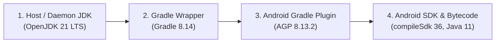

# Android Apps Build System Reference (Ready Reckoner)

This document summarizes the exact **JDK**, **Gradle**, **Android Gradle Plugin (AGP)**, **Android SDK**, and **Java/Kotlin bytecode target** versions used across all 10 Android apps in this repository, along with:
1. How the 4 build layers interact and why specific version pairings are required.
2. Step-by-step installation of the standalone Android CLI tools (`sdkmanager`, `adb`, `platforms`, `build-tools`) on Linux.
3. Android SDK & packaging requirements for **Google Play Store** vs. **F-Droid**.
4. Recommended component versions to track on **Ubuntu 26.04 LTS**.

---

## 1. Per-App Toolchain & SDK Matrix

| App Directory | Application ID | App Version | Host / Daemon JDK | Gradle Wrapper | Android Gradle Plugin (AGP) | Kotlin Plugin | `compileSdk` | `targetSdk` | `minSdk` | `buildToolsVersion` | Source / Target Bytecode |
| :--- | :--- | :--- | :--- | :--- | :--- | :--- | :--- | :--- | :--- | :--- | :--- |
| [`chordwheel/`](file:///usr/local/google/home/viki/xkdr/android/chordwheel/build.gradle) | `com.eggwall.chordwheel` | `1.4` (`4`) | **JDK 21** *(or 17)* | **8.14** | **8.13.2** | — *(Pure Java)* | **36** | **36** | **19** | `36.0.0` | Java 11 (`VERSION_11`) |
| [`eartrainer/`](file:///usr/local/google/home/viki/xkdr/android/eartrainer/build.gradle) | `com.eggwall.eartrainer` | `1.0` (`1`) | **JDK 21** *(or 17)* | **8.14** | **8.13.2** | — *(Pure Java)* | **36** | **36** | **19** | `36.0.0` | Java 11 (`VERSION_11`) |
| [`fretboard/`](file:///usr/local/google/home/viki/xkdr/android/fretboard/build.gradle) | `com.eggwall.fretboard` | `2.0` (`2`) | **JDK 21** *(or 17)* | **8.14** | **8.13.2** | — *(Pure Java)* | **36** | **36** | **19** | `36.0.0` | Java 11 (`VERSION_11`) |
| [`licktrainer/`](file:///usr/local/google/home/viki/xkdr/android/licktrainer/build.gradle) | `com.eggwall.licktrainer` | `1.0` (`1`) | **JDK 21** *(or 17)* | **8.14** | **8.13.2** | — *(Pure Java)* | **36** | **36** | **19** | `36.0.0` | Java 11 (`VERSION_11`) |
| [`metronome/`](file:///usr/local/google/home/viki/xkdr/android/metronome/build.gradle) | `com.eggwall.metronome` | `1.0` (`1`) | **JDK 21** *(or 17)* | **8.14** | **8.13.2** | — *(Pure Java)* | **36** | **36** | **19** | `36.0.0` | Java 11 (`VERSION_11`) |
| [`pocketband/`](file:///usr/local/google/home/viki/xkdr/android/pocketband/build.gradle) | `com.eggwall.pocketband` | `1.0` (`1`) | **JDK 21** *(or 17)* | **8.14** | **8.13.2** | — *(Pure Java)* | **36** | **36** | **19** | `36.0.0` | Java 11 (`VERSION_11`) |
| [`pomodoro/`](file:///usr/local/google/home/viki/xkdr/android/pomodoro/build.gradle) | `com.eggwall.pomodoro` | `1.0` (`1`) | **JDK 21** *(or 17)* | **8.14** | **8.13.2** | — *(Pure Java)* | **36** | **36** | **19** | `36.0.0` | Java 11 (`VERSION_11`) |
| [`sightread/`](file:///usr/local/google/home/viki/xkdr/android/sightread/build.gradle) | `com.eggwall.sightread` | `1.0` (`1`) | **JDK 21** *(or 17)* | **8.14** | **8.13.2** | — *(Pure Java)* | **36** | **36** | **19** | `36.0.0` | Java 11 (`VERSION_11`) |
| [`sound-sleep/`](file:///usr/local/google/home/viki/xkdr/android/sound-sleep/build.gradle) | `com.eggwall.soundsleep` | `1.11` (`11`) | **JDK 21** *(or 17)* | **8.14** | **8.13.2** | — *(Pure Java)* | **36** | **36** | **19** | `36.0.0` | Java 11 (`VERSION_11`) |
| [`rhythm-trainer/`](file:///usr/local/google/home/viki/xkdr/android/rhythm-trainer/build.gradle) | `com.eggwall.rhythmtrainer` | `1.0.0` (`1`) | **JDK 21** *(or 17)* | **8.14** | **8.13.2** | — *(Pure Java)* | **36** | **36** | **19** | `36.0.0` | Java 11 (`VERSION_11`) |

---

## 2. How the 4 Build Layers Fit Together

When you run `./gradlew assembleDebug`, four separate versioned layers participate:



### Layer 1: Host / Daemon JDK (`OpenJDK 21` — required to run Gradle & AGP)
- **What it does**: Runs the Gradle Wrapper launcher, the background Gradle Daemon, Groovy/Kotlin buildscript compilation, and AGP's internal `jlink` (`JdkImageTransform`) tool.
- **Required version**: **JDK 21 LTS** (or **JDK 17 LTS**).
- **Where it is configured**: Auto-detected in each app's `gradlew` script (`/usr/lib/jvm/java-21-openjdk-amd64`, etc.) when `JAVA_HOME` is unset.
- **Why newer JDKs (JDK 25 / JDK 26) fail**:
  1. **Java Class File Major Version Mismatch**: Every JDK bumps the `.class` major version (`Java 17 = 61`, `Java 21 = 65`, `Java 24 = 68`, `Java 25 = 69`, `Java 26 = 70`). Gradle 8.14's bundled Groovy `3.0.24` / ASM bytecode parser cannot parse JDK 25/26 class files and crashes with `Unsupported class file major version 69/70`.
  2. **AGP `JdkImageTransform` (`jlink`) Failure**: When compiling against `compileSdk 35` or `36` with `sourceCompatibility` lower than the host JDK, AGP runs `$JAVA_HOME/bin/jlink` on `platforms/android-36/core-for-system-modules.jar`. That Android system module JAR is built for JDK 17/21 and fails `jlink` under JDK 25+.

### Layer 2: Gradle Wrapper (`Gradle 8.14`)
- **What it does**: Orchestrates task execution, caching, and dependency resolution.
- **Where it is configured**: `gradle/wrapper/gradle-wrapper.properties`:
  ```properties
  distributionUrl=https\://services.gradle.org/distributions/gradle-8.14-bin.zip
  ```
- **JVM memory settings**: `gradle.properties` (`org.gradle.jvmargs=-Xmx2048m -XX:MaxMetaspaceSize=512m`).

### Layer 3: Android Gradle Plugin (`AGP 8.13.2`)
- **What it does**: Adds Android-specific tasks (`assembleDebug`, `assembleRelease`, `lint`, `testDebugUnitTest`), invokes `aapt2` (resource compiler), `d8`/`r8` (DEX compiler/shrinker), and APK signing.
- **Where it is configured**:
  - Across all 10 apps (`chordwheel`, `eartrainer`, `fretboard`, `licktrainer`, `metronome`, `pocketband`, `pomodoro`, `rhythm-trainer`, `sightread`, `sound-sleep`):
    - Top of `build.gradle`: `id 'com.android.application' version '8.13.2'`

### Layer 4: Android SDK (`compileSdk`, `targetSdk`, `minSdk`) & App Bytecode (`compileOptions`)
- **`compileSdk` (`36` across all 10 apps)**: Which `platforms/android-36/android.jar` API headers the app compiles against. Requires `$ANDROID_HOME/platforms/android-36` installed.
- **`buildToolsVersion` (`36.0.0`)**: Which `$ANDROID_HOME/build-tools/36.0.0` (`aapt2`, `apksigner`, `zipalign`) binaries are used.
- **`targetSdk` (`36`)**: Which Android runtime behavior rules the OS applies when running the app.
- **`minSdk` (`19` Android 4.4 KitKat across all 10 apps)**: Lowest Android OS version the APK can be installed on.
- **`compileOptions` (`JavaVersion.VERSION_11` across all 10 apps)**: The Java language level and `.class` bytecode version emitted by `javac` before `d8` converts `.class` files into Dalvik `.dex` bytecode.

---

## 3. Installing the Android CLI Tools, SDK, and Platform Tools on Linux

You do **not** need the full Android Studio IDE to build, test, or deploy these apps. You only need:
1. **OpenJDK 21** (`openjdk-21-jdk`)
2. **Android Command-Line Tools** (`cmdline-tools`, which provides `sdkmanager` and `avdmanager`)
3. **Android SDK Packages** (`platform-tools` for `adb`, `platforms;android-36`, `platforms;android-35`, and `build-tools;36.0.0`)

### Step 1: Install OpenJDK 21 & Required Host Packages
```bash
sudo apt update
sudo apt install -y openjdk-21-jdk unzip wget curl
```

### Step 2: Download & Extract Android `cmdline-tools` into `~/Android/Sdk`
Google's `sdkmanager` expects the directory structure `~/Android/Sdk/cmdline-tools/latest/bin/sdkmanager`:

```bash
export ANDROID_HOME="$HOME/Android/Sdk"
mkdir -p "$ANDROID_HOME/cmdline-tools"

# Download the latest official Linux command-line tools archive from Google
cd /tmp
wget -O commandlinetools-linux-latest.zip \
  https://dl.google.com/android/repository/commandlinetools-linux-11076708_latest.zip

# Extract and move into the required cmdline-tools/latest/ layout
unzip -q commandlinetools-linux-latest.zip -d "$ANDROID_HOME/cmdline-tools"
mv "$ANDROID_HOME/cmdline-tools/cmdline-tools" "$ANDROID_HOME/cmdline-tools/latest"
rm -f commandlinetools-linux-latest.zip
```

### Step 3: Add `ANDROID_HOME` to `~/.bashrc` (or `~/.zshrc`)
```bash
cat << 'EOF' >> ~/.bashrc

# Android SDK & CLI Tools
export ANDROID_HOME="$HOME/Android/Sdk"
export ANDROID_SDK_ROOT="$ANDROID_HOME"
export PATH="$ANDROID_HOME/cmdline-tools/latest/bin:$ANDROID_HOME/platform-tools:$ANDROID_HOME/build-tools/36.0.0:$PATH"
EOF
source ~/.bashrc
```

### Step 4: Accept SDK Licenses & Install Required SDK / Build-Tools Packages
Run `sdkmanager` using JDK 21 to install `platform-tools` (`adb`, `fastboot`), `build-tools` (`36.0.0` and `35.0.0`), and the Android API `35` & `36` platforms:

```bash
export JAVA_HOME=/usr/lib/jvm/java-21-openjdk-amd64
yes | sdkmanager --licenses

sdkmanager --install \
  "platform-tools" \
  "platforms;android-36" \
  "platforms;android-35" \
  "build-tools;36.0.0" \
  "build-tools;35.0.0"
```

### Step 5: Verify Installation
```bash
adb --version
sdkmanager --list_installed
```
You should see `build-tools;35.0.0`, `build-tools;36.0.0`, `platform-tools`, `platforms;android-35`, and `platforms;android-36` listed under `Installed packages`.

---

## 4. Android SDK & Build Requirements: Google Play Store vs. F-Droid

Both stores accept apps built from this repository, but they enforce very different policies:

| Requirement Area | Google Play Store | F-Droid Store | Current Repo Status |
| :--- | :--- | :--- | :--- |
| **Minimum `targetSdk`** | **Strict rolling deadline**: New apps and app updates must target within 1 year of the latest Android OS release (**API 35 / Android 15** required as of Aug 2025; **API 36 / Android 16** required starting Aug 2026). | **No strict `targetSdk` floor**, though targeting modern SDKs (`35` or `36`) is strongly recommended for modern Android permissions and edge-to-edge behavior. | **Compliant**: All 10 apps target **API 36**. |
| **Supported `compileSdk`** | Any official Android SDK (`35` or `36`). | Must be buildable on F-Droid's Debian-based buildserver using standard `sdkmanager` packages (`platforms;android-36`, `build-tools;36.0.0`). Avoid preview/canary SDKs (e.g. `android-Baklava`). | **Compliant**: All 10 apps use stable `compileSdk 36`. |
| **`minSdk` Floor** | Play Console requires `minSdk` $\ge 19$ (or $\ge 21$ for modern Play Services, which we do not use). | F-Droid welcomes low `minSdk` (`19` = Android 4.4+) so older devices stay supported. | **Compliant**: All 10 apps support **`minSdk 19`** (Android 4.4 KitKat+). |
| **Encrypted Dependency Metadata (`dependenciesInfo`)** | Play Store encourages AGP's default `DEPENDENCY_INFO_BLOCK` signing block inside APKs/AABs. | **STRICT BLOCKER**: F-Droid **rejects** APKs containing Google's encrypted `DEPENDENCY_INFO_BLOCK`. Every `build.gradle` **must** disable it. | **Compliant**: All 10 apps set `dependenciesInfo { includeInApk = false; includeInBundle = false }`. |
| **Binary Artifacts & Maven Repos** | Allows proprietary SDKs. | **Compiled from source**: All dependencies must come from Maven Central or Google Maven (`maven.google.com`) with zero prebuilt `.jar`/`.so` blobs in Git. | **Compliant**: All 10 apps are pure Java with **zero runtime dependencies**. |
| **Distribution Format** | **Android App Bundle (`.aab`)** via `./gradlew bundleRelease` (Play App Signing). | **APK (`.apk`)** built from source by F-Droid's CI (or reproducibly verified against your signed release APK). | **Compliant**: Both `assembleRelease` and `bundleRelease` work cleanly. |

---

## 5. Recommended Component Versions to Track on Ubuntu 26.04 LTS

Ubuntu 26.04 LTS (*Resolute*) ships with **OpenJDK 26** (`openjdk-26-jdk`) as the system default `java`, while also providing **OpenJDK 21 LTS** (`openjdk-21-jdk`) in the standard Ubuntu main archive.

Because the Android toolchain (Gradle + AGP + `jlink` + Kotlin compiler) always lags behind the bleeding-edge non-LTS/newly-released JDK by 1–2 years, use the following **Golden Version Matrix** on Ubuntu 26.04 LTS:

| Component | Recommended Version on Ubuntu 26.04 LTS | Ubuntu / Upstream Package | Why This Version Is the Sweet Spot |
| :--- | :--- | :--- | :--- |
| **Build / Daemon JDK** | **OpenJDK 21 LTS** (`/usr/lib/jvm/java-21-openjdk-amd64`) | `sudo apt install openjdk-21-jdk` | **First-class LTS**: Supported by Ubuntu through 2031+, officially targeted by Android Studio, AGP 8.13.x, Gradle 8.14, and Android `core-for-system-modules.jar` (`jlink`). Our `gradlew` scripts automatically select this path even if Ubuntu's default `java` is JDK 26. |
| **Gradle Wrapper** | **Gradle 8.14** | `gradle-8.14-bin.zip` *(in `gradle-wrapper.properties`)* | Latest stable 8.x release; rock-solid with JDK 21, AGP 8.13.2, and F-Droid buildservers. *(Avoid upgrading to Gradle 9.x until AGP 9.x is stable and deployed on F-Droid.)* |
| **Android Gradle Plugin (AGP)** | **AGP 8.13.2** | `com.android.application:8.13.2` | Officially tested against `compileSdk 36` and `buildToolsVersion 36.0.0` with zero SDK-version warnings. |
| **Android `compileSdk` & `targetSdk`** | **API 36 (Android 16)** | `platforms;android-36` | Satisfies Google Play Store's `targetSdk` requirements through 2027 while remaining 100% supported on F-Droid's buildserver. |
| **Android `buildToolsVersion`** | **`36.0.0`** | `build-tools;36.0.0` | Matches `compileSdk 36`; provides current `aapt2`, `d8`, `apksigner`, and `zipalign`. |
| **Java App Source/Target Level** | **`JavaVersion.VERSION_11`** *(all 10 apps)* | `compileOptions` in `build.gradle` | Compiles cleanly with zero desugaring overhead while maintaining `minSdk 19` compatibility across all 10 Canvas/Java apps. |

### Rule of Thumb Before Upgrading Any Version in the Future
Whenever you consider bumping one component in the future, check this chain in order:
1. **Does F-Droid's buildserver have the new `compileSdk` / `build-tools`?** (Stick to stable numbered releases like `35`, `36`, never preview/RC versions.)
2. **Does the AGP version support the Gradle version?** (Keep Gradle on `8.14` while on AGP `8.13.x`.)
3. **Keep `openjdk-21-jdk` installed on Ubuntu 26.04 LTS** so `gradlew` always has a compatible LTS JDK regardless of whether the OS default `java` is JDK 26 or newer.

---

## 6. Compatibility & Troubleshooting Cheat Sheet

| Symptom / Error Message | Root Cause | Fix |
| :--- | :--- | :--- |
| `Unsupported class file major version 70` (or `69`) | System `java` is JDK 26 (`70`) or JDK 25 (`69`), which Gradle 8.14's Groovy parser does not support. | Install `openjdk-21-jdk` (`sudo apt install openjdk-21-jdk`). `gradlew` now auto-selects `/usr/lib/jvm/java-21-openjdk-*`. |
| `Execution failed for JdkImageTransform: .../android-36/core-for-system-modules.jar` | Gradle ran with JDK 25+ whose `jlink` rejects the Android SDK's `core-for-system-modules.jar`. | Run with JDK 21 (`export JAVA_HOME=/usr/lib/jvm/java-21-openjdk-amd64`), which `gradlew` now does automatically. |
| `SDK location not found. Define a valid SDK location with an ANDROID_HOME environment variable` | Neither `ANDROID_HOME` nor `local.properties` (`sdk.dir=...`) is set on the machine. | Export `ANDROID_HOME=$HOME/Android/Sdk` in `~/.bashrc` (see Section 3) or create `local.properties` with `sdk.dir=/path/to/Android/Sdk`. |
| `Failed to find target with hash string 'android-36'` or `'build-tools;36.0.0'` | Missing Android SDK platform or build-tools package on a new machine. | Run `sdkmanager "platforms;android-36" "platforms;android-35" "build-tools;36.0.0"`. |

---

## 7. Common Commands Reference

```bash
# Check which JVM and Gradle version gradlew resolved
./gradlew --version

# Run unit tests + build Debug & Release APKs for an app
./gradlew testDebugUnitTest assembleDebug assembleRelease

# Build all 10 apps in one loop from the repository root
for app in chordwheel eartrainer fretboard licktrainer metronome pocketband pomodoro rhythm-trainer sightread sound-sleep; do
    echo "=== Building $app ==="
    (cd "$app" && ./gradlew testDebugUnitTest assembleDebug assembleRelease) || break
done
```
