# Eggwall Android Music & Productivity App Suite

A collection of self-contained, offline Android applications for guitarists, music students, and software engineers. Every application is engineered with real-time 44.1 kHz PCM audio synthesis (`AudioTrack`), responsive Portrait and Landscape layouts, zero runtime permissions, and zero external network dependencies.

---

## Built for Both Musicians & Software Engineers

### 1. For Musicians, Students of Music & Students of Guitar
Every app in this repository is designed as a practical, distraction-free daily practice tool:
- **Guitar & Fretboard Mastery**: Explore CAGED scale boxes, modes, chord voicings, alternate tunings ([**Fretboard**](fretboard/README.md)), practice 33 lead guitar licks across 6 genres with automated BPM speed ladders ([**LickTrainer**](licktrainer/README.md)), and sight-read treble-clef notation directly onto a 6-string neck ([**SightRead**](sightread/README.md)).
- **Harmony, Ear Training & Jamming**: Navigate keys and Roman numerals on an interactive Circle of Fifths ([**ChordWheel**](chordwheel/README.md)), jam over 12 backing styles from Blues and Jazz to Bossa Nova, Heavy Metal, and Pop ([**PocketBand**](pocketband/README.md)), and train relative pitch on intervals, chords, scales, and melodic dictation ([**EarTrainer**](eartrainer/README.md)).
- **Rhythm & Focused Practice**: Master odd meters, polyrhythms, and muted-bar timekeeping ([**Metronome**](metronome/README.md) & [**Rhythm Trainer**](rhythm-trainer/README.md)), and structure focused practice or coding blocks with procedural background soundscapes ([**Pomodoro**](pomodoro/README.md)).
- **Musician's Guides**: Each app includes a dedicated **`USER_GUIDE.md`** with visual tours and structured practice routines.

### 2. For Software Engineers & Tinkerers — Modify & Create Your Own Apps
These applications are intentionally architected as **clean, hackable, zero-bloat reference codebases** so software engineers and musician-coders can understand an entire app in one sitting, customize it for their exact workflow, or fork it to build brand-new apps:
- **Four-Class Modular Architecture**:
  1. **Pure JVM Theory / Model Layer (`*Theory.java` / `*Model.java`)**: 100% stateless music-theory, voicing, and timing math with zero Android UI dependencies—verified by fast host-JVM JUnit 4 unit tests (`test/`).
  2. **Real-Time 44.1 kHz DSP Audio Engine (`*SynthEngine.java`)**: Sample-accurate procedural synthesis (Karplus-Strong plucked strings, TR-808 drums, additive piano/organ, filtered bass, and ambient noise) streaming via `AudioTrack` with zero heap allocations inside the audio loop.
  3. **Hardware-Accelerated Custom `Canvas` View (`*View.java`)**: DPI-aware vector rendering that dynamically reflows between Portrait and Landscape without Activity restarts.
  4. **Zero-Permission Host `Activity` (`*Activity.java`)**: Handles system-bar window insets, screen wake policies, and `SharedPreferences` state persistence.
- **Comprehensive Developer Documentation**:
  - **[Suite Engineering & Porting Playbook (`porting.md`)](porting.md)** — End-to-end architectural guide covering Gradle scaffolding, real-time `AudioTrack` synthesis, touch/controller input, adaptive icons, and emulator testing.
  - **Per-App Developer Guides (`<app>/DEVELOPER_GUIDE.md`)** — Every app directory includes its own **`DEVELOPER_GUIDE.md`** detailing its classes, screen layout map, and step-by-step recipes for adding custom scales, tunings, licks, backing styles, synth voices, or UI controls.

---

## Quick Directory Index

| Application | Package ID | Short Description | Documentation Links |
| :--- | :--- | :--- | :--- |
| **[ChordWheel](chordwheel/README.md)** | `com.eggwall.chordwheel` | Interactive Circle of Fifths, CAGED guitar voicings, and 4-bar chord looper. | [README](chordwheel/README.md) · [User Guide](chordwheel/USER_GUIDE.md) · [Developer Guide](chordwheel/DEVELOPER_GUIDE.md) · [Play Store](chordwheel/PLAY_STORE_LISTING.md) · [Privacy](chordwheel/PRIVACY_POLICY.md) |
| **[Fretboard](fretboard/README.md)** | `com.eggwall.fretboard` | Master guitar scales, CAGED boxes, chord voicings, and fretboard note quizzes. | [README](fretboard/README.md) · [User Guide](fretboard/USER_GUIDE.md) · [Developer Guide](fretboard/DEVELOPER_GUIDE.md) · [Play Store](fretboard/PLAY_STORE_LISTING.md) · [Privacy](fretboard/PRIVACY_POLICY.md) |
| **[LickTrainer](licktrainer/README.md)** | `com.eggwall.licktrainer` | Practice 33 guitar licks with interactive tab, fretboard, and BPM speed ladders. | [README](licktrainer/README.md) · [User Guide](licktrainer/USER_GUIDE.md) · [Developer Guide](licktrainer/DEVELOPER_GUIDE.md) · [Play Store](licktrainer/PLAY_STORE_LISTING.md) · [Privacy](licktrainer/PRIVACY_POLICY.md) |
| **[PocketBand](pocketband/README.md)** | `com.eggwall.pocketband` | Create beats and songs on a 4-track 16-step drum, bass, chord, and synth studio. | [README](pocketband/README.md) · [User Guide](pocketband/USER_GUIDE.md) · [Developer Guide](pocketband/DEVELOPER_GUIDE.md) · [Play Store](pocketband/PLAY_STORE_LISTING.md) · [Privacy](pocketband/PRIVACY_POLICY.md) |
| **[EarTrainer](eartrainer/README.md)** | `com.eggwall.eartrainer` | Train your ear on intervals, chords, and scales with an interactive piano. | [README](eartrainer/README.md) · [User Guide](eartrainer/USER_GUIDE.md) · [Developer Guide](eartrainer/DEVELOPER_GUIDE.md) · [Play Store](eartrainer/PLAY_STORE_LISTING.md) · [Privacy](eartrainer/PRIVACY_POLICY.md) |
| **[Metronome](metronome/README.md)** | `com.eggwall.metronome` | Precision pendulum metronome with odd meters, polyrhythms, and speed coach. | [README](metronome/README.md) · [User Guide](metronome/USER_GUIDE.md) · [Developer Guide](metronome/DEVELOPER_GUIDE.md) · [Play Store](metronome/PLAY_STORE_LISTING.md) · [Privacy](metronome/PRIVACY_POLICY.md) |
| **[Pomodoro](pomodoro/README.md)** | `com.eggwall.pomodoro` | Stay focused with a clean Pomodoro timer, ambient soundscapes, and work log. | [README](pomodoro/README.md) · [User Guide](pomodoro/USER_GUIDE.md) · [Developer Guide](pomodoro/DEVELOPER_GUIDE.md) · [Play Store](pomodoro/PLAY_STORE_LISTING.md) · [Privacy](pomodoro/PRIVACY_POLICY.md) |
| **[SightRead](sightread/README.md)** | `com.eggwall.sightread` | Learn treble clef sight-reading on a 6-string guitar fretboard across 6 keys. | [README](sightread/README.md) · [User Guide](sightread/USER_GUIDE.md) · [Developer Guide](sightread/DEVELOPER_GUIDE.md) · [Play Store](sightread/PLAY_STORE_LISTING.md) · [Privacy](sightread/PRIVACY_POLICY.md) |
| **[Rhythm Trainer](rhythm-trainer/README.md)** | `com.eggwall.rhythmtrainer` | Single-frequency (440 Hz) musical rhythm notation editor and practice player. | [README](rhythm-trainer/README.md) · [User Guide](rhythm-trainer/USER_GUIDE.md) · [Developer Guide](rhythm-trainer/DEVELOPER_GUIDE.md) · [Play Store](rhythm-trainer/PLAY_STORE_LISTING.md) |
| **[Sound Sleep](sound-sleep/README.md)** | `com.eggwall.soundsleep` | Minimalist all-night bedside clock with soothing white noise and sleep music. | [README](sound-sleep/README.md) · [User Guide](sound-sleep/USER_GUIDE.md) · [Developer Guide](sound-sleep/DEVELOPER_GUIDE.md) · [Play Store](sound-sleep/PLAY_STORE_LISTING.md) · [Privacy](sound-sleep/PRIVACY_POLICY.md) |

---

## Application Overview & Screenshots

### 1. [ChordWheel — Interactive Circle of Fifths & Guitar Chord Looper](chordwheel/README.md)

**Short Description:** *Interactive Circle of Fifths, CAGED guitar voicings, and 4-bar chord looper.*

- **Concentric Circle of Fifths Wheel**: Outer ring for Major keys (`I`, `IV`, `V`), inner ring for relative minor chords (`ii`, `iii`, `vi`), and center hub for diminished (`vii°`), with `ROTATE` and `LOCK` key modes.
- **Scale-Degree Chord Formulas & CAGED Voicings**: Displays active-key scale-degree formulas (`1 - 3 - 5`, `4 - 6 - 8`, `5 - 7 - 9 - 11`) alongside interactive `Open/CAGED`, `E-Barre`, and `A-Barre` fretboard diagrams with Karplus-Strong string synthesis.
- **Links:** [**App README**](chordwheel/README.md) · [**User Guide**](chordwheel/USER_GUIDE.md) · [**Developer Guide**](chordwheel/DEVELOPER_GUIDE.md)

<p align="center">
  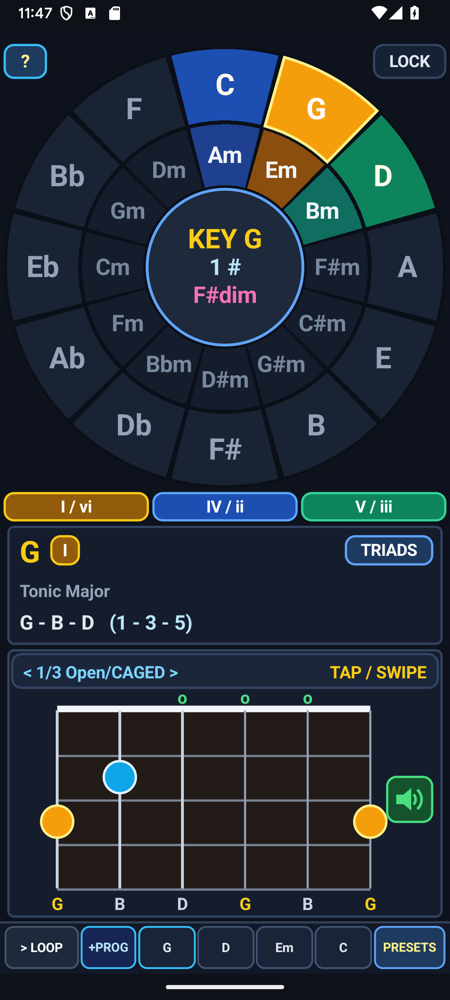
</p>

---

### 2. [Fretboard — Guitar Scale, Chord & CAGED Neck Explorer](fretboard/README.md)

**Short Description:** *Master guitar scales, CAGED boxes, chord voicings, and fretboard note quizzes.*

- **3 Interactive Modes**: **Scales** (14 scales/modes across all 12 keys and 5 CAGED positions), **Chords** (12 chord qualities across 5 movable CAGED voicings with finger numbers and barre indicators), and **Chord Finder** (tap any fret combination to identify the chord).
- **Orientation-Adaptive Neck**: Vertical 15-fret neck with a right-side control rail and drop-down Key/Mode selectors in Portrait; full-width horizontal 15-fret neck in Landscape.
- **Links:** [**App README**](fretboard/README.md) · [**User Guide**](fretboard/USER_GUIDE.md) · [**Developer Guide**](fretboard/DEVELOPER_GUIDE.md)

<p align="center">
  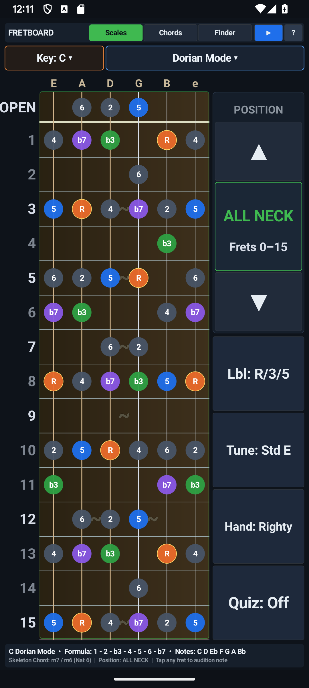
</p>

---

### 3. [LickTrainer — 33 Essential Guitar Licks & Speed Ladder Coach](licktrainer/README.md)

**Short Description:** *Practice 33 guitar licks with interactive tab, fretboard, and BPM speed ladders.*

- **33 Curated Guitar Licks Across 6 Styles**: Blues, Rock, Jazz/Bebop, Country Chicken Pickin', Neo-Soul/Funk, and Shred/Metal, complete with bends, slides, hammer-ons, pull-offs, and vibrato.
- **Scrolling Tablature + Live Fretboard**: Synchronized 6-string tab highway and 15-fret neck with automated Speed Ladder tempo coaching (`+2` or `+5 BPM` every N loops), backing beat, and A–B phrase looping.
- **Links:** [**App README**](licktrainer/README.md) · [**User Guide**](licktrainer/USER_GUIDE.md) · [**Developer Guide**](licktrainer/DEVELOPER_GUIDE.md)

<p align="center">
  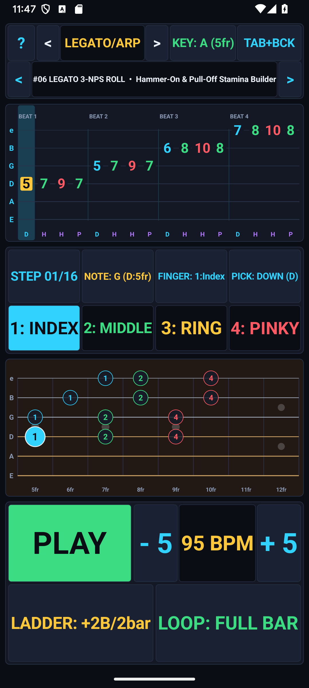
</p>

---

### 4. [PocketBand — Backing Band, Step Sequencer & Guitar Solo Scale Studio](pocketband/README.md)

**Short Description:** *Create beats and songs on a 4-track 16-step drum, bass, chord, and synth studio.*

- **12 Backing Styles & 9 Chord Progressions**: Drop-down style selector covering Blues Shuffle, Slow Blues, Classic Rock, Rock Ballad, Jazz Swing, Jazz Waltz, Bossa Nova, Funk Groove, Country Train, Reggae One-Drop, Heavy Metal, and Pop.
- **5-Track Step Sequencer & 12-Fret Solo Scale Map**: Interactive Kick, Snare, Closed Hat, Open Hat, and Bass sequencer paired with a 3-channel mixer (`DRUMS`, `BASS`, `CHORDS`) and a live 12-fret guitar scale map highlighting Key Roots, Active Chord Roots, and Blue Notes. Keeps the screen awake during playback.
- **Links:** [**App README**](pocketband/README.md) · [**User Guide**](pocketband/USER_GUIDE.md) · [**Developer Guide**](pocketband/DEVELOPER_GUIDE.md)

<p align="center">
  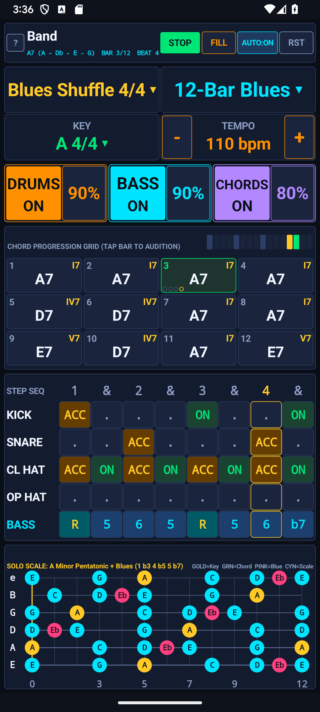
</p>

---

### 5. [EarTrainer — Interval, Chord & Scale Ear Training](eartrainer/README.md)

**Short Description:** *Train your ear on intervals, chords, and scales with an interactive piano.*

- **4 Progressive Modules**: **Intervals** (13 chromatic intervals in ascending, descending, or harmonic playback), **Chords** (9 triad & 7th qualities), **Scales & Modes** (8 scales/modes), and **Melodic Dictation** (3–5 note phrases).
- **Interactive 2-Octave Piano & Streak Tracking**: Audition notes directly on the keyboard (`C4–C6`), switch between Grand Piano, Guitar Pluck, and Warm Organ timbres, and track accuracy and streaks.
- **Links:** [**App README**](eartrainer/README.md) · [**User Guide**](eartrainer/USER_GUIDE.md) · [**Developer Guide**](eartrainer/DEVELOPER_GUIDE.md)

<p align="center">
  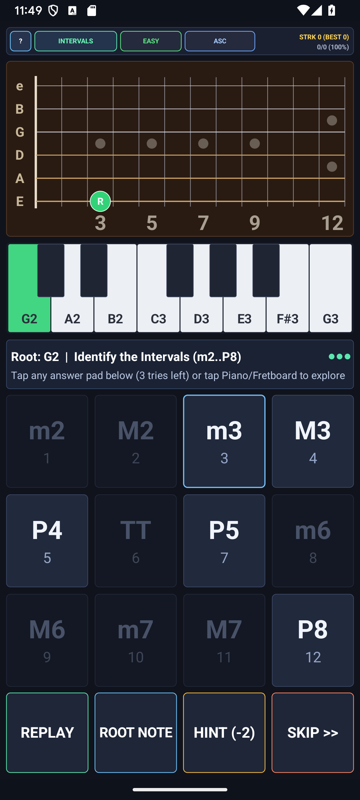
</p>

---

### 6. [Metronome — Precision Pendulum, Polyrhythm & Speed Coach](metronome/README.md)

**Short Description:** *Precision pendulum metronome with odd meters, polyrhythms, and speed coach.*

- **Sample-Accurate 44.1 kHz Timing Engine**: 20–260 BPM range, 12 time signatures (including odd meters `5/4`, `7/8`, `9/8`, `11/8`), and 6 rhythmic subdivisions with per-beat accent cycling (`STRONG`, `NORMAL`, `SUB`, `MUTE`).
- **Polyrhythm & Practice Modes**: Dual-ring polyrhythm generator (`3:2`, `4:3`, `5:4`, `7:4`), Speed Trainer (`+BPM` every N bars), and Bar Dropper (Muting Trainer) to test internal timekeeping. Keeps the screen awake during practice.
- **Links:** [**App README**](metronome/README.md) · [**User Guide**](metronome/USER_GUIDE.md) · [**Developer Guide**](metronome/DEVELOPER_GUIDE.md)

<p align="center">
  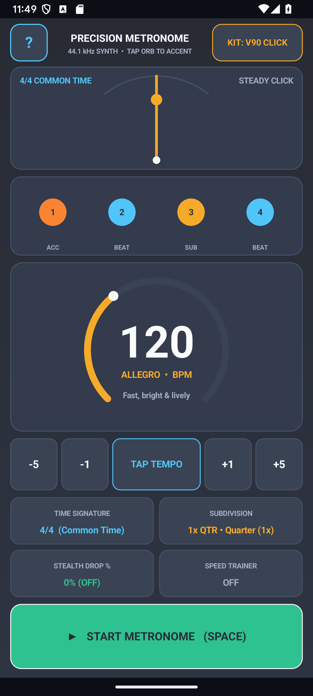
</p>

---

### 7. [Pomodoro — Focus Timer, Background Sound & Work Log](pomodoro/README.md)

**Short Description:** *Stay focused with a clean Pomodoro timer, ambient soundscapes, and work log.*

- **Distraction-Free Countdown Ring**: High-contrast status banner (`WORKING: DO NOT DISTURB` / `READY TO FOCUS`), circular progress ring with quick speaker toggle in the lower-right corner, and `-5m / -1m / +1m / +5m` duration adjustments.
- **Procedural Background Sound & Work Telemetry**: Built-in real-time `SOFT TICK`, `RAIN`, and `BROWN NOISE` background sound generator, 4 duration presets (`Classic 25/5/15`, `Deep Work 50/10/20`, `Studio 45/15/30`, `Sprint 15/3/10`), and automatic Today / All-Time work-hours logging.
- **Links:** [**App README**](pomodoro/README.md) · [**User Guide**](pomodoro/USER_GUIDE.md) · [**Developer Guide**](pomodoro/DEVELOPER_GUIDE.md)

<p align="center">
  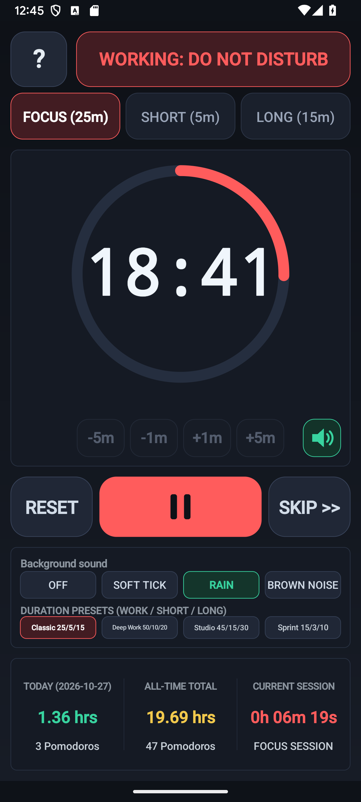
</p>

---

### 8. [SightRead — Treble Clef Guitar Sight-Reading Trainer](sightread/README.md)

**Short Description:** *Learn treble clef sight-reading on a 6-string guitar fretboard across 6 keys.*

- **5-Tier Treble Clef Curriculum**: Progresses from middle treble staff (`G4–D5`) to full treble staff (`E4–F5`), lower ledger lines (`E3–D4`), upper ledger lines (`G5–A5`), and full guitar range (`E3–A5`) across 6 key signatures (`C`, `G`, `D`, `A`, `F`, `Bb`).
- **Interactive 6-String Fretboard & Practice Modes**: Identify staff notes by tapping the matching string and fret (with Karplus-Strong guitar synthesis) across Drill, 60-Second Timed Blitz, and Study Reference modes.
- **Links:** [**App README**](sightread/README.md) · [**User Guide**](sightread/USER_GUIDE.md) · [**Developer Guide**](sightread/DEVELOPER_GUIDE.md)

<p align="center">
  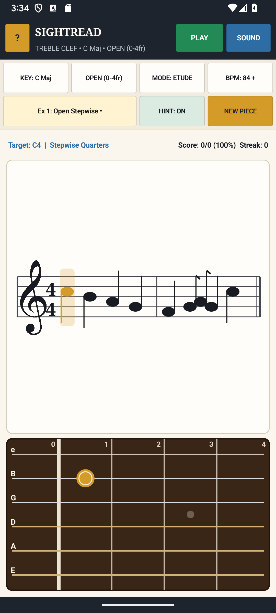
</p>

---

### 9. [Rhythm Trainer — Musical Rhythm Notation Editor & Player](rhythm-trainer/README.md)

**Short Description:** *Single-frequency (440 Hz) musical rhythm notation editor and practice player.*

- **Standard Rhythm Notation & Odd Meters**: Renders whole, half, quarter, eighth, and sixteenth notes and rests across `4/4`, `3/4`, `2/2`, `5/4`, and `7/4` time signatures.
- **Edit Mode & Count-In Playback**: Subdivide or combine note and rest durations within each bar in Edit Mode, then press Play for a 4-beat click count-in followed by exact duration playback at `440 Hz`.
- **Links:** [**App README**](rhythm-trainer/README.md) · [**User Guide**](rhythm-trainer/USER_GUIDE.md) · [**Developer Guide**](rhythm-trainer/DEVELOPER_GUIDE.md)

<p align="center">
  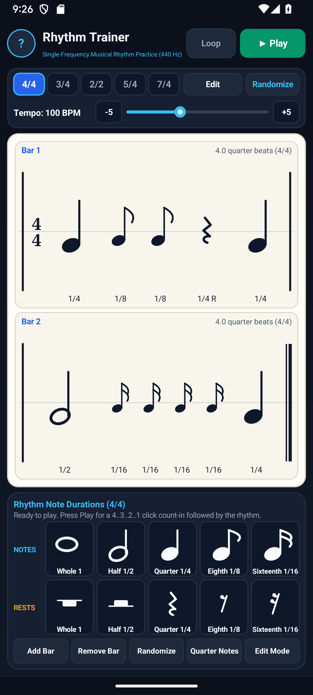
</p>

---

### 10. [Sound Sleep — Bedside Night Clock & White Noise](sound-sleep/README.md)

**Short Description:** *Minimalist all-night bedside clock with soothing white noise and sleep music.*

- **All-Night Clock with Burn-In Protection**: Displays the time in a large `120dp` `h:mm` format on a pure black background in immersive fullscreen, smoothly drifting every 10 minutes and progressively dimming icons overnight.
- **Half-Screen White Noise & Sleep Music Controls**: Tap the bottom half (Rain Cloud) to loop continuous white noise or the top half (Music Note) to play tracks from `Music/sleeping` (or the bundled lullaby jingle); tap again for silence.
- **Links:** [**App README**](sound-sleep/README.md) · [**User Guide**](sound-sleep/USER_GUIDE.md) · [**Developer Guide**](sound-sleep/DEVELOPER_GUIDE.md) · [**Play Store**](sound-sleep/PLAY_STORE_LISTING.md) · [**Privacy**](sound-sleep/PRIVACY_POLICY.md)

<p align="center">
  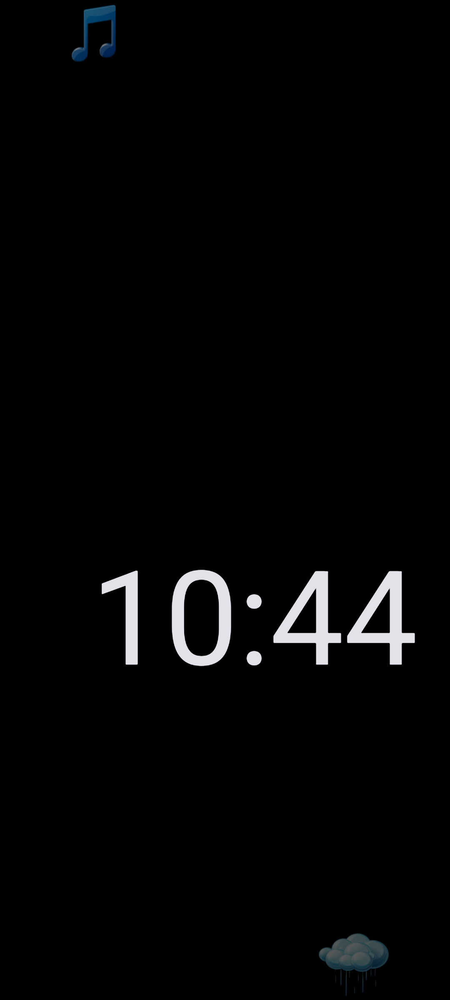
</p>

<!-- I18N_EFIGSCJK_START -->
---

## Internationalization (i18n) — Top 20 World Languages, Play Console AI Import & EFIGSCJK Gallery

Every application in the suite is localized for the **top 20 world languages** (`en-US`, `fr-FR`, `it-IT`, `de-DE`, `es-ES`, `zh-CN`, `ja-JP`, `ko-KR`, `pt-BR`, `ru-RU`, `ar`, `hi-IN`, `bn-BD`, `id`, `tr-TR`, `vi`, `pl-PL`, `nl-NL`, `th`, `uk`) with automatic width-fitting typography and includes single-file **Google Play Console "Import translations with AI"** bundles (`.csv`, `.md`, `.txt`) plus Fastlane per-locale metadata.

Click any thumbnail below to open the full-resolution `2260×2640` 8-language contact sheet for inspection, or grab the Play Store AI import file for any app:

| Application | Play Console "Import translations with AI" (20 Languages) | Fastlane & EFIGSCJK Copy | Individual EFIGSCJK Screenshots (`1080×2400`) |
| :--- | :--- | :--- | :--- |
| **[`ChordWheel`](chordwheel/README.md)** | [`CSV`](chordwheel/PLAY_STORE_AI_IMPORT.csv) · [`MD`](chordwheel/PLAY_STORE_AI_IMPORT.md) · [`TXT`](chordwheel/PLAY_STORE_AI_IMPORT.txt) | [`PLAY_STORE_I18N_EFIGSCJK.md`](chordwheel/PLAY_STORE_I18N_EFIGSCJK.md) · [`metadata/`](chordwheel/playstore/metadata/android/) | [`en`](chordwheel/docs/images/i18n/en.png) · [`fr`](chordwheel/docs/images/i18n/fr.png) · [`it`](chordwheel/docs/images/i18n/it.png) · [`de`](chordwheel/docs/images/i18n/de.png) · [`es`](chordwheel/docs/images/i18n/es.png) · [`zh`](chordwheel/docs/images/i18n/zh.png) · [`ja`](chordwheel/docs/images/i18n/ja.png) · [`ko`](chordwheel/docs/images/i18n/ko.png) |
| **[`Fretboard Explorer`](fretboard/README.md)** | [`CSV`](fretboard/PLAY_STORE_AI_IMPORT.csv) · [`MD`](fretboard/PLAY_STORE_AI_IMPORT.md) · [`TXT`](fretboard/PLAY_STORE_AI_IMPORT.txt) | [`PLAY_STORE_I18N_EFIGSCJK.md`](fretboard/PLAY_STORE_I18N_EFIGSCJK.md) · [`metadata/`](fretboard/playstore/metadata/android/) | [`en`](fretboard/docs/images/i18n/en.png) · [`fr`](fretboard/docs/images/i18n/fr.png) · [`it`](fretboard/docs/images/i18n/it.png) · [`de`](fretboard/docs/images/i18n/de.png) · [`es`](fretboard/docs/images/i18n/es.png) · [`zh`](fretboard/docs/images/i18n/zh.png) · [`ja`](fretboard/docs/images/i18n/ja.png) · [`ko`](fretboard/docs/images/i18n/ko.png) |
| **[`LickTrainer`](licktrainer/README.md)** | [`CSV`](licktrainer/PLAY_STORE_AI_IMPORT.csv) · [`MD`](licktrainer/PLAY_STORE_AI_IMPORT.md) · [`TXT`](licktrainer/PLAY_STORE_AI_IMPORT.txt) | [`PLAY_STORE_I18N_EFIGSCJK.md`](licktrainer/PLAY_STORE_I18N_EFIGSCJK.md) · [`metadata/`](licktrainer/playstore/metadata/android/) | [`en`](licktrainer/docs/images/i18n/en.png) · [`fr`](licktrainer/docs/images/i18n/fr.png) · [`it`](licktrainer/docs/images/i18n/it.png) · [`de`](licktrainer/docs/images/i18n/de.png) · [`es`](licktrainer/docs/images/i18n/es.png) · [`zh`](licktrainer/docs/images/i18n/zh.png) · [`ja`](licktrainer/docs/images/i18n/ja.png) · [`ko`](licktrainer/docs/images/i18n/ko.png) |
| **[`Band (PocketBand)`](pocketband/README.md)** | [`CSV`](pocketband/PLAY_STORE_AI_IMPORT.csv) · [`MD`](pocketband/PLAY_STORE_AI_IMPORT.md) · [`TXT`](pocketband/PLAY_STORE_AI_IMPORT.txt) | [`PLAY_STORE_I18N_EFIGSCJK.md`](pocketband/PLAY_STORE_I18N_EFIGSCJK.md) · [`metadata/`](pocketband/playstore/metadata/android/) | [`en`](pocketband/docs/images/i18n/en.png) · [`fr`](pocketband/docs/images/i18n/fr.png) · [`it`](pocketband/docs/images/i18n/it.png) · [`de`](pocketband/docs/images/i18n/de.png) · [`es`](pocketband/docs/images/i18n/es.png) · [`zh`](pocketband/docs/images/i18n/zh.png) · [`ja`](pocketband/docs/images/i18n/ja.png) · [`ko`](pocketband/docs/images/i18n/ko.png) |
| **[`EarTrainer`](eartrainer/README.md)** | [`CSV`](eartrainer/PLAY_STORE_AI_IMPORT.csv) · [`MD`](eartrainer/PLAY_STORE_AI_IMPORT.md) · [`TXT`](eartrainer/PLAY_STORE_AI_IMPORT.txt) | [`PLAY_STORE_I18N_EFIGSCJK.md`](eartrainer/PLAY_STORE_I18N_EFIGSCJK.md) · [`metadata/`](eartrainer/playstore/metadata/android/) | [`en`](eartrainer/docs/images/i18n/en.png) · [`fr`](eartrainer/docs/images/i18n/fr.png) · [`it`](eartrainer/docs/images/i18n/it.png) · [`de`](eartrainer/docs/images/i18n/de.png) · [`es`](eartrainer/docs/images/i18n/es.png) · [`zh`](eartrainer/docs/images/i18n/zh.png) · [`ja`](eartrainer/docs/images/i18n/ja.png) · [`ko`](eartrainer/docs/images/i18n/ko.png) |
| **[`Metronome`](metronome/README.md)** | [`CSV`](metronome/PLAY_STORE_AI_IMPORT.csv) · [`MD`](metronome/PLAY_STORE_AI_IMPORT.md) · [`TXT`](metronome/PLAY_STORE_AI_IMPORT.txt) | [`PLAY_STORE_I18N_EFIGSCJK.md`](metronome/PLAY_STORE_I18N_EFIGSCJK.md) · [`metadata/`](metronome/playstore/metadata/android/) | [`en`](metronome/docs/images/i18n/en.png) · [`fr`](metronome/docs/images/i18n/fr.png) · [`it`](metronome/docs/images/i18n/it.png) · [`de`](metronome/docs/images/i18n/de.png) · [`es`](metronome/docs/images/i18n/es.png) · [`zh`](metronome/docs/images/i18n/zh.png) · [`ja`](metronome/docs/images/i18n/ja.png) · [`ko`](metronome/docs/images/i18n/ko.png) |
| **[`Pomodoro Timer`](pomodoro/README.md)** | [`CSV`](pomodoro/PLAY_STORE_AI_IMPORT.csv) · [`MD`](pomodoro/PLAY_STORE_AI_IMPORT.md) · [`TXT`](pomodoro/PLAY_STORE_AI_IMPORT.txt) | [`PLAY_STORE_I18N_EFIGSCJK.md`](pomodoro/PLAY_STORE_I18N_EFIGSCJK.md) · [`metadata/`](pomodoro/playstore/metadata/android/) | [`en`](pomodoro/docs/images/i18n/en.png) · [`fr`](pomodoro/docs/images/i18n/fr.png) · [`it`](pomodoro/docs/images/i18n/it.png) · [`de`](pomodoro/docs/images/i18n/de.png) · [`es`](pomodoro/docs/images/i18n/es.png) · [`zh`](pomodoro/docs/images/i18n/zh.png) · [`ja`](pomodoro/docs/images/i18n/ja.png) · [`ko`](pomodoro/docs/images/i18n/ko.png) |
| **[`SightRead`](sightread/README.md)** | [`CSV`](sightread/PLAY_STORE_AI_IMPORT.csv) · [`MD`](sightread/PLAY_STORE_AI_IMPORT.md) · [`TXT`](sightread/PLAY_STORE_AI_IMPORT.txt) | [`PLAY_STORE_I18N_EFIGSCJK.md`](sightread/PLAY_STORE_I18N_EFIGSCJK.md) · [`metadata/`](sightread/playstore/metadata/android/) | [`en`](sightread/docs/images/i18n/en.png) · [`fr`](sightread/docs/images/i18n/fr.png) · [`it`](sightread/docs/images/i18n/it.png) · [`de`](sightread/docs/images/i18n/de.png) · [`es`](sightread/docs/images/i18n/es.png) · [`zh`](sightread/docs/images/i18n/zh.png) · [`ja`](sightread/docs/images/i18n/ja.png) · [`ko`](sightread/docs/images/i18n/ko.png) |
| **[`Rhythm Trainer`](rhythm-trainer/README.md)** | [`CSV`](rhythm-trainer/PLAY_STORE_AI_IMPORT.csv) · [`MD`](rhythm-trainer/PLAY_STORE_AI_IMPORT.md) · [`TXT`](rhythm-trainer/PLAY_STORE_AI_IMPORT.txt) | [`PLAY_STORE_I18N_EFIGSCJK.md`](rhythm-trainer/PLAY_STORE_I18N_EFIGSCJK.md) · [`metadata/`](rhythm-trainer/playstore/metadata/android/) | [`en`](rhythm-trainer/docs/images/i18n/en.png) · [`fr`](rhythm-trainer/docs/images/i18n/fr.png) · [`it`](rhythm-trainer/docs/images/i18n/it.png) · [`de`](rhythm-trainer/docs/images/i18n/de.png) · [`es`](rhythm-trainer/docs/images/i18n/es.png) · [`zh`](rhythm-trainer/docs/images/i18n/zh.png) · [`ja`](rhythm-trainer/docs/images/i18n/ja.png) · [`ko`](rhythm-trainer/docs/images/i18n/ko.png) |
| **[`Sound Sleep`](sound-sleep/README.md)** | [`CSV`](sound-sleep/PLAY_STORE_AI_IMPORT.csv) · [`MD`](sound-sleep/PLAY_STORE_AI_IMPORT.md) · [`TXT`](sound-sleep/PLAY_STORE_AI_IMPORT.txt) | [`PLAY_STORE_I18N_EFIGSCJK.md`](sound-sleep/PLAY_STORE_I18N_EFIGSCJK.md) · [`metadata/`](sound-sleep/playstore/metadata/android/) | [`en`](sound-sleep/docs/images/i18n/en.png) · [`fr`](sound-sleep/docs/images/i18n/fr.png) · [`it`](sound-sleep/docs/images/i18n/it.png) · [`de`](sound-sleep/docs/images/i18n/de.png) · [`es`](sound-sleep/docs/images/i18n/es.png) · [`zh`](sound-sleep/docs/images/i18n/zh.png) · [`ja`](sound-sleep/docs/images/i18n/ja.png) · [`ko`](sound-sleep/docs/images/i18n/ko.png) |

### Clickable EFIGSCJK Contact Sheet Thumbnails (Click Any Thumbnail to Inspect Full Image)

#### [ChordWheel](chordwheel/README.md) — [Full-Res Grid (`efigscjk_grid.png`)](chordwheel/docs/images/i18n/efigscjk_grid.png) · [Play Console AI Import (`CSV`)](chordwheel/PLAY_STORE_AI_IMPORT.csv) · [Localized Play Store Copy](chordwheel/PLAY_STORE_I18N_EFIGSCJK.md)

[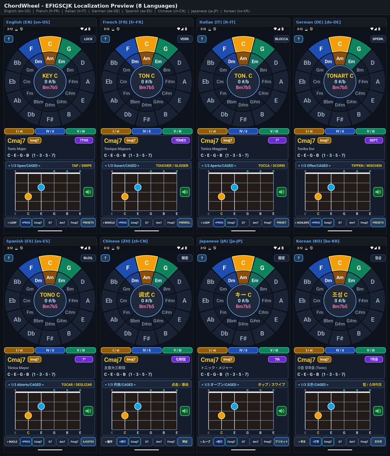](chordwheel/docs/images/i18n/efigscjk_grid.png)

#### [Fretboard Explorer](fretboard/README.md) — [Full-Res Grid (`efigscjk_grid.png`)](fretboard/docs/images/i18n/efigscjk_grid.png) · [Play Console AI Import (`CSV`)](fretboard/PLAY_STORE_AI_IMPORT.csv) · [Localized Play Store Copy](fretboard/PLAY_STORE_I18N_EFIGSCJK.md)

[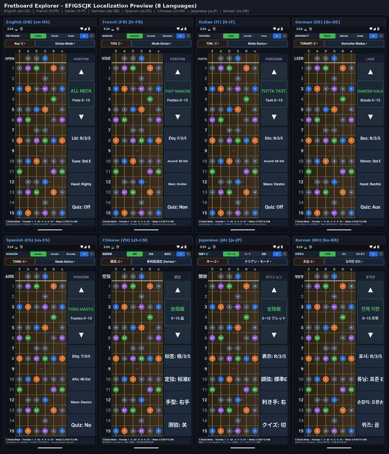](fretboard/docs/images/i18n/efigscjk_grid.png)

#### [LickTrainer](licktrainer/README.md) — [Full-Res Grid (`efigscjk_grid.png`)](licktrainer/docs/images/i18n/efigscjk_grid.png) · [Play Console AI Import (`CSV`)](licktrainer/PLAY_STORE_AI_IMPORT.csv) · [Localized Play Store Copy](licktrainer/PLAY_STORE_I18N_EFIGSCJK.md)

[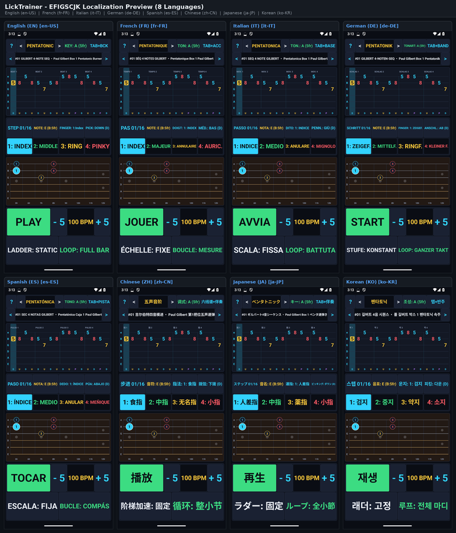](licktrainer/docs/images/i18n/efigscjk_grid.png)

#### [Band (PocketBand)](pocketband/README.md) — [Full-Res Grid (`efigscjk_grid.png`)](pocketband/docs/images/i18n/efigscjk_grid.png) · [Play Console AI Import (`CSV`)](pocketband/PLAY_STORE_AI_IMPORT.csv) · [Localized Play Store Copy](pocketband/PLAY_STORE_I18N_EFIGSCJK.md)

[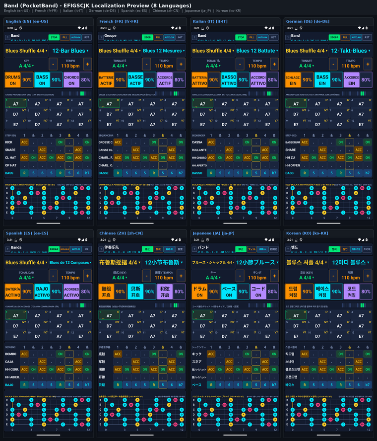](pocketband/docs/images/i18n/efigscjk_grid.png)

#### [EarTrainer](eartrainer/README.md) — [Full-Res Grid (`efigscjk_grid.png`)](eartrainer/docs/images/i18n/efigscjk_grid.png) · [Play Console AI Import (`CSV`)](eartrainer/PLAY_STORE_AI_IMPORT.csv) · [Localized Play Store Copy](eartrainer/PLAY_STORE_I18N_EFIGSCJK.md)

[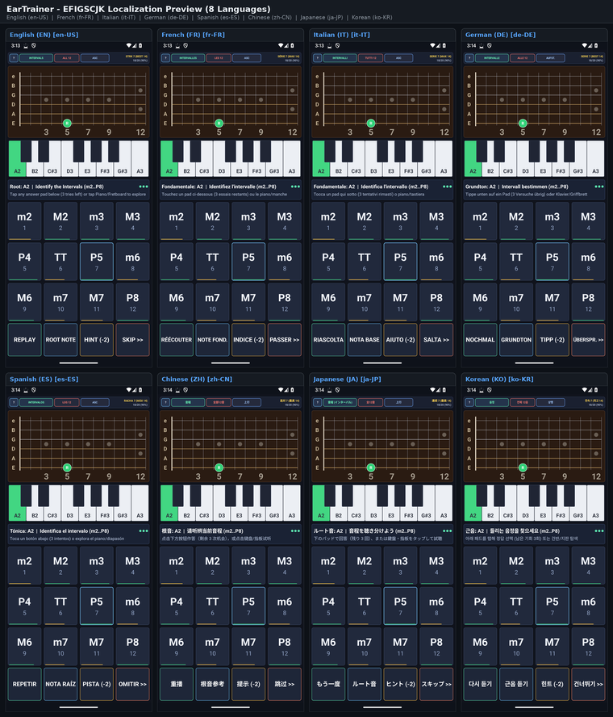](eartrainer/docs/images/i18n/efigscjk_grid.png)

#### [Metronome](metronome/README.md) — [Full-Res Grid (`efigscjk_grid.png`)](metronome/docs/images/i18n/efigscjk_grid.png) · [Play Console AI Import (`CSV`)](metronome/PLAY_STORE_AI_IMPORT.csv) · [Localized Play Store Copy](metronome/PLAY_STORE_I18N_EFIGSCJK.md)

[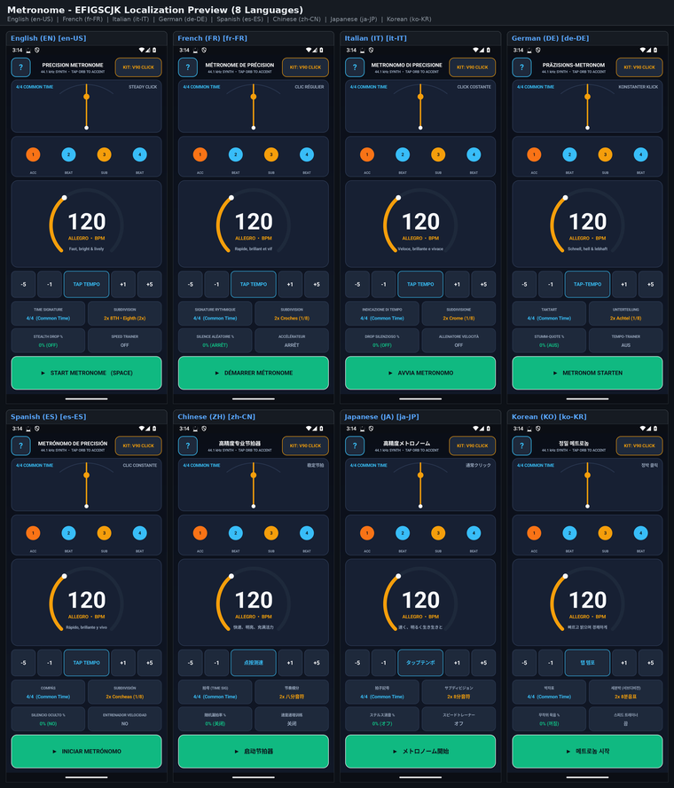](metronome/docs/images/i18n/efigscjk_grid.png)

#### [Pomodoro Timer](pomodoro/README.md) — [Full-Res Grid (`efigscjk_grid.png`)](pomodoro/docs/images/i18n/efigscjk_grid.png) · [Play Console AI Import (`CSV`)](pomodoro/PLAY_STORE_AI_IMPORT.csv) · [Localized Play Store Copy](pomodoro/PLAY_STORE_I18N_EFIGSCJK.md)

[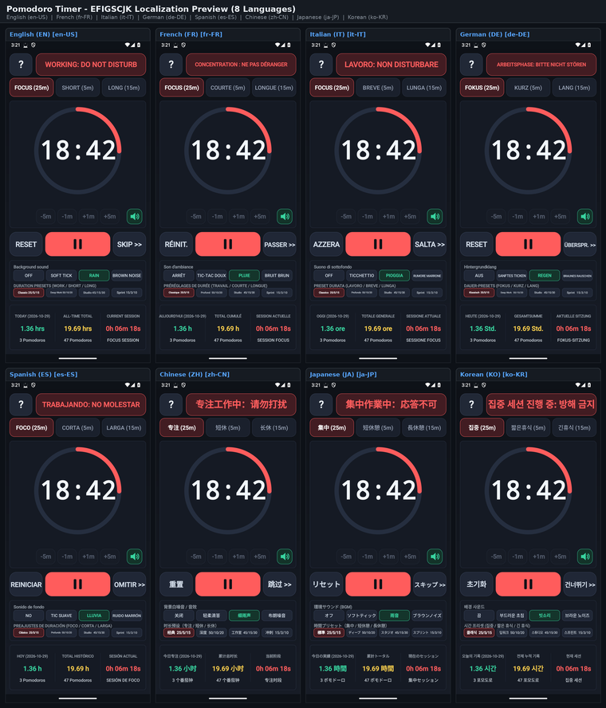](pomodoro/docs/images/i18n/efigscjk_grid.png)

#### [SightRead](sightread/README.md) — [Full-Res Grid (`efigscjk_grid.png`)](sightread/docs/images/i18n/efigscjk_grid.png) · [Play Console AI Import (`CSV`)](sightread/PLAY_STORE_AI_IMPORT.csv) · [Localized Play Store Copy](sightread/PLAY_STORE_I18N_EFIGSCJK.md)

[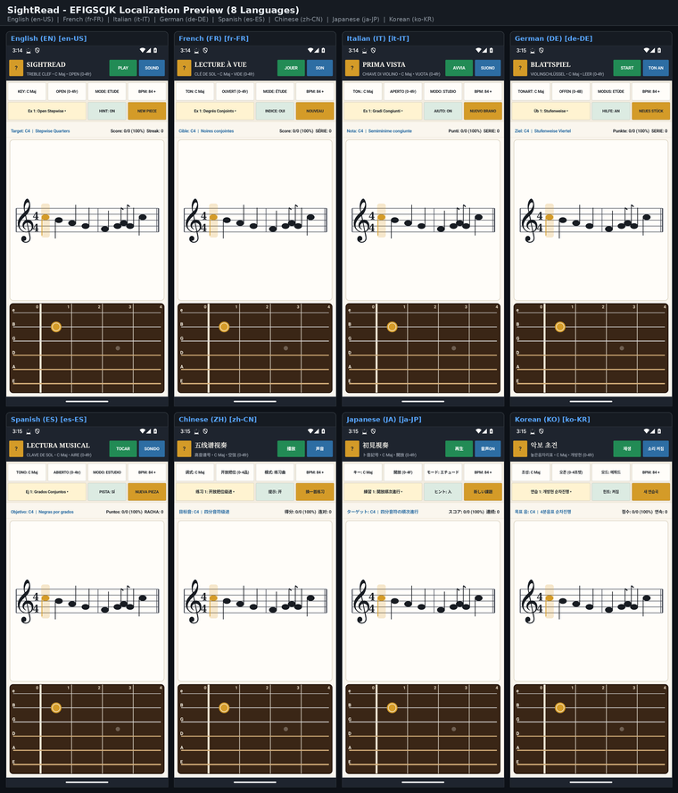](sightread/docs/images/i18n/efigscjk_grid.png)

#### [Rhythm Trainer](rhythm-trainer/README.md) — [Full-Res Grid (`efigscjk_grid.png`)](rhythm-trainer/docs/images/i18n/efigscjk_grid.png) · [Play Console AI Import (`CSV`)](rhythm-trainer/PLAY_STORE_AI_IMPORT.csv) · [Localized Play Store Copy](rhythm-trainer/PLAY_STORE_I18N_EFIGSCJK.md)

[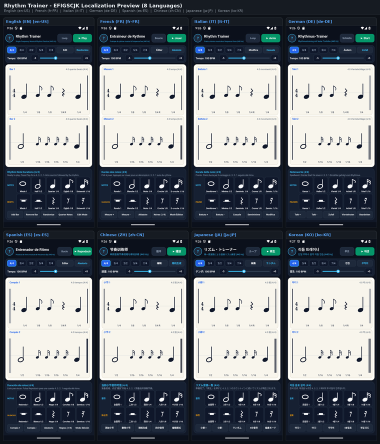](rhythm-trainer/docs/images/i18n/efigscjk_grid.png)

#### [Sound Sleep](sound-sleep/README.md) — [Full-Res Grid (`efigscjk_grid.png`)](sound-sleep/docs/images/i18n/efigscjk_grid.png) · [Play Console AI Import (`CSV`)](sound-sleep/PLAY_STORE_AI_IMPORT.csv) · [Localized Play Store Copy](sound-sleep/PLAY_STORE_I18N_EFIGSCJK.md)

[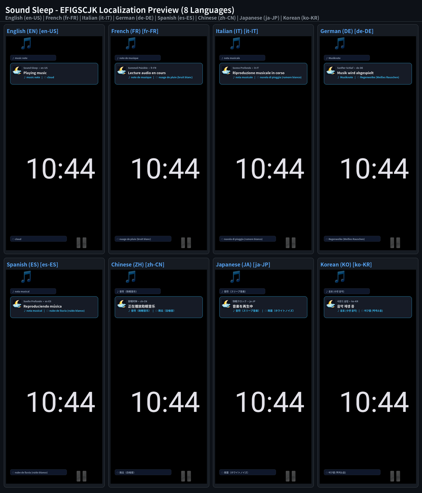](sound-sleep/docs/images/i18n/efigscjk_grid.png)

### Clickable EFIGSCJK Help (`?`) Modal Verification Grids (Click Any Thumbnail to Inspect Full Image)

#### [ChordWheel](chordwheel/README.md) — [Full-Res Help Grid (`efigscjk_help_grid.png`)](chordwheel/docs/images/i18n/efigscjk_help_grid.png)

[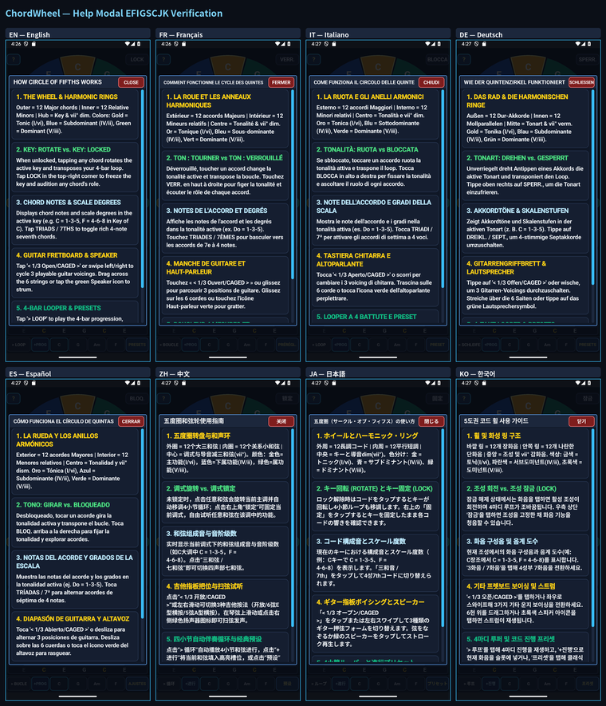](chordwheel/docs/images/i18n/efigscjk_help_grid.png)

#### [Fretboard Explorer](fretboard/README.md) — [Full-Res Help Grid (`efigscjk_help_grid.png`)](fretboard/docs/images/i18n/efigscjk_help_grid.png)

[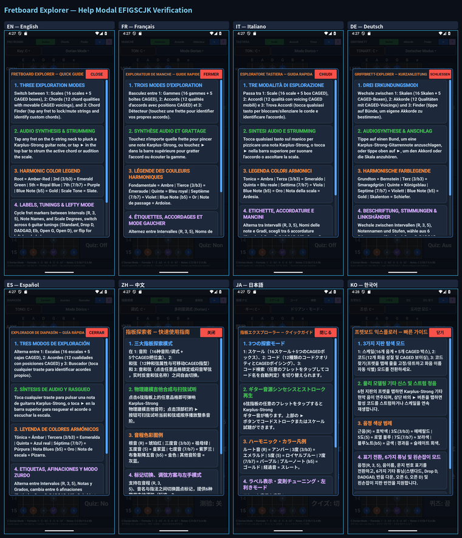](fretboard/docs/images/i18n/efigscjk_help_grid.png)

#### [LickTrainer](licktrainer/README.md) — [Full-Res Help Grid (`efigscjk_help_grid.png`)](licktrainer/docs/images/i18n/efigscjk_help_grid.png)

[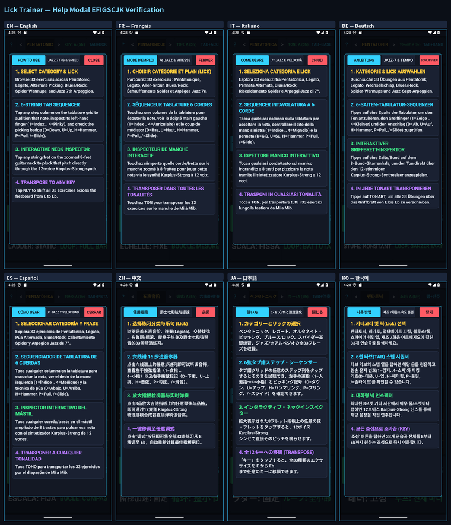](licktrainer/docs/images/i18n/efigscjk_help_grid.png)

#### [Band (PocketBand)](pocketband/README.md) — [Full-Res Help Grid (`efigscjk_help_grid.png`)](pocketband/docs/images/i18n/efigscjk_help_grid.png)

[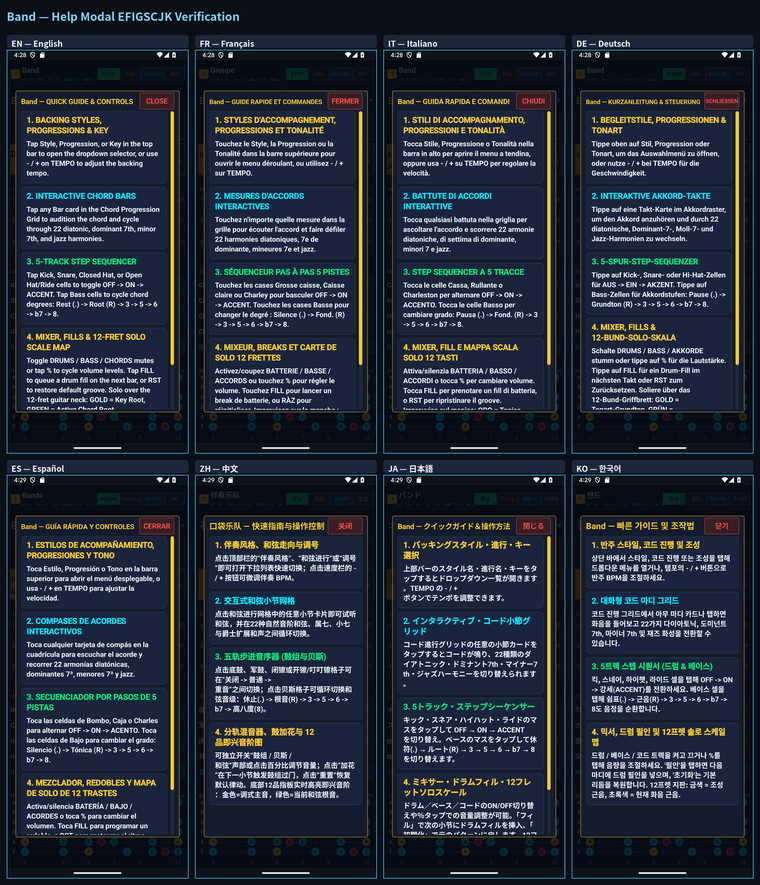](pocketband/docs/images/i18n/efigscjk_help_grid.png)

#### [EarTrainer](eartrainer/README.md) — [Full-Res Help Grid (`efigscjk_help_grid.png`)](eartrainer/docs/images/i18n/efigscjk_help_grid.png)

[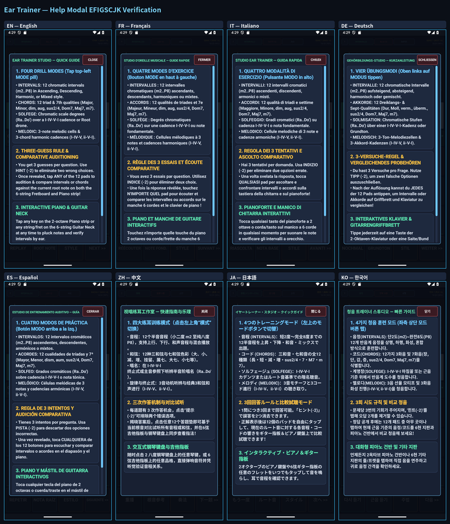](eartrainer/docs/images/i18n/efigscjk_help_grid.png)

#### [Metronome](metronome/README.md) — [Full-Res Help Grid (`efigscjk_help_grid.png`)](metronome/docs/images/i18n/efigscjk_help_grid.png)

[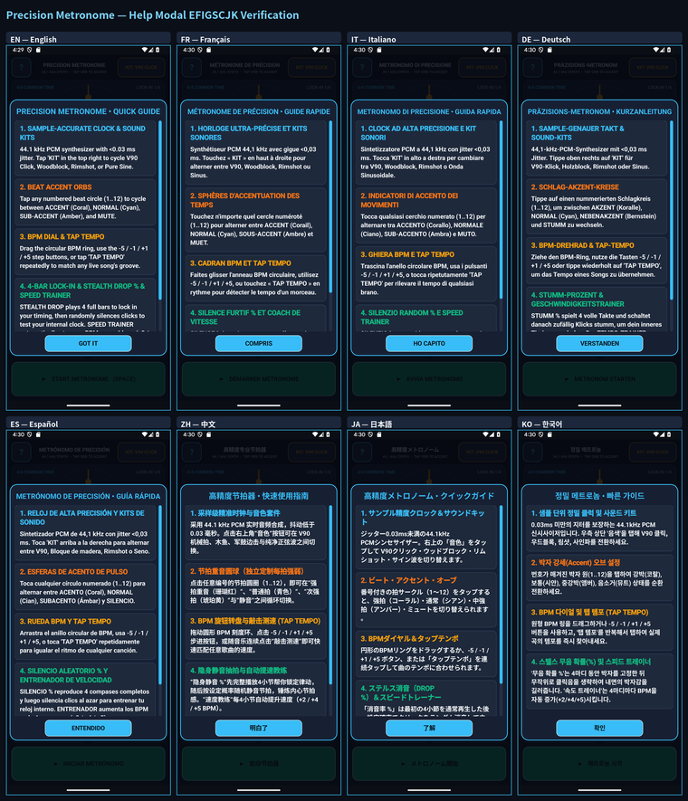](metronome/docs/images/i18n/efigscjk_help_grid.png)

#### [Pomodoro Timer](pomodoro/README.md) — [Full-Res Help Grid (`efigscjk_help_grid.png`)](pomodoro/docs/images/i18n/efigscjk_help_grid.png)

[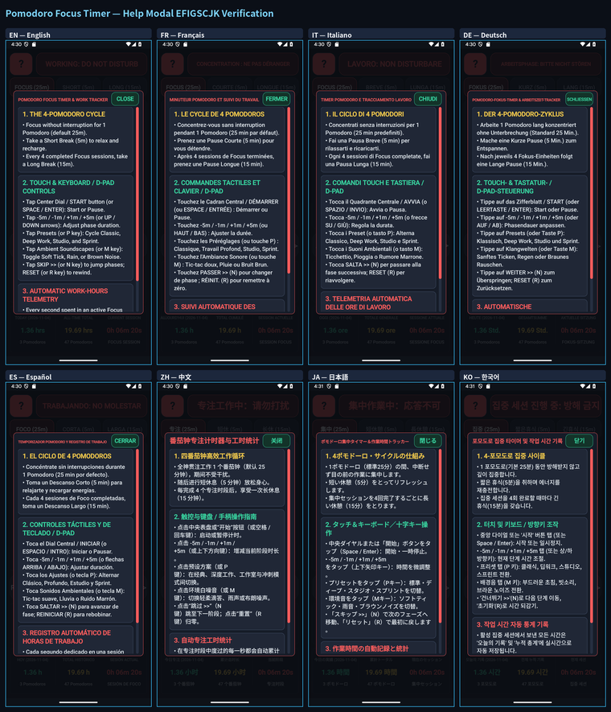](pomodoro/docs/images/i18n/efigscjk_help_grid.png)

#### [SightRead](sightread/README.md) — [Full-Res Help Grid (`efigscjk_help_grid.png`)](sightread/docs/images/i18n/efigscjk_help_grid.png)

[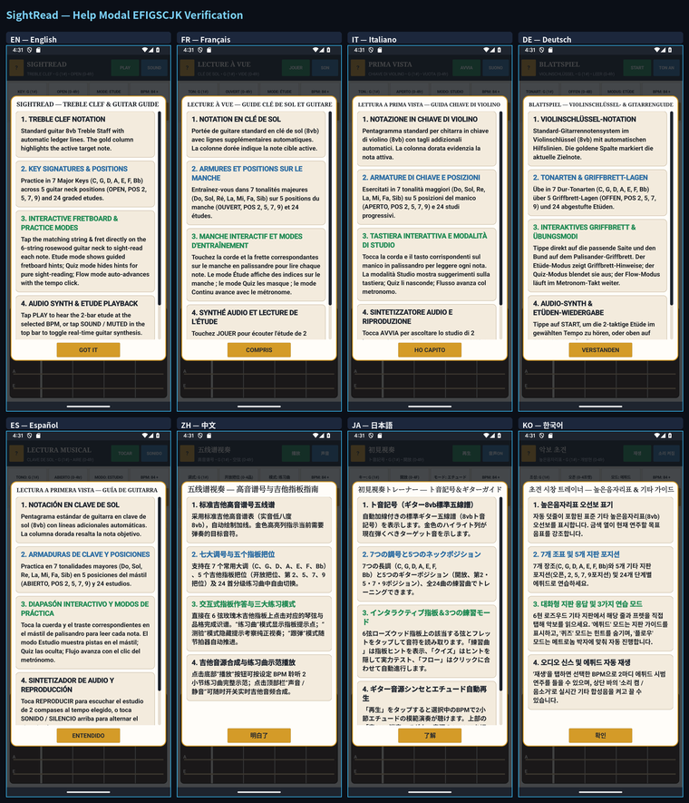](sightread/docs/images/i18n/efigscjk_help_grid.png)

#### [Rhythm Trainer](rhythm-trainer/README.md) — [Full-Res Help Grid (`efigscjk_help_grid.png`)](rhythm-trainer/docs/images/i18n/efigscjk_help_grid.png)

[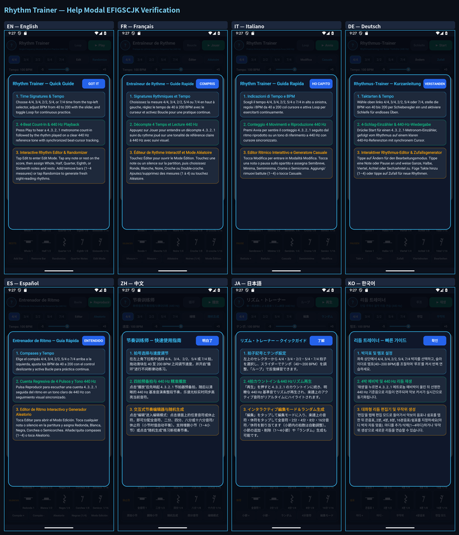](rhythm-trainer/docs/images/i18n/efigscjk_help_grid.png)

<!-- I18N_EFIGSCJK_END -->

---

## Building & Testing Any Application

Each app directory contains its own Gradle wrapper (`./gradlew`). To build the debug APK, run unit tests, or build a signed Play Store release bundle (`.aab` and `.apk`):

```bash
cd <app-directory>
./gradlew assembleDebug testDebugUnitTest
./gradlew assembleRelease bundleRelease
```
