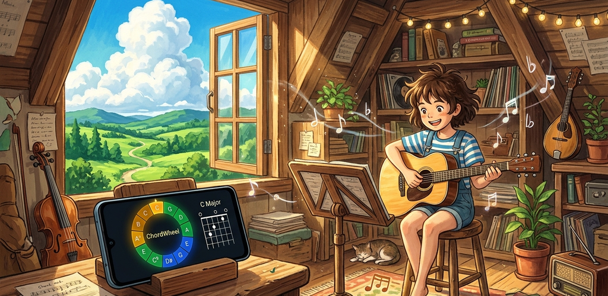
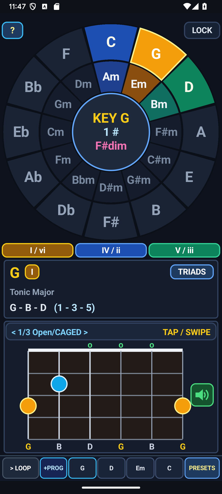
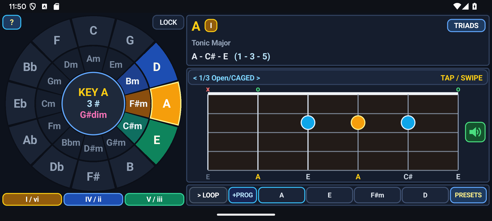
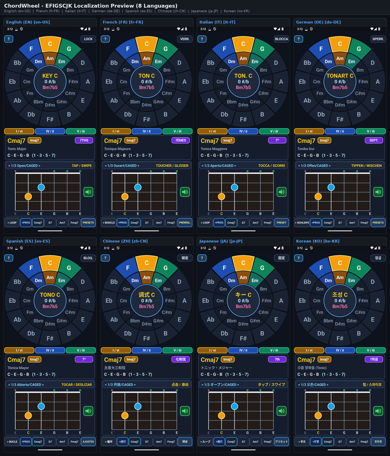

# Google Play Store Listing — ChordWheel — Circle of Fifths & Guitar Looper (`com.eggwall.chordwheel`)

## Short Description (76 / 80 characters)
> Interactive Circle of Fifths, CAGED guitar voicings, and 4-bar chord looper.

## Full Description (3755 / 4000 characters)
- **Standalone Description File:** [`PLAY_STORE_DESCRIPTION.md`](PLAY_STORE_DESCRIPTION.md)

Master music theory, songwriting harmony, and guitar chord voicings on a single interactive screen with ChordWheel — Circle of Fifths & Guitar Looper. Built specifically for guitarists, songwriters, music students, and educators, ChordWheel transforms the classic Circle of Fifths from a static wall poster into a playable, real-time musical instrument and harmonic workstation.

Whether you are figuring out which chords belong to a key, transposing a song on the fly, exploring CAGED guitar shapes up the neck, or jamming over a custom 4-bar chord progression, ChordWheel gives you instant visual and audio feedback with zero clutter, zero ads, and zero internet dependency.

CONCENTRIC CIRCLE OF FIFTHS HARMONIC WHEEL
• Outer Major Ring: Displays all 12 Major keys arranged in fifths (C, G, D, A, E, B/Cb, F#/Gb, Db, Ab, Eb, Bb, F) and highlights the primary diatonic major chords (I, IV, and V) in the active key.
• Inner Relative Minor Ring: Aligns each key with its relative minor and highlights the diatonic minor chords (ii, iii, and vi) inside the harmonic family wedge.
• Diminished Center Wedge & Roman Numerals: Clearly marks the leading-tone diminished chord (vii°) and labels every diatonic chord with its Roman numeral function (I, ii, iii, IV, V, vi, vii°) so you immediately understand harmonic movement.
• Dual Wheel Modes (ROTATE vs. LOCK): Spin the physical wheel smoothly to bring any key Signature to the top 12 o'clock anchor in ROTATE mode, or switch to LOCK mode to keep C anchored at 12 o'clock while tapping any key or chord around the perimeter.

SCALE-DEGREE FORMULAS & CHORD QUALITY EXTENSIONS
• Real-Time Scale-Degree Readout: Displays the exact scale degrees of the selected chord relative to the active key signature (for example, I = 1 - 3 - 5, IV = 4 - 6 - 8, V7 = 5 - 7 - 9 - 11) alongside individual pitch names and interval formulas.
• Instant Chord Quality Modifiers: Expand any triad into a Seventh (maj7, m7, dom7, m7b5), Sus2, Sus4, or Add9 voicing with a single tap to hear rich contemporary, jazz, pop, and neo-soul colors.

MOVABLE CAGED GUITAR FRETBOARD VOICINGS
• Three Playable Neck Positions Per Chord: Switch seamlessly between Open / CAGED shapes, 6th-string E-Shape Barre voicings, and 5th-string A-Shape Barre voicings.
• Fingerings, Barres & String Mutes: Every fretboard diagram displays recommended finger numbers (1–4), curved barre arcs, open-string circles (O), muted-string markers (X), and fret position numbers so you can play the voicing immediately on your guitar.
• Tap-to-Strum Karplus-Strong Guitar Synthesis: Tap any chord wedge on the wheel or tap the guitar neck diagram to hear an expressive, physically modeled 6-string acoustic guitar strum synthesized in real time at 44.1 kHz.

4-BAR SONGWRITING LOOPER & GENRE PRESETS
• Programmable 4-Bar Chord Sequencer: Assign any chord and voicing to Bars 1 through 4 to sketch verses, choruses, and bridges, or create a backing loop for solo improvisation.
• Curated Hit Progression Presets: Load classic harmonic templates instantly—including Pop I–V–vi–IV, 50s Doo-Wop I–vi–IV–V, Jazz ii–V–I–VI, Andalusian Cadence, Royal Road (IV–V–iii–vi), and Blues turnarounds—and transpose them into any of the 12 keys with one tap.
• Adjustable Tempo & Strum Groove: Dial in your exact practice BPM and loop continuously with sample-accurate timing.

DESIGNED FOR MUSICIANS — PRIVACY FIRST & 100% OFFLINE
• Adaptive Portrait & Landscape Layouts: Optimized vector interface that adapts cleanly to phones and tablets in both vertical and horizontal orientations.
• Complete Privacy: Requires zero runtime permissions, collects zero personal data or analytics, displays no advertisements or paywalls, and runs 100% offline anywhere your music takes you.

## Play Store Visual Assets & Policy Links
- **Full Play Store Description (4000-char limit):** [`PLAY_STORE_DESCRIPTION.md`](PLAY_STORE_DESCRIPTION.md)
- **App Icon (512×512 PNG):** [`playstore-icon-512.png`](playstore-icon-512.png)
- **Feature Graphic (1024×500 PNG, Miyazaki Style):** [`feature-graphic-1024x500.png`](feature-graphic-1024x500.png)
- **Privacy Policy:** [`PRIVACY_POLICY.md`](PRIVACY_POLICY.md)

### Feature Graphic Preview

### Phone Screenshots (Portrait & Landscape)
| Portrait 1 | Portrait 2 |
| :---: | :---: |
|  |  |

| Landscape 1 | Landscape 2 |
| :---: | :---: |
|  |  |
<!-- I18N_EFIGSCJK_START -->

---

## Google Play Console "Import translations with AI" (All 20 World Languages)

Google Play Console's **Import translations with AI** dialog (*Grow users → Store presence → Store listings → Edit store listing → Manage translations → Import translations with AI*) accepts `.csv`, `.md`, or `.txt` files (UTF-8, up to 3 MB) and automatically extracts `languageCode`, `appName` (`≤ 30` chars), `shortDescription` (`≤ 80` chars), and `fullDescription` (`≤ 4000` chars) for every language in the file:

- **CSV Import File (Recommended):** **[`PLAY_STORE_AI_IMPORT.csv`](PLAY_STORE_AI_IMPORT.csv)**
- **Markdown Import File:** **[`PLAY_STORE_AI_IMPORT.md`](PLAY_STORE_AI_IMPORT.md)**
- **Structured JSON-in-TXT Import File:** **[`PLAY_STORE_AI_IMPORT.txt`](PLAY_STORE_AI_IMPORT.txt)**
- **EFIGSCJK Copy-Paste Reference:** **[`PLAY_STORE_I18N_EFIGSCJK.md`](PLAY_STORE_I18N_EFIGSCJK.md)**
- **Fastlane / Per-Locale Metadata Directory (All 20 Languages):** **[`playstore/metadata/android/`](playstore/metadata/android/)**

| BCP-47 Locale | Language | Title (`<= 30` chars) | Short Description (`<= 80` chars) | Full Description (`<= 4000` chars) | EFIGSCJK Screenshot (`1080×2400`) |
| :--- | :--- | :--- | :--- | :--- | :--- |
| **`en-US`** | English (United States) | [`title.txt`](playstore/metadata/android/en-US/title.txt) | [`short_description.txt`](playstore/metadata/android/en-US/short_description.txt) | [`full_description.txt`](playstore/metadata/android/en-US/full_description.txt) | [`en.png`](docs/images/i18n/en.png) |
| **`fr-FR`** | French (France) — Français | [`title.txt`](playstore/metadata/android/fr-FR/title.txt) | [`short_description.txt`](playstore/metadata/android/fr-FR/short_description.txt) | [`full_description.txt`](playstore/metadata/android/fr-FR/full_description.txt) | [`fr.png`](docs/images/i18n/fr.png) |
| **`it-IT`** | Italian (Italy) — Italiano | [`title.txt`](playstore/metadata/android/it-IT/title.txt) | [`short_description.txt`](playstore/metadata/android/it-IT/short_description.txt) | [`full_description.txt`](playstore/metadata/android/it-IT/full_description.txt) | [`it.png`](docs/images/i18n/it.png) |
| **`de-DE`** | German (Germany) — Deutsch | [`title.txt`](playstore/metadata/android/de-DE/title.txt) | [`short_description.txt`](playstore/metadata/android/de-DE/short_description.txt) | [`full_description.txt`](playstore/metadata/android/de-DE/full_description.txt) | [`de.png`](docs/images/i18n/de.png) |
| **`es-ES`** | Spanish (Spain) — Español | [`title.txt`](playstore/metadata/android/es-ES/title.txt) | [`short_description.txt`](playstore/metadata/android/es-ES/short_description.txt) | [`full_description.txt`](playstore/metadata/android/es-ES/full_description.txt) | [`es.png`](docs/images/i18n/es.png) |
| **`zh-CN`** | Chinese (Simplified) — 中文（简体） | [`title.txt`](playstore/metadata/android/zh-CN/title.txt) | [`short_description.txt`](playstore/metadata/android/zh-CN/short_description.txt) | [`full_description.txt`](playstore/metadata/android/zh-CN/full_description.txt) | [`zh.png`](docs/images/i18n/zh.png) |
| **`ja-JP`** | Japanese (Japan) — 日本語 | [`title.txt`](playstore/metadata/android/ja-JP/title.txt) | [`short_description.txt`](playstore/metadata/android/ja-JP/short_description.txt) | [`full_description.txt`](playstore/metadata/android/ja-JP/full_description.txt) | [`ja.png`](docs/images/i18n/ja.png) |
| **`ko-KR`** | Korean (South Korea) — 한국어 | [`title.txt`](playstore/metadata/android/ko-KR/title.txt) | [`short_description.txt`](playstore/metadata/android/ko-KR/short_description.txt) | [`full_description.txt`](playstore/metadata/android/ko-KR/full_description.txt) | [`ko.png`](docs/images/i18n/ko.png) |
| **`pt-BR`** | Portuguese (Brazil) — Português | [`title.txt`](playstore/metadata/android/pt-BR/title.txt) | [`short_description.txt`](playstore/metadata/android/pt-BR/short_description.txt) | [`full_description.txt`](playstore/metadata/android/pt-BR/full_description.txt) | — |
| **`ru-RU`** | Russian (Russia) — Русский | [`title.txt`](playstore/metadata/android/ru-RU/title.txt) | [`short_description.txt`](playstore/metadata/android/ru-RU/short_description.txt) | [`full_description.txt`](playstore/metadata/android/ru-RU/full_description.txt) | — |
| **`ar`** | Arabic — العربية | [`title.txt`](playstore/metadata/android/ar/title.txt) | [`short_description.txt`](playstore/metadata/android/ar/short_description.txt) | [`full_description.txt`](playstore/metadata/android/ar/full_description.txt) | — |
| **`hi-IN`** | Hindi (India) — हिन्दी | [`title.txt`](playstore/metadata/android/hi-IN/title.txt) | [`short_description.txt`](playstore/metadata/android/hi-IN/short_description.txt) | [`full_description.txt`](playstore/metadata/android/hi-IN/full_description.txt) | — |
| **`bn-BD`** | Bengali (Bangladesh) — বাংলা | [`title.txt`](playstore/metadata/android/bn-BD/title.txt) | [`short_description.txt`](playstore/metadata/android/bn-BD/short_description.txt) | [`full_description.txt`](playstore/metadata/android/bn-BD/full_description.txt) | — |
| **`id`** | Indonesian — Bahasa Indonesia | [`title.txt`](playstore/metadata/android/id/title.txt) | [`short_description.txt`](playstore/metadata/android/id/short_description.txt) | [`full_description.txt`](playstore/metadata/android/id/full_description.txt) | — |
| **`tr-TR`** | Turkish (Turkey) — Türkçe | [`title.txt`](playstore/metadata/android/tr-TR/title.txt) | [`short_description.txt`](playstore/metadata/android/tr-TR/short_description.txt) | [`full_description.txt`](playstore/metadata/android/tr-TR/full_description.txt) | — |
| **`vi`** | Vietnamese — Tiếng Việt | [`title.txt`](playstore/metadata/android/vi/title.txt) | [`short_description.txt`](playstore/metadata/android/vi/short_description.txt) | [`full_description.txt`](playstore/metadata/android/vi/full_description.txt) | — |
| **`pl-PL`** | Polish (Poland) — Polski | [`title.txt`](playstore/metadata/android/pl-PL/title.txt) | [`short_description.txt`](playstore/metadata/android/pl-PL/short_description.txt) | [`full_description.txt`](playstore/metadata/android/pl-PL/full_description.txt) | — |
| **`nl-NL`** | Dutch (Netherlands) — Nederlands | [`title.txt`](playstore/metadata/android/nl-NL/title.txt) | [`short_description.txt`](playstore/metadata/android/nl-NL/short_description.txt) | [`full_description.txt`](playstore/metadata/android/nl-NL/full_description.txt) | — |
| **`th`** | Thai — ไทย | [`title.txt`](playstore/metadata/android/th/title.txt) | [`short_description.txt`](playstore/metadata/android/th/short_description.txt) | [`full_description.txt`](playstore/metadata/android/th/full_description.txt) | — |
| **`uk`** | Ukrainian — Українська | [`title.txt`](playstore/metadata/android/uk/title.txt) | [`short_description.txt`](playstore/metadata/android/uk/short_description.txt) | [`full_description.txt`](playstore/metadata/android/uk/full_description.txt) | — |

### EFIGSCJK Localization Grid (Click Thumbnail for Full-Resolution `2260×2640` Image)

<!-- I18N_EFIGSCJK_END -->
