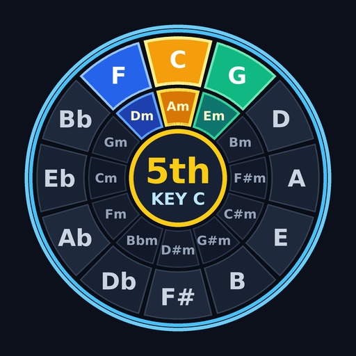
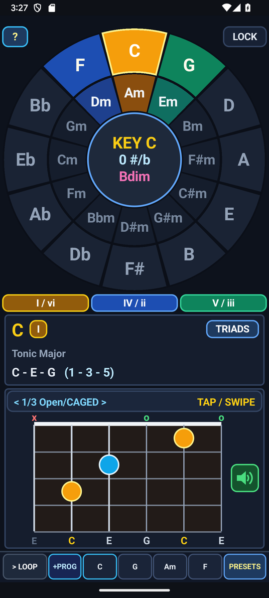

# Circle of Fifths (`com.eggwall.chordwheel`)

<p align="center">
  
</p>

Android music-theory companion, guitar voicing inspector, and 4-bar chord progression looper translated from the PowKiddy V90 `chordwheel` application.

## Screenshots

| Portrait Workspace | Landscape Two-Pane Workspace |
| :---: | :---: |
|  |  |

## Documentation

- **[Musician's User Guide (`USER_GUIDE.md`)](USER_GUIDE.md)**: How the interface works and 6 structured practice routines to improve ear training, fretboard fluency, songwriting, and harmonic understanding.
- **[Engineering & Customization Guide (`DEVELOPER_GUIDE.md`)](DEVELOPER_GUIDE.md)**: Architecture overview and step-by-step instructions for modifying chord qualities, tunings, voicings, progression presets, layout geometry, and Karplus-Strong synthesis, with relative links to source files.
- **[Privacy Policy (`PRIVACY_POLICY.md`)](PRIVACY_POLICY.md)**: Zero-permission, offline-only privacy policy with direct source-code verification links.

## Key Features

- **Full-Width Interactive Circle of Fifths Wheel** ([`ChordWheelView.java`](src/com/eggwall/chordwheel/ChordWheelView.java#L481-L611)):
  - **Outer Ring**: 12 Major keys/chords (`C, G, D, A, E, B, F#, Db, Ab, Eb, Bb, F`).
  - **Inner Ring**: 12 Relative Minor chords (`Am, Em, Bm, F#m, C#m, G#m, D#m, Bbm, Fm, Cm, Gm, Dm`).
  - **Center Hub**: Key signature and leading-tone diminished (`vii°` / `m7b5`) chord of the active key.
  - **Corner `?` & `LOCK` Pills**: Top-left `?` opens the in-app *How Circle of Fifths Works* guide modal; top-right `LOCK` freezes the active key so you can audition any chord's harmonic role without rotating the key.
- **Chord Composition with Active-Key Scale Degrees** ([`MusicTheory.resolveChordAt()`](src/com/eggwall/chordwheel/MusicTheory.java#L379-L464)):
  - Displays both spelled chord notes and scale-degree numbers relative to the active key (e.g., in Key of C: `C Major` = `C - E - G (1 - 3 - 5)`, `F Major` = `F - A - C (4 - 6 - 8)`, `G Major` = `G - B - D (5 - 7 - 9)`).
- **Responsive Portrait & Landscape Layouts** ([`drawLandscapeLayout()`](src/com/eggwall/chordwheel/ChordWheelView.java#L421-L447), [`drawPortraitLayout()`](src/com/eggwall/chordwheel/ChordWheelView.java#L449-L479)):
  - **Landscape**: Full-height Circle of Fifths wheel on the left pane; Chord Info card, 6-string Guitar Fretboard card, and 4-bar Progression Loop bar stacked on the right pane.
  - **Portrait**: Full-width Circle of Fifths wheel on top, Chord Info and Fretboard cards in the middle, and the 4-bar Progression Loop bar along the bottom.
- **Interactive 6-String Fretboard & Karplus-Strong Synth** ([`GuitarSynthEngine.java`](src/com/eggwall/chordwheel/GuitarSynthEngine.java#L26-L261)):
  - Drag across the strings to pluck individual strings, tap the green speaker icon on the right of the fretboard to strum, or tap/swipe the `< 1/3 Open/CAGED >` bar to cycle between Open/CAGED, E-Barre, and A-Barre shapes.
- **System Status Bar & Screen Timeout Behavior** ([`AndroidManifest.xml`](AndroidManifest.xml), [`ChordWheelActivity.java`](src/com/eggwall/chordwheel/ChordWheelActivity.java)):
  - Uses `@android:style/Theme.DeviceDefault.NoActionBar` with system-bar window-inset padding (`wrapWithStatusBarInsets`) so the top Android status bar remains visible at all times.
  - Respects the device's normal system screen timeout (does not hold `FLAG_KEEP_SCREEN_ON`).

## Build, Test & Sign Instructions

Built with Android Gradle Plugin `8.9.0`, Gradle `8.14`, and Android SDK `36` (`minSdk = 19`, `targetSdk = 36`):

```bash
# Run JUnit 4 unit tests (verifies all 12 keys and all 252 guitar voicings)
./gradlew testDebugUnitTest

# Build debug APK
./gradlew assembleDebug

# Build signed release APK and Play Store AAB bundle (uses ant.properties)
./gradlew assembleRelease bundleRelease
```
