# Circle of Fifths — Musician's Guide & Practice Companion

Welcome to **Circle of Fifths** (`com.eggwall.chordwheel`), an interactive harmonic compass, 6-string guitar chord visualizer, and 4-bar progression looper.

This guide pairs cropped segments of the application screen with music-theory explanations and six structured practice workouts to improve your **ear training**, **fretboard fluency**, **songwriting**, and **harmonic understanding**.

---

## 1. Visual Guide to the Interface

### A. The Three Concentric Rings & Diatonic Color Legend

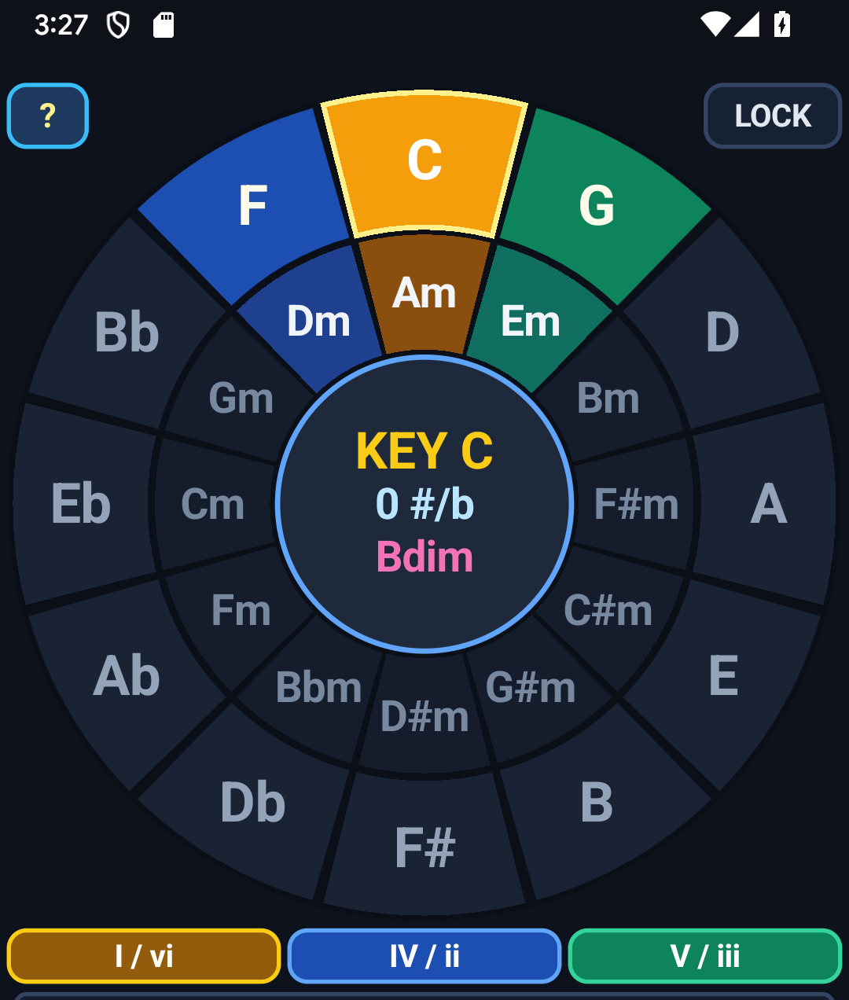

The wheel arranges all 12 musical keys clockwise by **perfect fifths** (and counter-clockwise by **perfect fourths**):
- **Outer Ring (Major Chords)**: The 12 Major keys/chords (`C, G, D, A, E, B, F#, Db, Ab, Eb, Bb, F`).
- **Inner Ring (Relative Minors)**: Each Major key's relative minor (`Am, Em, Bm, F#m, C#m, G#m, D#m, Bbm, Fm, Cm, Gm, Dm`), which shares the exact same key signature.
- **Center Hub (Key Signature & Leading-Tone Diminished)**: Displays the active key (`KEY C`), its key signature (`0 #/b`, `1 #`, `2 b`, etc.), and the 7th scale degree diminished chord (`Bdim` in Triad mode, or half-diminished `Bm7b5` in 7ths mode). Tapping the center hub selects and strums this `vii°` chord.
- **Diatonic Family Legend Pills (`I / vi`, `IV / ii`, `V / iii`)**: In any Major key, the **6 core diatonic chords** always form a tight, contiguous 3-sector wedge on the wheel:
  - **Gold (`I / vi` — Tonic Family)**: Home base and stability (`C` and `Am` in the key of C).
  - **Blue (`IV / ii` — Subdominant Family)**: Counter-clockwise neighbor; creates forward motion and lift away from home (`F` and `Dm` in the key of C).
  - **Green (`V / iii` — Dominant Family)**: Clockwise neighbor (plus the center `vii°` hub); creates harmonic tension that wants to resolve back to the Gold Tonic (`G`, `Em`, and `Bdim` in the key of C).
  - **Slate (Outside the 3-Sector Wedge)**: Non-diatonic, borrowed, and secondary-dominant chords.

---

### B. Top Corner Controls: `?` and `LOCK`

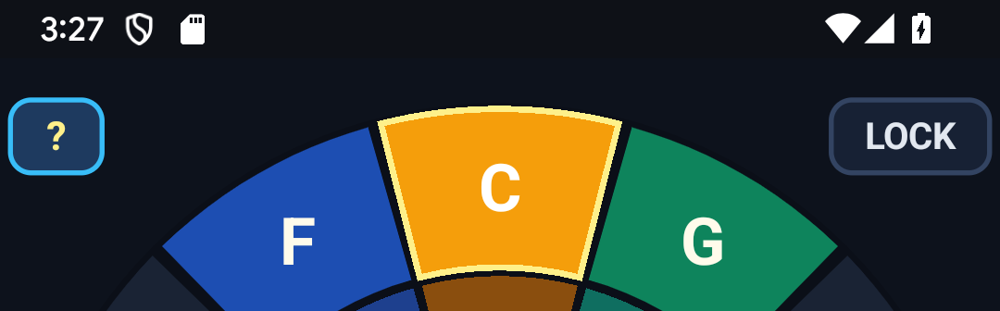

- **`?` (Top-Left)**: Opens the in-app **How Circle of Fifths Works** reference modal:

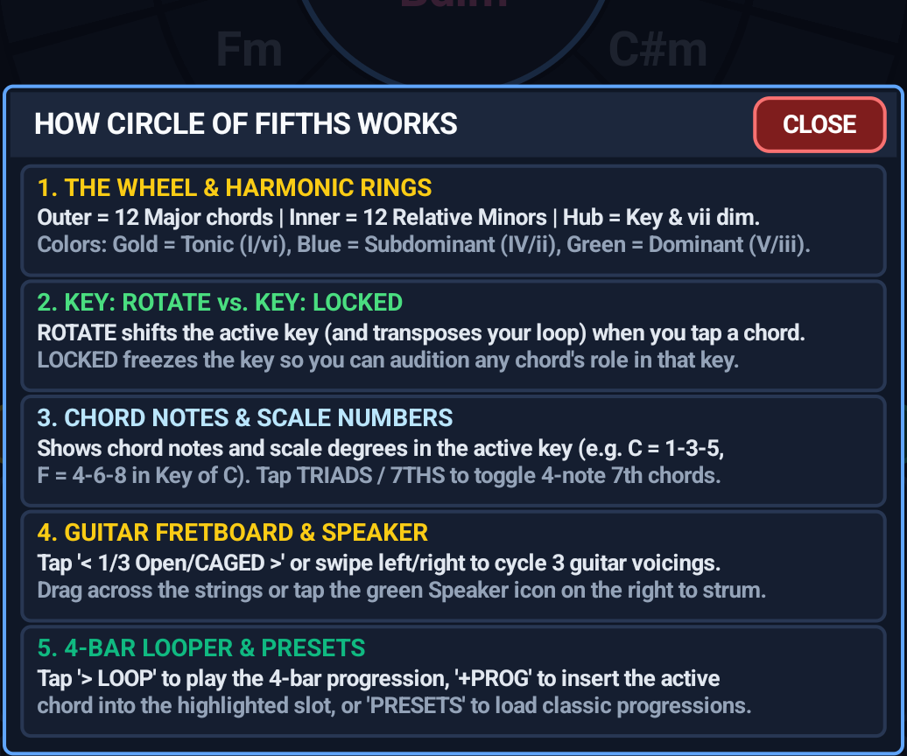

- **`LOCK` (Top-Right)**: Controls what happens when you tap or drag around the wheel:
  - **Unlocked (Dark Slate — Key Rotation Mode)**: Tapping any Major or Minor sector rotates the **active key** to that sector and **automatically transposes** your 4-bar loop into the new key.
  - **Locked (Highlighted Orange — Chord Audition Mode, shown above)**: Freezes the active key signature (`KEY C` stays at 12 o'clock) so you can tap **any** chord around the wheel (such as `F` highlighted in the yellow border above, or any chord outside the key) to hear how it functions inside the locked home key.

---

### C. Chord Inspector Card & Scale-Degree Numbers in the Active Key

Instead of labeling every chord as `1 - 3 - 5` relative to itself, the Chord Inspector Card displays **both** the chord's note spelling and its **scale-degree numbers inside the active key**:

| Tonic (`I` in Key of C) | Subdominant (`IV` in Key of C) | Dominant 7th (`V7` in Key of C) |
| :---: | :---: | :---: |
| 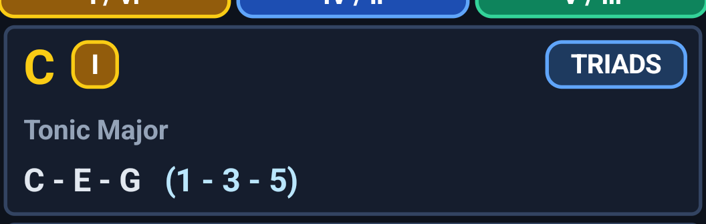 | 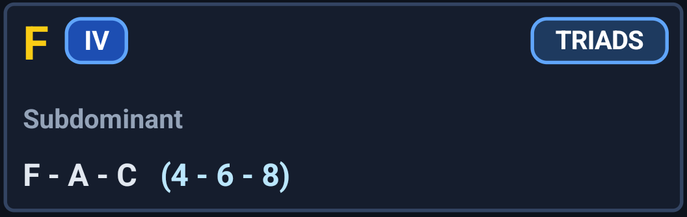 | 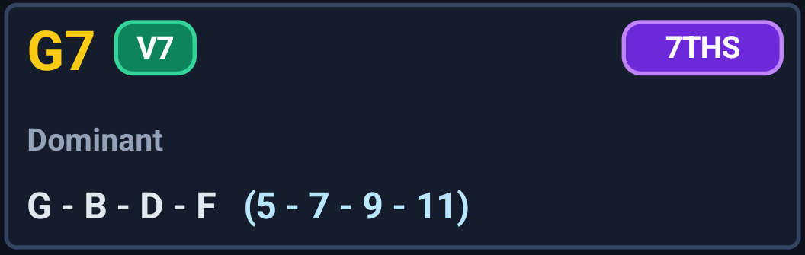 |
| **`C - E - G   (1 - 3 - 5)`** | **`F - A - C   (4 - 6 - 8)`** | **`G - B - D - F   (5 - 7 - 9 - 11)`** |

- **Chord Symbol & Roman Numeral Pill**: Shows the chord name (`C`, `F`, `G7`) alongside its Roman numeral badge (`I`, `IV`, `V7`), color-coded to match the wheel's Gold/Blue/Green harmonic families.
- **`TRIADS` / `7THS` Toggle Pill (Top-Right of Card)**: Switches the entire app between 3-note triads (`C, Dm, Em, F, G, Am, Bdim`) and 4-note diatonic 7th chords (`Cmaj7, Dm7, Em7, Fmaj7, G7, Am7, Bm7b5`).
- **Scale-Degree Numbering**:
  - In **Key of C**, `C Major` is built on the 1st degree (`1 - 3 - 5`).
  - In **Key of C**, `F Major` is built on the 4th degree (`4 - 6 - 8`, where `8` is the octave `C` root).
  - In **Key of C**, `G7` is built on the 5th degree (`5 - 7 - 9 - 11`, where `11` is the 4th scale degree `F` that pulls down to `E` (`3`)).
  - Non-diatonic chords reveal their exact chromatic alterations relative to the active key — for example, `D Major` (`V/V`) in the Key of C displays `D - F# - A (2 - #4 - 6)`, and borrowed `Fm` (`iv`) displays `F - Ab - C (4 - b6 - 8)`.

---

### D. Interactive 6-String Guitar Fretboard & Speaker Button

| Open / CAGED Position (`baseFret = 1`) | Movable Barre Position (`7fr` Indicator) |
| :---: | :---: |
| 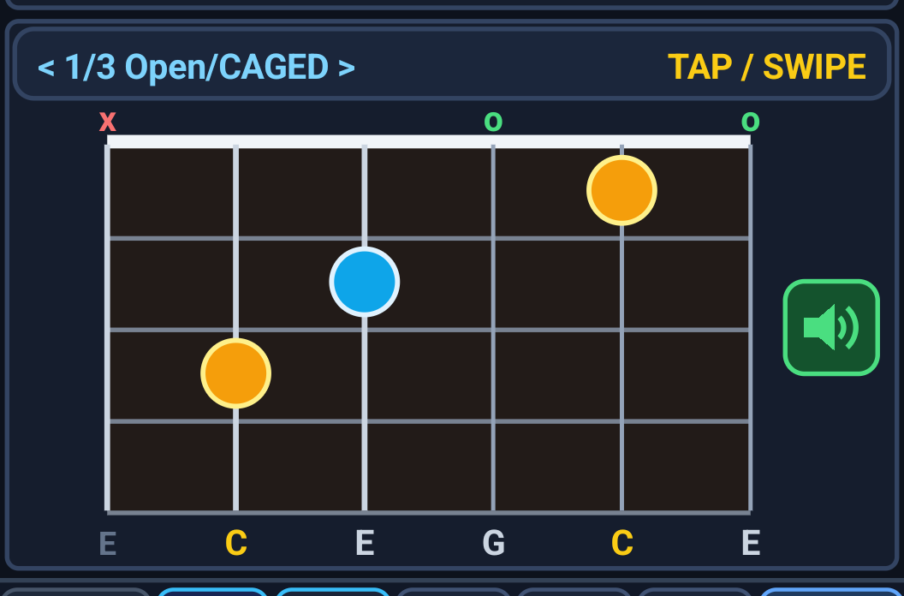 | 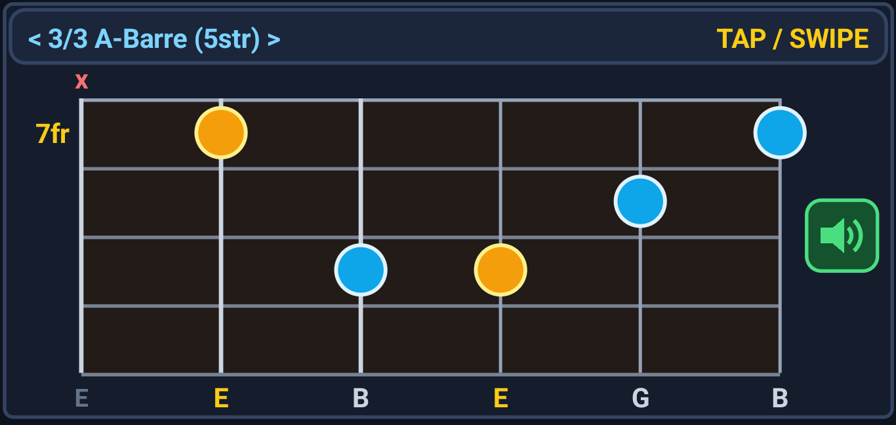 |

- **Voicing Selector Bar (`< 1/3 Open/CAGED >   TAP / SWIPE`)**: Tap the header bar or **swipe left/right** across the fretboard card to cycle between three playable guitar voicings for every chord:
  1. `1/3 Open/CAGED`: Open-position or compact CAGED voicings (draws the white ivory nut bar at the top).
  2. `2/3 E-Barre (6str)`: Movable 6th-string root barre shape (displays the gold base-fret label such as `3fr`, `5fr`, or `7fr` to the left of the top fret).
  3. `3/3 A-Barre (5str)`: Movable 5th-string root barre shape.
- **Root vs. Chord-Tone Dots**:
  - **Gold Dots**: Mark the **root note** of the chord (e.g., `C` on the 5th and 2nd strings in C Major; `E` on the 5th and 3rd strings in E Minor).
  - **Sky-Blue Dots**: Mark the remaining chord tones (`3rd`, `5th`, `7th`).
  - **Above-Nut String Markers**: Green `o` marks open strings; red `x` marks muted strings.
  - **Bottom Note Labels**: Displays the exact note pitch sounded on each string (`E C E G C E`), with root notes highlighted in gold.
- **Three Ways to Strum**:
  1. **Drag Across Strings**: Drag your finger horizontally across the 6 strings to pluck each string individually in real time (strings glow gold as they vibrate).
  2. **Tap Fretboard**: Tap anywhere on the string grid to hear the full chord strummed.
  3. **Green Speaker Button**: Tap the green speaker icon on the right side of the fretboard for an instant 22 ms pick-staggered downstroke.

---

### E. 4-Bar Progression Looper, Presets & Landscape Mode

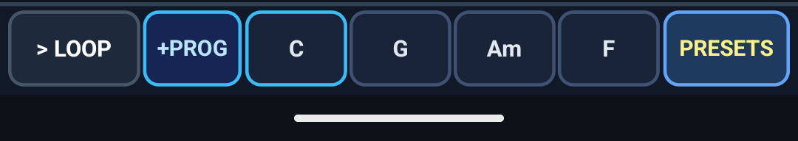

- **`> LOOP` / `|| PAUSE`**: Starts or stops the automatic 4-bar chord progression player (`1.4 seconds` per bar). While playing, the button turns emerald green (`|| PAUSE`) and the active chord slot highlights in amber/gold (`D` in the second screenshot above).
- **`+PROG`**: Copies the currently selected chord into the next target slot (outlined in bright sky-blue, such as slot 1 `C` in the top screenshot) and advances the write pointer to the next bar.
- **4 Chord Slots**: Tap any of the 4 slots to jump directly to that chord and set it as the next write target for `+PROG`.
- **`PRESETS`**: Opens the **Progression Presets & Guide** modal with 5 foundational progressions:

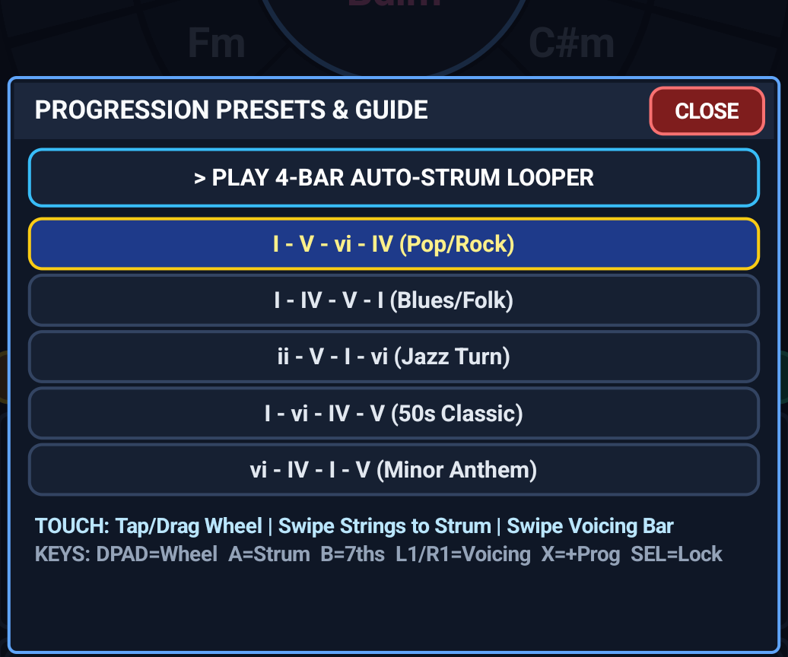

- **Two-Pane Landscape Layout**: Rotating your phone or tablet to Landscape places the full-height Circle of Fifths wheel on the left and stacks the Chord Card, Fretboard Card, and 4-Bar Loop Bar on the right:

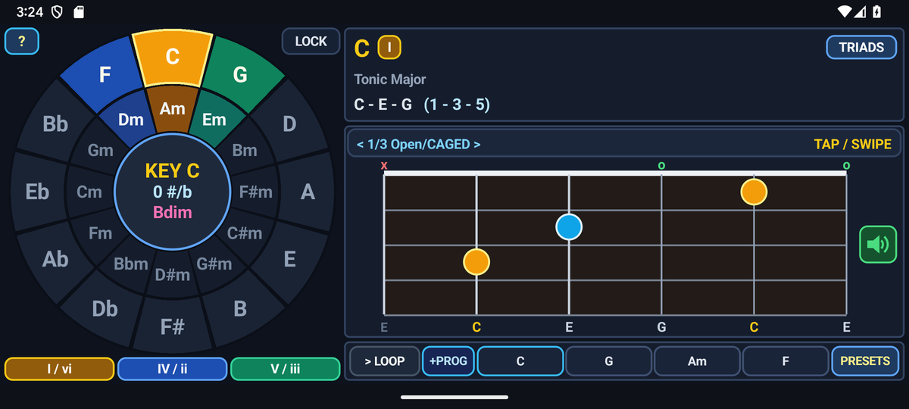

---

## 2. Six Musicianship Workouts Using the App

### Workout 1: Master "Nashville Number" & Scale-Degree Thinking
Many musicians memorize chord shapes in isolation (`1 - 3 - 5` relative to the chord itself) without hearing how each note sits inside the **parent key**.
1. Select **C Major** (`KEY C`) and tap **`LOCK`** in the top-right corner so it turns orange.
2. Tap through the 7 diatonic chords in order (`C` → `Dm` → `Em` → `F` → `G` → `Am` → `Bdim`) and read the blue scale-degree numbers in parentheses:
   - `I (C)`: `1 - 3 - 5`
   - `ii (Dm)`: `2 - 4 - 6`
   - `iii (Em)`: `3 - 5 - 7`
   - `IV (F)`: `4 - 6 - 8`
   - `V (G)`: `5 - 7 - 9`
   - `vi (Am)`: `6 - 8 - 10`
   - `vii° (Bdim)`: `7 - 9 - 11`
3. Notice how **common tones** link chords together: `C (1 - 3 - 5)` and `Am (6 - 8 - 10)` share `C (1/8)` and `E (3/10)` — two out of three notes are identical! That is why `vi` substitutes so smoothly for `I`.
4. Now unlock `LOCK`, tap **G Major** or **Eb Major**, and lock again. Sing the `1 - 3 - 5` and `4 - 6 - 8` arpeggios while plucking individual strings on the fretboard.

### Workout 2: CAGED Fretboard Connecting Drill (Play One Progression in One Neck Zone)
Beginning guitarists often jump 7 frets up and down the neck when changing barre chords. Pros stay within a 3–4 fret window by mixing **Open**, **E-Barre**, and **A-Barre** shapes.
1. Tap **`PRESETS`** and select **`I - V - vi - IV (Pop/Rock)`** in **Key of G** (`G – D – Em – C`).
2. Tap slot 1 (`G`) and swipe the voicing bar to **`2/3 E-Barre (6str)`** (3rd fret).
3. Tap slot 2 (`D`) and swipe to **`3/3 A-Barre (5str)`** (5th fret).
4. Tap slot 3 (`Em`) and compare **`1/3 Open/CAGED`** with **`3/3 A-Barre (5str)`** (`7fr`, shown in the barre fretboard screenshot above).
5. Tap slot 4 (`C`) and select **`3/3 A-Barre (5str)`** (3rd fret).
6. Now you can play the entire `G – D – Em – C` progression between frets 3 and 7 without looking at your hands.

### Workout 3: Hearing Diatonic Triads vs. Jazz 7th Color
1. Load **`ii - V - I - vi (Jazz Turn)`** from **`PRESETS`** in **Key of C** (`Dm – G – C – Am`).
2. Tap **`> LOOP`** and listen to two full cycles in **`TRIADS`** mode.
3. While the loop is playing, tap **`TRIADS`** to switch to **`7THS`** (`Dm7 – G7 – Cmaj7 – Am7`).
4. Listen to the 4th note added to each chord (`1 - 3 - 5 - 7` on `Cmaj7`, `5 - 7 - 9 - 11` on `G7`):
   - Notice how the `7` (`B`) and `11` (`F`, the 4th scale degree of C) inside `G7` create a tritone that pulls strongly into `E (3)` and `C (1/8)` of `Cmaj7`.
5. Drag your finger slowly across the D, G, B, and high-e strings on the fretboard to hear the upper-structure voice leading between `Dm7`, `G7`, and `Cmaj7`.

### Workout 4: Songwriting with Secondary Dominants & Borrowed Chords
Want to break out of predictable 4-chord loops? Use **`LOCK`** mode to audition chords outside the highlighted 3-sector wedge:
1. Set the wheel to **Key of C** and enable **`LOCK`**.
2. **Secondary Dominants (Clockwise from `V`)**:
   - Tap **`D`** (2 o'clock on the outer ring). The card shows `V/V — Sec Dom (II)` with degrees `2 - #4 - 6`. That `#4` (`F#`) acts as a temporary leading tone pulling directly into `G (V)`.
   - Tap **`A`** (3 o'clock): `V/ii — Sec Dom (VI)` (`6 - #8 - 10`, where `#8` is `C#` pulling to `Dm`).
   - Tap **`E`** (4 o'clock): `V/vi — Sec Dom (III)` (`3 - #5 - 7`, where `#5` is `G#` pulling to `Am`).
3. **Modal Interchange / Borrowed Chords (Counter-Clockwise from `IV`)**:
   - Tap **`Fm`** (8 o'clock on the inner ring): `iv — Borrowed iv` (`4 - b6 - 8`). Using `F` (`4 - 6 - 8`) followed by `Fm` (`4 - b6 - 8`) before resolving to `C` (`1 - 3 - 5`) creates the classic chromatic line `A → Ab → G` (`6 → b6 → 5`).
   - Tap **`Bb`** (10 o'clock outer ring) and **`Ab`** (8 o'clock outer ring) to hear the rock/cinematic `bVI – bVII – I` (`Ab – Bb – C`) cadence.
4. Use **`+PROG`** while `LOCK` is enabled to build a 4-bar loop mixing diatonic and borrowed chords (for example: `C – E7 – F – Fm`), then hit **`> LOOP`** to solo over it!

### Workout 5: Instant Transposition for Vocalists & Jam Sessions
If a song's chord progression works great in C Major (`C – G – Am – F`) but sits too low or too high for a singer:
1. Build your 4-bar progression in the original key using **`+PROG`** (or choose a preset).
2. Make sure **`LOCK`** is **off** (unhighlighted).
3. Tap **`> LOOP`** to start playback, then tap different Major sectors around the outer ring (`D`, `Eb`, `E`, `F`, `G`, `A`).
4. Every time you tap a new sector, the entire 4-bar progression transposes automatically while keeping its exact Roman-numeral relationships intact. Once you find the key that fits the vocalist's range, read the new chords directly from the 4 loop slots and check their capo-free barre voicings on the fretboard.

### Workout 6: Blind Ear-Training Game with a Practice Partner
1. Have a partner hold the phone, lock the key to **C Major** (`LOCK` on), and tap any of the 7 diatonic chords (`I, ii, iii, IV, V, vi, vii°`).
2. Listen to the Karplus-Strong guitar strum and identify:
   - First: Is it **Major**, **Minor**, or **Diminished**?
   - Second: Which harmonic family does it belong to — **Tonic** (`I/vi`), **Subdominant** (`IV/ii`), or **Dominant** (`V/iii/vii°`)?
   - Third: Name the exact Roman numeral and scale-degree numbers (e.g., `IV: 4 - 6 - 8`).
