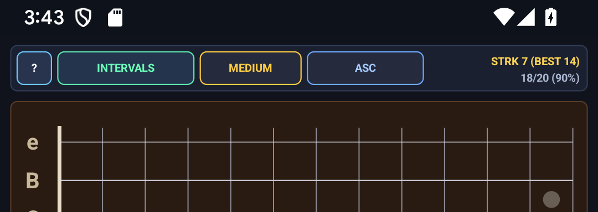
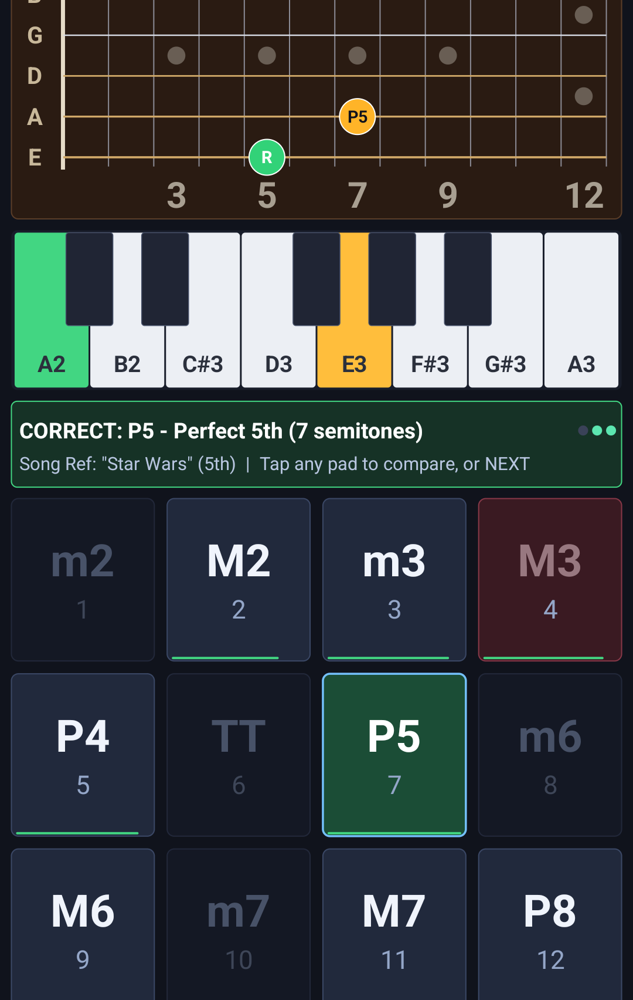
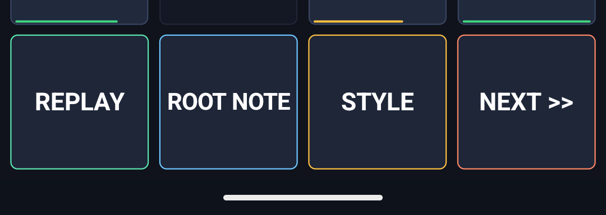
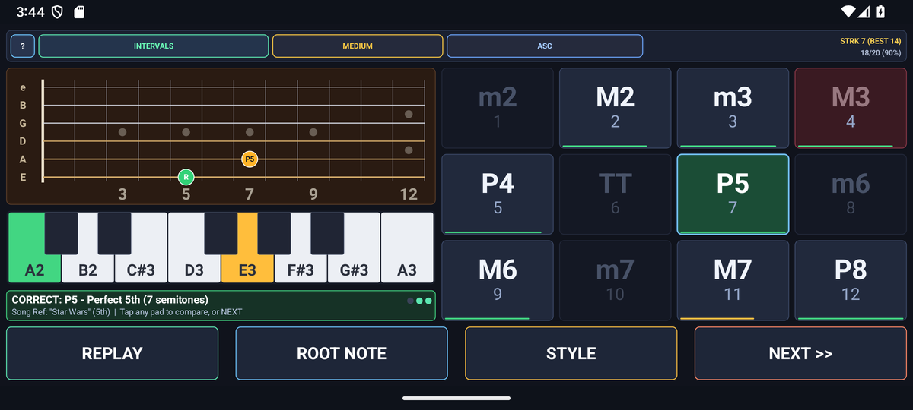

# EarTrainer — Functional Aural Skills & Fretboard Visualizer — Developer & Customization Guide

This guide explains the architecture of **`com.eggwall.eartrainer`** and how engineers can extend its music theory/model tables, real-time DSP audio synthesis, custom Canvas UI, and JUnit 4 test suite.

---

## 1. Four-Class Modular Architecture

The application follows a strict separation of concerns under [`src/com/eggwall/eartrainer/`](src/com/eggwall/eartrainer/) with zero third-party runtime libraries:

| File | Responsibility | Threading & Dependencies |
| :--- | :--- | :--- |
| [`EarTheory.java`](src/com/eggwall/eartrainer/EarTheory.java) | Pure, stateless music-theory / state model, data tables, and deterministic algorithms. | **Zero Android UI dependencies** — 100% testable on host JVM via JUnit 4. |
| [`EarSynthEngine.java`](src/com/eggwall/eartrainer/EarSynthEngine.java) | Real-time `44.1 kHz` 16-bit mono PCM synthesizer (`AudioTrack.MODE_STREAM`) with pre-allocated voice buffers. | Dedicated high-priority daemon audio thread; **zero heap allocations** inside the audio loop. |
| [`EarTrainerView.java`](src/com/eggwall/eartrainer/EarTrainerView.java) | Custom `android.view.View` handling DPI-independent vector rendering, Portrait/Landscape split geometry, touch hit-testing, and the `?` Help Modal. | Android UI thread (`onDraw`, `onTouchEvent`, `onKeyDown`). |
| [`EarTrainerActivity.java`](src/com/eggwall/eartrainer/EarTrainerActivity.java) | Lifecycle host (`Activity`) managing visible top status-bar insets (`wrapWithStatusBarInsets`), standard screen timeout (no `FLAG_KEEP_SCREEN_ON`), audio engine start/stop (`onResume`/`onPause`), `SharedPreferences` persistence, and intent extras. | Android Main thread. |
| [`EarTheoryTest.java`](test/com/eggwall/eartrainer/EarTheoryTest.java) | Host-JVM JUnit 4 unit test suite verifying invariants across [`EarTheory.java`](src/com/eggwall/eartrainer/EarTheory.java). | Runs in ~1 second via `./gradlew testDebugUnitTest`. |

---

## 2. Screen Regions & Rendering Map in [`EarTrainerView.java`](src/com/eggwall/eartrainer/EarTrainerView.java)

### Top Header Bar


Rendered in [`EarTrainerView.java`](src/com/eggwall/eartrainer/EarTrainerView.java), storing hit rectangles (`RectF`) for the top-left `?` Help pill and mode/key/preset selectors.

### Primary Interactive Canvas


All coordinates are computed dynamically from `getWidth()` and `getHeight()` inside `onDraw(Canvas)` so the layout scales cleanly from compact phones to tablets.

### Transport & Control Dock


### Responsive Landscape Split-Pane


When `getWidth() > getHeight()`, [`EarTrainerView.java`](src/com/eggwall/eartrainer/EarTrainerView.java) automatically switches to a side-by-side two-pane layout.

---

## 3. How Engineers Can Customize & Extend the App

- **Customizing Intervals, Chords, or Mnemonics**: Update [`EarTheory.INTERVALS`](src/com/eggwall/eartrainer/EarTheory.java), [`EarTheory.CHORDS`](src/com/eggwall/eartrainer/EarTheory.java), or [`EarTheory.PROGRESSIONS`](src/com/eggwall/eartrainer/EarTheory.java) and run [`EarTheoryTest.java`](test/com/eggwall/eartrainer/EarTheoryTest.java).
- **Adjusting Quiz Session Rules**: Modify guess counts or hint elimination in [`EarTheory.TrainerSession`](src/com/eggwall/eartrainer/EarTheory.java).
- **Tuning Karplus-Strong Pluck Envelopes**: Edit [`EarSynthEngine.java`](src/com/eggwall/eartrainer/EarSynthEngine.java).

---

## 4. Building, Testing & Verifying

Run the JUnit 4 unit tests and build both Debug and Release APKs using the Gradle wrapper (configured in [`build.gradle`](build.gradle) and [`gradle.properties`](gradle.properties)):

```bash
./gradlew testDebugUnitTest assembleDebug assembleRelease
```

- **Unit Test Report**: `build/reports/tests/testDebugUnitTest/index.html`
- **Debug APK**: `build/outputs/apk/debug/`
- **Release APK**: `build/outputs/apk/release/`
