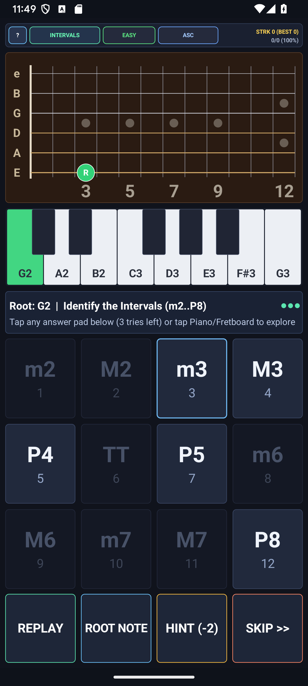
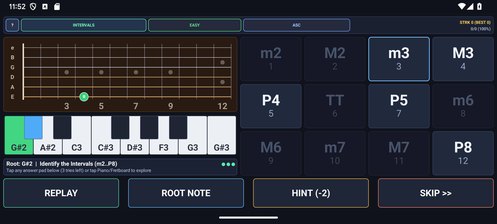
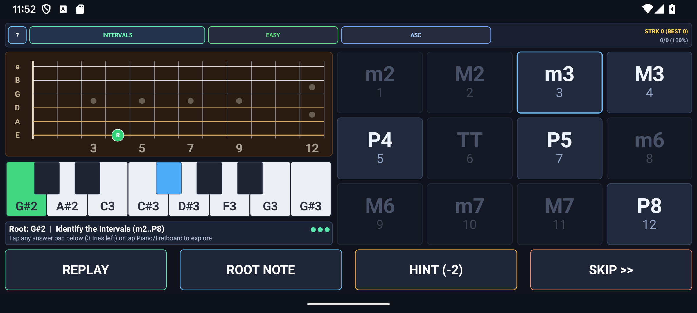
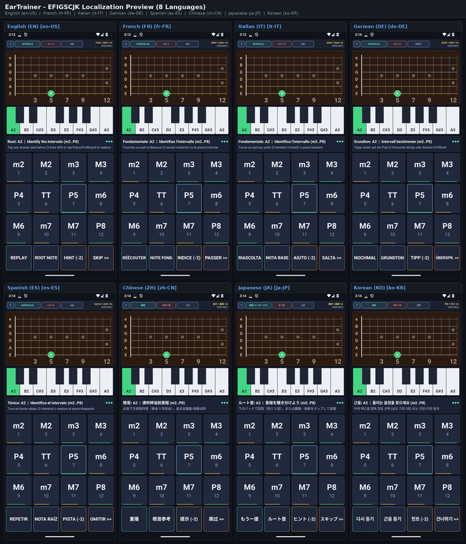

# Google Play Store Listing — EarTrainer — Interval, Chord & Scale Ear Gym (`com.eggwall.eartrainer`)

## Short Description (74 / 80 characters)
> Train your ear on intervals, chords, and scales with an interactive piano.

## Full Description (3231 / 4000 characters)
- **Standalone Description File:** [`PLAY_STORE_DESCRIPTION.md`](PLAY_STORE_DESCRIPTION.md)

Develop razor-sharp relative pitch, harmonic recognition, and musical memory with EarTrainer — Interval, Chord & Scale Ear Gym. Built for guitarists, pianists, vocalists, producers, and music theory students, EarTrainer combines four progressive ear-training disciplines with an interactive 2-octave keyboard, three synthesized instrument timbres, and real-time accuracy telemetry.

Great musicians don't guess which fret or key to play next—they hear the interval, chord quality, and scale degree in their head before their fingers touch the instrument. EarTrainer gives you a structured, distraction-free daily workout to connect what you hear directly to music theory and your instrument.

FOUR COMPREHENSIVE EAR-TRAINING MODULES
1. INTERVAL RECOGNITION
• All 13 Chromatic Intervals: From Minor 2nd (m2) and Major 2nd (M2) through Tritone (TT), Perfect 5th (P5), Minor/Major 6ths and 7ths, up to the Perfect Octave (P8).
• 3 Playback Directions: Practice intervals Ascending (melodic up), Descending (melodic down), or Harmonic (both notes struck simultaneously) to master both melodic soloing and chord voicing analysis.

2. CHORD QUALITY IDENTIFICATION
• 9 Essential Triad & 7th Qualities: Hear the distinct emotional and harmonic color of Major, Minor, Diminished, Augmented, Sus2, Sus4, Dominant 7, Major 7, and Minor 7 chords.
• Arpeggiated + Block Voicing Playback: Listen to the chord both rolled note-by-note and played together so you can isolate internal intervals (3rds, 5ths, and 7ths) within the harmony.

3. SCALES & MODES EAR GYM
• 8 Core Scales & Church Modes: Train your ear to distinguish Major (Ionian), Natural Minor (Aeolian), Harmonic Minor, Melodic Minor, Dorian, Mixolydian, Lydian, and Phrygian by their characteristic color tones.

4. MELODIC DICTATION (PLAY BY EAR)
• Transcribe 3-Note to 5-Note Melodies: Listen to a short melodic phrase anchored to a tonic reference and play it back note-for-note to build real-world transcription and improvisation reflexes.

PROGRESSIVE DIFFICULTY TIERS & INTERACTIVE 2-OCTAVE PIANO
• 3 Structured Skill Levels: Start with Level 1 (Foundational Consonances & Basic Triads), advance to Level 2 (Full Diatonic Palette & 7th Chords), and master Level 3 (All 13 Chromatic Intervals, Modal Scales & Extended Harmonies).
• Playable 2-Octave Keyboard (C4–C6): Freely audition notes, compare intervals, and test melodies on the responsive on-screen piano before or after locking in your answer.
• Visual Answer Breakdown: Whenever you answer a question, EarTrainer highlights the exact root and target keys on the piano keyboard and displays the interval distance in semitones so every mistake turns into an instant learning moment.

THREE REAL-TIME INSTRUMENT TIMBRES
• Train your ear across multiple acoustic textures using our 44.1 kHz polyphonic synthesis engine: switch at any time between Grand Piano (harmonic-rich hammer attack), Acoustic Guitar Pluck (Karplus-Strong string model), and Warm Studio Organ (sustained drawbar tones).

PRIVACY-FIRST, OFFLINE & DISTRACTION-FREE
• Tracks your current streak, best streak, and session accuracy locally on your device.
• Responsive Portrait and Landscape layouts, zero permissions, zero ads, and 100% offline operation.

## Play Store Visual Assets & Policy Links
- **Full Play Store Description (4000-char limit):** [`PLAY_STORE_DESCRIPTION.md`](PLAY_STORE_DESCRIPTION.md)
- **App Icon (512×512 PNG):** [`playstore-icon-512.png`](playstore-icon-512.png)
- **Feature Graphic (1024×500 PNG, Miyazaki Style):** [`feature-graphic-1024x500.png`](feature-graphic-1024x500.png)
- **Privacy Policy:** [`PRIVACY_POLICY.md`](PRIVACY_POLICY.md)

### Feature Graphic Preview

### Phone Screenshots (Portrait & Landscape)
| Portrait 1 | Portrait 2 |
| :---: | :---: |
|  |  |

| Landscape 1 | Landscape 2 |
| :---: | :---: |
|  |  |
<!-- I18N_EFIGSCJK_START -->

---

## Google Play Console "Import translations with AI" (All 20 World Languages)

Google Play Console's **Import translations with AI** dialog (*Grow users → Store presence → Store listings → Edit store listing → Manage translations → Import translations with AI*) accepts `.csv`, `.md`, or `.txt` files (UTF-8, up to 3 MB) and automatically extracts `languageCode`, `appName` (`≤ 30` chars), `shortDescription` (`≤ 80` chars), and `fullDescription` (`≤ 4000` chars) for every language in the file:

- **CSV Import File (Recommended):** **[`PLAY_STORE_AI_IMPORT.csv`](PLAY_STORE_AI_IMPORT.csv)**
- **Markdown Import File:** **[`PLAY_STORE_AI_IMPORT.md`](PLAY_STORE_AI_IMPORT.md)**
- **Structured JSON-in-TXT Import File:** **[`PLAY_STORE_AI_IMPORT.txt`](PLAY_STORE_AI_IMPORT.txt)**
- **EFIGSCJK Copy-Paste Reference:** **[`PLAY_STORE_I18N_EFIGSCJK.md`](PLAY_STORE_I18N_EFIGSCJK.md)**
- **Fastlane / Per-Locale Metadata Directory (All 20 Languages):** **[`playstore/metadata/android/`](playstore/metadata/android/)**

| BCP-47 Locale | Language | Title (`<= 30` chars) | Short Description (`<= 80` chars) | Full Description (`<= 4000` chars) | EFIGSCJK Screenshot (`1080×2400`) |
| :--- | :--- | :--- | :--- | :--- | :--- |
| **`en-US`** | English (United States) | [`title.txt`](playstore/metadata/android/en-US/title.txt) | [`short_description.txt`](playstore/metadata/android/en-US/short_description.txt) | [`full_description.txt`](playstore/metadata/android/en-US/full_description.txt) | [`en.png`](docs/images/i18n/en.png) |
| **`fr-FR`** | French (France) — Français | [`title.txt`](playstore/metadata/android/fr-FR/title.txt) | [`short_description.txt`](playstore/metadata/android/fr-FR/short_description.txt) | [`full_description.txt`](playstore/metadata/android/fr-FR/full_description.txt) | [`fr.png`](docs/images/i18n/fr.png) |
| **`it-IT`** | Italian (Italy) — Italiano | [`title.txt`](playstore/metadata/android/it-IT/title.txt) | [`short_description.txt`](playstore/metadata/android/it-IT/short_description.txt) | [`full_description.txt`](playstore/metadata/android/it-IT/full_description.txt) | [`it.png`](docs/images/i18n/it.png) |
| **`de-DE`** | German (Germany) — Deutsch | [`title.txt`](playstore/metadata/android/de-DE/title.txt) | [`short_description.txt`](playstore/metadata/android/de-DE/short_description.txt) | [`full_description.txt`](playstore/metadata/android/de-DE/full_description.txt) | [`de.png`](docs/images/i18n/de.png) |
| **`es-ES`** | Spanish (Spain) — Español | [`title.txt`](playstore/metadata/android/es-ES/title.txt) | [`short_description.txt`](playstore/metadata/android/es-ES/short_description.txt) | [`full_description.txt`](playstore/metadata/android/es-ES/full_description.txt) | [`es.png`](docs/images/i18n/es.png) |
| **`zh-CN`** | Chinese (Simplified) — 中文（简体） | [`title.txt`](playstore/metadata/android/zh-CN/title.txt) | [`short_description.txt`](playstore/metadata/android/zh-CN/short_description.txt) | [`full_description.txt`](playstore/metadata/android/zh-CN/full_description.txt) | [`zh.png`](docs/images/i18n/zh.png) |
| **`ja-JP`** | Japanese (Japan) — 日本語 | [`title.txt`](playstore/metadata/android/ja-JP/title.txt) | [`short_description.txt`](playstore/metadata/android/ja-JP/short_description.txt) | [`full_description.txt`](playstore/metadata/android/ja-JP/full_description.txt) | [`ja.png`](docs/images/i18n/ja.png) |
| **`ko-KR`** | Korean (South Korea) — 한국어 | [`title.txt`](playstore/metadata/android/ko-KR/title.txt) | [`short_description.txt`](playstore/metadata/android/ko-KR/short_description.txt) | [`full_description.txt`](playstore/metadata/android/ko-KR/full_description.txt) | [`ko.png`](docs/images/i18n/ko.png) |
| **`pt-BR`** | Portuguese (Brazil) — Português | [`title.txt`](playstore/metadata/android/pt-BR/title.txt) | [`short_description.txt`](playstore/metadata/android/pt-BR/short_description.txt) | [`full_description.txt`](playstore/metadata/android/pt-BR/full_description.txt) | — |
| **`ru-RU`** | Russian (Russia) — Русский | [`title.txt`](playstore/metadata/android/ru-RU/title.txt) | [`short_description.txt`](playstore/metadata/android/ru-RU/short_description.txt) | [`full_description.txt`](playstore/metadata/android/ru-RU/full_description.txt) | — |
| **`ar`** | Arabic — العربية | [`title.txt`](playstore/metadata/android/ar/title.txt) | [`short_description.txt`](playstore/metadata/android/ar/short_description.txt) | [`full_description.txt`](playstore/metadata/android/ar/full_description.txt) | — |
| **`hi-IN`** | Hindi (India) — हिन्दी | [`title.txt`](playstore/metadata/android/hi-IN/title.txt) | [`short_description.txt`](playstore/metadata/android/hi-IN/short_description.txt) | [`full_description.txt`](playstore/metadata/android/hi-IN/full_description.txt) | — |
| **`bn-BD`** | Bengali (Bangladesh) — বাংলা | [`title.txt`](playstore/metadata/android/bn-BD/title.txt) | [`short_description.txt`](playstore/metadata/android/bn-BD/short_description.txt) | [`full_description.txt`](playstore/metadata/android/bn-BD/full_description.txt) | — |
| **`id`** | Indonesian — Bahasa Indonesia | [`title.txt`](playstore/metadata/android/id/title.txt) | [`short_description.txt`](playstore/metadata/android/id/short_description.txt) | [`full_description.txt`](playstore/metadata/android/id/full_description.txt) | — |
| **`tr-TR`** | Turkish (Turkey) — Türkçe | [`title.txt`](playstore/metadata/android/tr-TR/title.txt) | [`short_description.txt`](playstore/metadata/android/tr-TR/short_description.txt) | [`full_description.txt`](playstore/metadata/android/tr-TR/full_description.txt) | — |
| **`vi`** | Vietnamese — Tiếng Việt | [`title.txt`](playstore/metadata/android/vi/title.txt) | [`short_description.txt`](playstore/metadata/android/vi/short_description.txt) | [`full_description.txt`](playstore/metadata/android/vi/full_description.txt) | — |
| **`pl-PL`** | Polish (Poland) — Polski | [`title.txt`](playstore/metadata/android/pl-PL/title.txt) | [`short_description.txt`](playstore/metadata/android/pl-PL/short_description.txt) | [`full_description.txt`](playstore/metadata/android/pl-PL/full_description.txt) | — |
| **`nl-NL`** | Dutch (Netherlands) — Nederlands | [`title.txt`](playstore/metadata/android/nl-NL/title.txt) | [`short_description.txt`](playstore/metadata/android/nl-NL/short_description.txt) | [`full_description.txt`](playstore/metadata/android/nl-NL/full_description.txt) | — |
| **`th`** | Thai — ไทย | [`title.txt`](playstore/metadata/android/th/title.txt) | [`short_description.txt`](playstore/metadata/android/th/short_description.txt) | [`full_description.txt`](playstore/metadata/android/th/full_description.txt) | — |
| **`uk`** | Ukrainian — Українська | [`title.txt`](playstore/metadata/android/uk/title.txt) | [`short_description.txt`](playstore/metadata/android/uk/short_description.txt) | [`full_description.txt`](playstore/metadata/android/uk/full_description.txt) | — |

### EFIGSCJK Localization Grid (Click Thumbnail for Full-Resolution `2260×2640` Image)

<!-- I18N_EFIGSCJK_END -->
