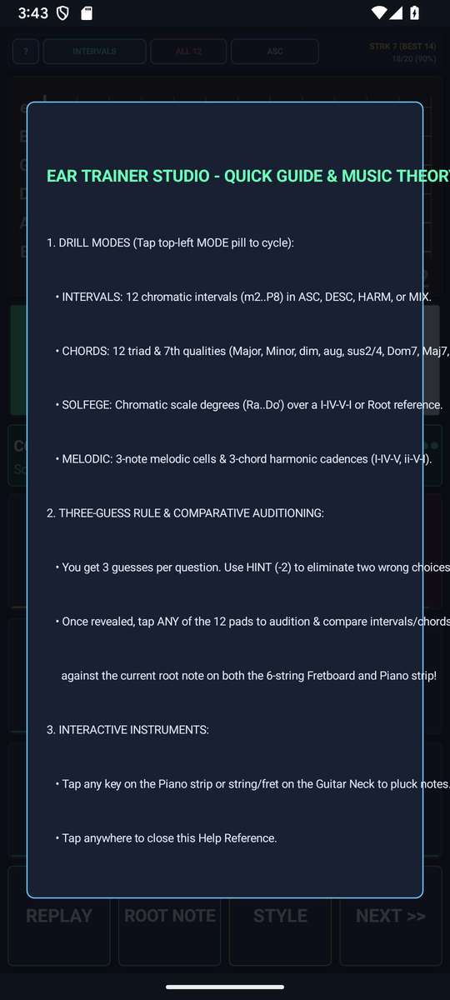

# EarTrainer — Functional Aural Skills & Fretboard Visualizer — User & Musician's Guide

4-mode functional ear trainer (Intervals, Chords, Scale Degrees/Solfege, and Melodic Progressions) with interactive 12-fret guitar neck visualization, 3 difficulty tiers, song mnemonics, and 8-voice Karplus-Strong guitar synthesis.

---

## 1. Visual Overview

### Portrait Workspace

### Top Header & Quick-Access Controls (`?` Help Modal)

- **`?` Help Pill (Top-Left)**: Tap `?` at any time to open the built-in two-tab Interactive Reference & Practice Guide modal (`HOW TO USE` and `PRACTICE TIPS`).
- **Mode / Preset / Key Selectors**: Tap any header pill to cycle modes, keys, presets, or audio synthesis options with immediate visual and audio feedback.

### Interactive Core Canvas & Visualizer

### Bottom Transport & Action Dock

### Two-Pane Landscape Layout
Rotate your device to landscape for a studio-grade **Two-Pane Split Workspace** that maximizes the primary interactive canvas on the left while keeping transport, inspector, and controls accessible on the right:

### Built-In `?` Help Modal

---

## 2. Key Features

- **4 Complete Ear-Training Modes**: **Intervals** (`m2`..`P8` with famous song mnemonics), **Chords** (12 triad & 7th qualities with movable guitar shapes), **Scale Degrees** (`Do`..`Ti` preceded by a `I-IV-V-I` cadence in Key Lock mode), and **Progressions** (12 melodic & harmonic patterns) in [`EarTheory.java`](src/com/eggwall/eartrainer/EarTheory.java).
- **3 Progressive Difficulty Tiers**: **Tier 1: Easy (5)**, **Tier 2: Medium (8)**, and **Tier 3: All 12 (Chromatic)**—inactive cards are cleanly dimmed so beginners can focus on core intervals first.
- **3-Guess Rule & Smart Hint System**: Gives 3 tries per question with red `[X]` elimination badges, a **HINT (-2)** button that eliminates two wrong answers, and automatic fretboard + mnemonic reveal in [`EarTrainerView.java`](src/com/eggwall/eartrainer/EarTrainerView.java).
- **Interactive 12-Fret Guitar Neck & 8-Voice Synth**: Tap any string/fret on the guitar neck to audition notes directly through [`EarSynthEngine.java`](src/com/eggwall/eartrainer/EarSynthEngine.java).

---

## 3. How to Improve Your Musicianship & Practice Routine

1. **Anchor Intervals with Song Mnemonics**: Start in **INTERVALS** on **EASY (5)** (`m3`, `M3`, `P4`, `P5`, `P8`). Sing the second note out loud before tapping your answer card.
2. **Sing Solfege in Key-Locked Scale Degrees**: Switch to **DEGREES** (`1-7`), listen to the `I - IV - V - I` establishing cadence, and feel each note's resolution tendency (`Fa -> Mi`, `Ti -> Do`).
3. **Compare Ascending, Descending, and Harmonic Playback**: Cycle the playback style pill (`ASC` / `DESC` / `HARM`) to recognize intervals both melodically and stacked inside chords.
4. **Connect Ear to Fretboard**: After solving a question (or tapping the neck directly), play the revealed root + target fret shape on your physical guitar.

---

## 4. Zero-Distraction, 100% Offline Design

- **Zero Permissions & Zero Latency**: All audio is synthesized mathematically in real time at `44.1 kHz` on your device. No internet connection, account, or microphone access is ever required.
- **Automatic State Persistence**: Your active mode, key, tempo, and settings are automatically saved across app launches.
