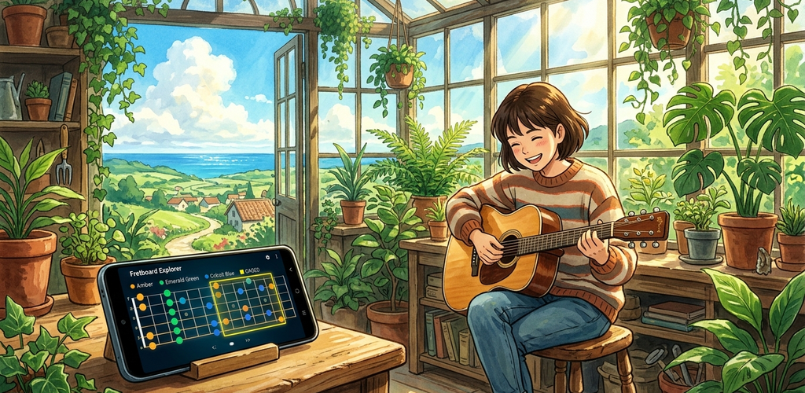
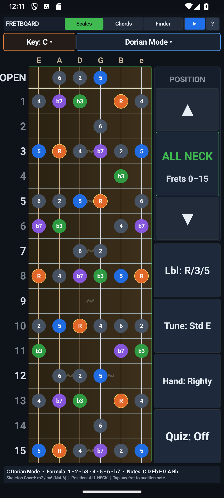
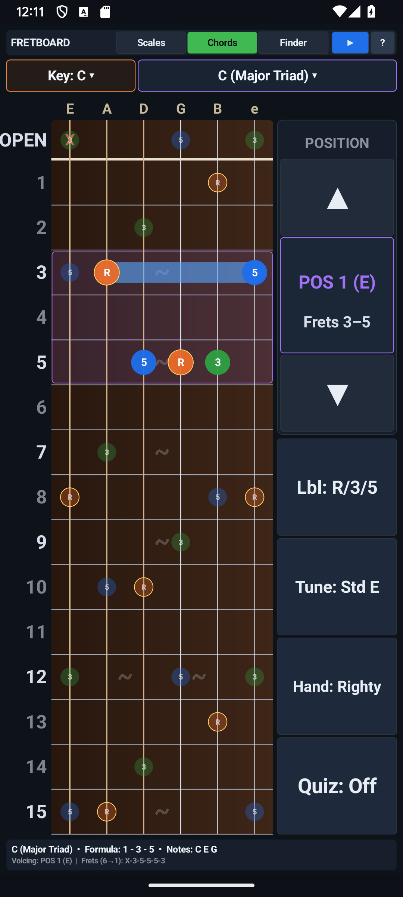
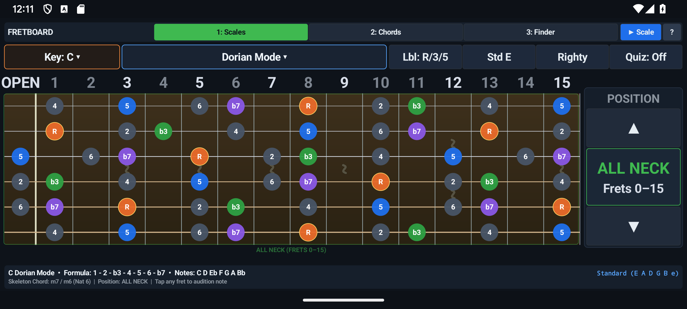
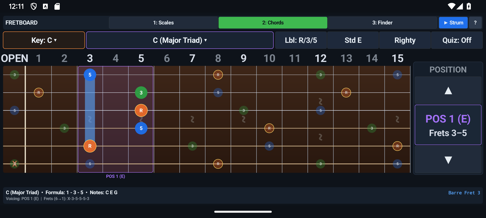
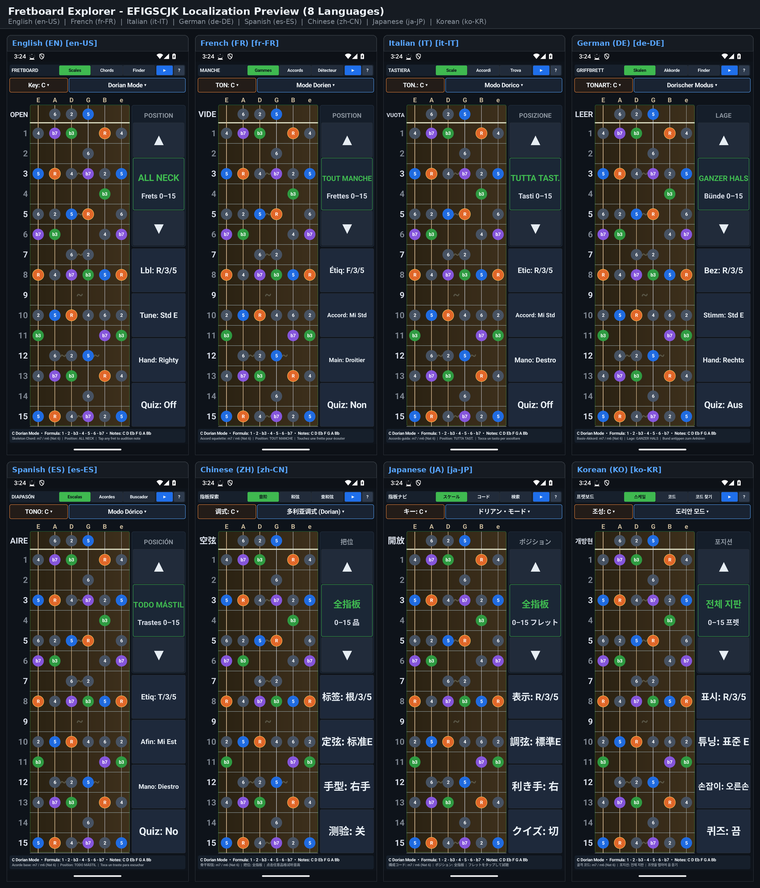

# Google Play Store Listing — Fretboard Explorer — Guitar Scales & Chords (`com.eggwall.fretboard`)

## Short Description (78 / 80 characters)
> Master guitar scales, CAGED boxes, chord voicings, and fretboard note quizzes.

## Full Description (3376 / 4000 characters)
- **Standalone Description File:** [`PLAY_STORE_DESCRIPTION.md`](PLAY_STORE_DESCRIPTION.md)

Unlock the entire 6-string guitar neck with Fretboard Explorer — Guitar Scales & Chords. Designed for beginner, intermediate, and advanced guitarists, Fretboard Explorer maps scales, modes, CAGED positions, movable chord shapes, alternate tunings, and reverse chord identification onto an interactive 15-fret fingerboard with real-time Karplus-Strong guitar audio synthesis.

Stop getting trapped in a single pentatonic box at the 5th fret. Fretboard Explorer shows you how scales, modes, arpeggios, and chord voicings connect across all 15 frets and all 6 strings—in both Portrait and Landscape orientations.

THREE INTEGRATED GUITAR WORKSTATIONS
1. SCALES & MODES EXPLORER
• 14 Essential Scales & Modes: Major (Ionian), Natural Minor (Aeolian), Dorian, Phrygian, Lydian, Mixolydian, Locrian, Minor Pentatonic, Major Pentatonic, Blues Scale, Harmonic Minor, Melodic Minor, Phrygian Dominant, and Whole Tone.
• All 12 Keys via Fast Dropdown Selectors: Switch keys (C, Db, D, Eb, E, F, F#, G, Ab, A, Bb, B) and modes instantaneously using large, stage-friendly dropdown menus.
• 5 CAGED Position Boxes + Full Neck View: Step up and down the neck through CAGED Positions 1 to 5 or view the entire fretboard at once using dedicated side-rail navigation arrows. Non-box scale tones are subtly dimmed so your active position stands out with crystal clarity while preserving full neck context.

2. MOVABLE CHORD LIBRARY
• 12 Core & Extended Chord Qualities: Major, Minor, Dominant 7, Major 7, Minor 7, Minor 7b5 (Half-Diminished), Diminished 7, Sus2, Sus4, Add9, Major 6, and Minor 6.
• 5 CAGED Voicings Per Chord: Cycle through five distinct playable shapes up the fretboard for every chord, complete with finger numbers (1, 2, 3, 4), barre indicators, open/muted string symbols, and root-note highlights.
• Strummable Audio Preview: Tap the chord diagram or individual strings to audition the exact voicing with realistic plucked-string synthesis.

3. INTERACTIVE CHORD FINDER (REVERSE CHORD LOOKUP)
• Identify Any Guitar Voicing on the Spot: Tap any combination of frets across the 6 strings to place your fingers on the virtual neck.
• Instant Harmonic Analysis: Fretboard Explorer analyzes the pitch classes and bass note in real time, displaying the exact chord name (including slash chords and inversions), interval formula, and constituent notes while strumming your custom shape.

CUSTOMIZABLE TUNINGS & FRETBOARD DISPLAY
• 6 Built-In Guitar Tunings: Standard (E A D G B E), Drop D (D A D G B E), Half-Step Down (Eb Ab Db Gb Bb Eb), Full-Step Down (D G C F A D), Open G (D G D G B D), and DADGAD Celtic/ Folk tuning—every scale pattern and chord diagram recalculates automatically when you change tunings.
• Flexible Note & Interval Labels: Toggle fretboard markers between Note Names (C, D#, F), Scale Degrees / Intervals (R, b3, 4, 5, b7), or Finger Numbers.
• Traditional ~ Fret Inlay Markers: Subtle, orientation-aware fret inlays at frets 3, 5, 7, 9, and double inlays at fret 12 give you instant visual landmarks without competing with fingering dots.

BUILT FOR DAILY PRACTICE — ZERO ADS, ZERO PERMISSIONS
• Portrait & Landscape Layouts: Vertical fretboard with ergonomic thumb controls in Portrait mode; expansive horizontal 15-fret neck in Landscape mode.
• 100% Offline & Private: No internet connection required, no tracking, no ads, and zero device permissions.

## Play Store Visual Assets & Policy Links
- **Full Play Store Description (4000-char limit):** [`PLAY_STORE_DESCRIPTION.md`](PLAY_STORE_DESCRIPTION.md)
- **App Icon (512×512 PNG):** [`playstore-icon-512.png`](playstore-icon-512.png)
- **Feature Graphic (1024×500 PNG, Miyazaki Style):** [`feature-graphic-1024x500.png`](feature-graphic-1024x500.png)
- **Privacy Policy:** [`PRIVACY_POLICY.md`](PRIVACY_POLICY.md)

### Feature Graphic Preview

### Phone Screenshots (Portrait & Landscape)
| Portrait 1 | Portrait 2 |
| :---: | :---: |
|  |  |

| Landscape 1 | Landscape 2 |
| :---: | :---: |
|  |  |
<!-- I18N_EFIGSCJK_START -->

---

## Google Play Console "Import translations with AI" (All 20 World Languages)

Google Play Console's **Import translations with AI** dialog (*Grow users → Store presence → Store listings → Edit store listing → Manage translations → Import translations with AI*) accepts `.csv`, `.md`, or `.txt` files (UTF-8, up to 3 MB) and automatically extracts `languageCode`, `appName` (`≤ 30` chars), `shortDescription` (`≤ 80` chars), and `fullDescription` (`≤ 4000` chars) for every language in the file:

- **CSV Import File (Recommended):** **[`PLAY_STORE_AI_IMPORT.csv`](PLAY_STORE_AI_IMPORT.csv)**
- **Markdown Import File:** **[`PLAY_STORE_AI_IMPORT.md`](PLAY_STORE_AI_IMPORT.md)**
- **Structured JSON-in-TXT Import File:** **[`PLAY_STORE_AI_IMPORT.txt`](PLAY_STORE_AI_IMPORT.txt)**
- **EFIGSCJK Copy-Paste Reference:** **[`PLAY_STORE_I18N_EFIGSCJK.md`](PLAY_STORE_I18N_EFIGSCJK.md)**
- **Fastlane / Per-Locale Metadata Directory (All 20 Languages):** **[`playstore/metadata/android/`](playstore/metadata/android/)**

| BCP-47 Locale | Language | Title (`<= 30` chars) | Short Description (`<= 80` chars) | Full Description (`<= 4000` chars) | EFIGSCJK Screenshot (`1080×2400`) |
| :--- | :--- | :--- | :--- | :--- | :--- |
| **`en-US`** | English (United States) | [`title.txt`](playstore/metadata/android/en-US/title.txt) | [`short_description.txt`](playstore/metadata/android/en-US/short_description.txt) | [`full_description.txt`](playstore/metadata/android/en-US/full_description.txt) | [`en.png`](docs/images/i18n/en.png) |
| **`fr-FR`** | French (France) — Français | [`title.txt`](playstore/metadata/android/fr-FR/title.txt) | [`short_description.txt`](playstore/metadata/android/fr-FR/short_description.txt) | [`full_description.txt`](playstore/metadata/android/fr-FR/full_description.txt) | [`fr.png`](docs/images/i18n/fr.png) |
| **`it-IT`** | Italian (Italy) — Italiano | [`title.txt`](playstore/metadata/android/it-IT/title.txt) | [`short_description.txt`](playstore/metadata/android/it-IT/short_description.txt) | [`full_description.txt`](playstore/metadata/android/it-IT/full_description.txt) | [`it.png`](docs/images/i18n/it.png) |
| **`de-DE`** | German (Germany) — Deutsch | [`title.txt`](playstore/metadata/android/de-DE/title.txt) | [`short_description.txt`](playstore/metadata/android/de-DE/short_description.txt) | [`full_description.txt`](playstore/metadata/android/de-DE/full_description.txt) | [`de.png`](docs/images/i18n/de.png) |
| **`es-ES`** | Spanish (Spain) — Español | [`title.txt`](playstore/metadata/android/es-ES/title.txt) | [`short_description.txt`](playstore/metadata/android/es-ES/short_description.txt) | [`full_description.txt`](playstore/metadata/android/es-ES/full_description.txt) | [`es.png`](docs/images/i18n/es.png) |
| **`zh-CN`** | Chinese (Simplified) — 中文（简体） | [`title.txt`](playstore/metadata/android/zh-CN/title.txt) | [`short_description.txt`](playstore/metadata/android/zh-CN/short_description.txt) | [`full_description.txt`](playstore/metadata/android/zh-CN/full_description.txt) | [`zh.png`](docs/images/i18n/zh.png) |
| **`ja-JP`** | Japanese (Japan) — 日本語 | [`title.txt`](playstore/metadata/android/ja-JP/title.txt) | [`short_description.txt`](playstore/metadata/android/ja-JP/short_description.txt) | [`full_description.txt`](playstore/metadata/android/ja-JP/full_description.txt) | [`ja.png`](docs/images/i18n/ja.png) |
| **`ko-KR`** | Korean (South Korea) — 한국어 | [`title.txt`](playstore/metadata/android/ko-KR/title.txt) | [`short_description.txt`](playstore/metadata/android/ko-KR/short_description.txt) | [`full_description.txt`](playstore/metadata/android/ko-KR/full_description.txt) | [`ko.png`](docs/images/i18n/ko.png) |
| **`pt-BR`** | Portuguese (Brazil) — Português | [`title.txt`](playstore/metadata/android/pt-BR/title.txt) | [`short_description.txt`](playstore/metadata/android/pt-BR/short_description.txt) | [`full_description.txt`](playstore/metadata/android/pt-BR/full_description.txt) | — |
| **`ru-RU`** | Russian (Russia) — Русский | [`title.txt`](playstore/metadata/android/ru-RU/title.txt) | [`short_description.txt`](playstore/metadata/android/ru-RU/short_description.txt) | [`full_description.txt`](playstore/metadata/android/ru-RU/full_description.txt) | — |
| **`ar`** | Arabic — العربية | [`title.txt`](playstore/metadata/android/ar/title.txt) | [`short_description.txt`](playstore/metadata/android/ar/short_description.txt) | [`full_description.txt`](playstore/metadata/android/ar/full_description.txt) | — |
| **`hi-IN`** | Hindi (India) — हिन्दी | [`title.txt`](playstore/metadata/android/hi-IN/title.txt) | [`short_description.txt`](playstore/metadata/android/hi-IN/short_description.txt) | [`full_description.txt`](playstore/metadata/android/hi-IN/full_description.txt) | — |
| **`bn-BD`** | Bengali (Bangladesh) — বাংলা | [`title.txt`](playstore/metadata/android/bn-BD/title.txt) | [`short_description.txt`](playstore/metadata/android/bn-BD/short_description.txt) | [`full_description.txt`](playstore/metadata/android/bn-BD/full_description.txt) | — |
| **`id`** | Indonesian — Bahasa Indonesia | [`title.txt`](playstore/metadata/android/id/title.txt) | [`short_description.txt`](playstore/metadata/android/id/short_description.txt) | [`full_description.txt`](playstore/metadata/android/id/full_description.txt) | — |
| **`tr-TR`** | Turkish (Turkey) — Türkçe | [`title.txt`](playstore/metadata/android/tr-TR/title.txt) | [`short_description.txt`](playstore/metadata/android/tr-TR/short_description.txt) | [`full_description.txt`](playstore/metadata/android/tr-TR/full_description.txt) | — |
| **`vi`** | Vietnamese — Tiếng Việt | [`title.txt`](playstore/metadata/android/vi/title.txt) | [`short_description.txt`](playstore/metadata/android/vi/short_description.txt) | [`full_description.txt`](playstore/metadata/android/vi/full_description.txt) | — |
| **`pl-PL`** | Polish (Poland) — Polski | [`title.txt`](playstore/metadata/android/pl-PL/title.txt) | [`short_description.txt`](playstore/metadata/android/pl-PL/short_description.txt) | [`full_description.txt`](playstore/metadata/android/pl-PL/full_description.txt) | — |
| **`nl-NL`** | Dutch (Netherlands) — Nederlands | [`title.txt`](playstore/metadata/android/nl-NL/title.txt) | [`short_description.txt`](playstore/metadata/android/nl-NL/short_description.txt) | [`full_description.txt`](playstore/metadata/android/nl-NL/full_description.txt) | — |
| **`th`** | Thai — ไทย | [`title.txt`](playstore/metadata/android/th/title.txt) | [`short_description.txt`](playstore/metadata/android/th/short_description.txt) | [`full_description.txt`](playstore/metadata/android/th/full_description.txt) | — |
| **`uk`** | Ukrainian — Українська | [`title.txt`](playstore/metadata/android/uk/title.txt) | [`short_description.txt`](playstore/metadata/android/uk/short_description.txt) | [`full_description.txt`](playstore/metadata/android/uk/full_description.txt) | — |

### EFIGSCJK Localization Grid (Click Thumbnail for Full-Resolution `2260×2640` Image)

<!-- I18N_EFIGSCJK_END -->
