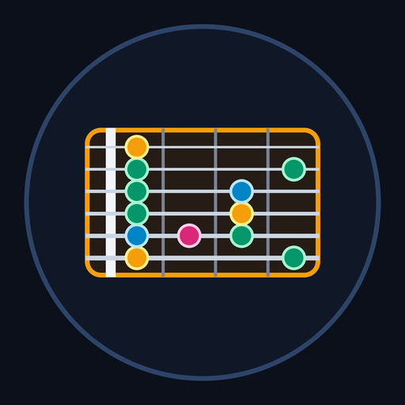
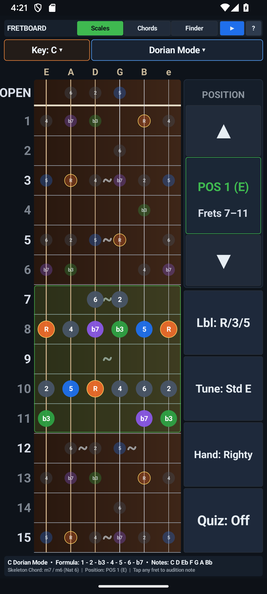
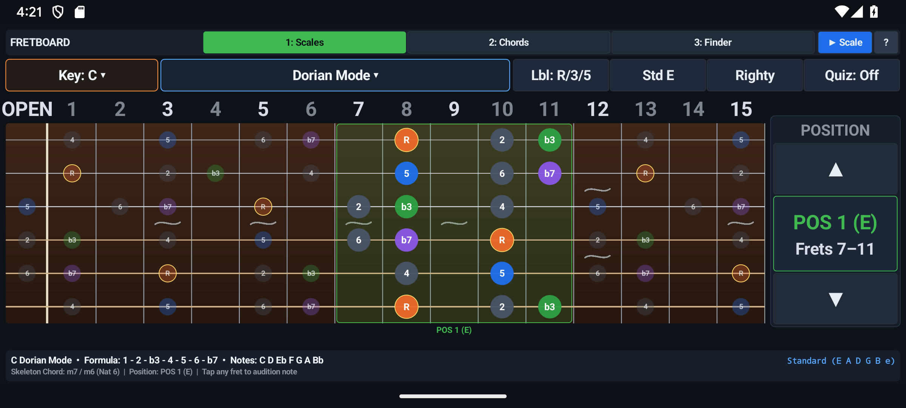

# Fretboard Explorer & Scale Trainer (`com.eggwall.fretboard`)

<p align="center">
  
</p>

Interactive 15-fret guitar neck visualizer, 14-scale CAGED box mapper, 12-quality chord voicing library, reverse chord identifier, and fretboard note/interval quiz with 6-voice Karplus-Strong guitar synthesis.

---

## Screenshots

| Portrait Workspace | Landscape Two-Pane Workspace |
| :---: | :---: |
|  |  |

---

## Documentation

- **[User & Musician's Guide (`USER_GUIDE.md`)](USER_GUIDE.md)** — Visual tour, feature reference, and structured practice routines.
- **[Developer & Customization Guide (`DEVELOPER_GUIDE.md`)](DEVELOPER_GUIDE.md)** — 4-class architecture ([`FretboardTheory.java`](src/com/eggwall/fretboard/FretboardTheory.java), [`GuitarSynthEngine.java`](src/com/eggwall/fretboard/GuitarSynthEngine.java), [`FretboardView.java`](src/com/eggwall/fretboard/FretboardView.java), [`FretboardActivity.java`](src/com/eggwall/fretboard/FretboardActivity.java)), customization recipes, and UI layout map.
- **[Privacy Policy (`PRIVACY_POLICY.md`)](PRIVACY_POLICY.md)** — Zero permissions, zero network access, and zero third-party SDK verification.

---

## Window & Screen Timeout Behavior

- **Visible System Status Bar**: Uses `@android:style/Theme.DeviceDefault.NoActionBar` ([`AndroidManifest.xml`](AndroidManifest.xml)) with system-bar window-inset padding in [`FretboardActivity.java`](src/com/eggwall/fretboard/FretboardActivity.java) so the top Android status bar remains visible at all times.
- **Standard Screen Timeout**: Does not set `FLAG_KEEP_SCREEN_ON`, respecting the user's normal device screen timeout.

---

## Build & Unit Test

```bash
./gradlew testDebugUnitTest assembleDebug assembleRelease
```
