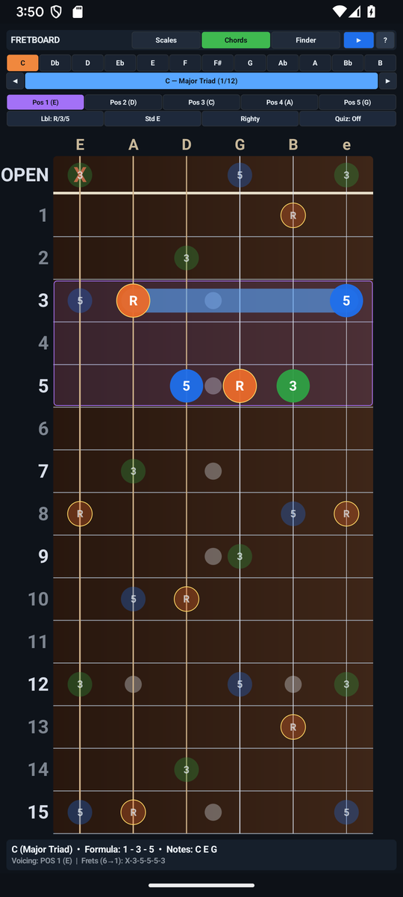

# Fretboard Explorer & Scale Trainer — User & Musician's Guide

Interactive 15-fret guitar neck visualizer, 14-scale CAGED box mapper, 12-quality chord voicing library, reverse chord identifier, and fretboard note/interval quiz with 6-voice Karplus-Strong guitar synthesis.

---

## 1. Visual Overview

### Portrait Workspace

### Top Header & Quick-Access Controls (`?` Help Modal)

- **`?` Help Pill (Top-Left)**: Tap `?` at any time to open the built-in two-tab Interactive Reference & Practice Guide modal (`HOW TO USE` and `PRACTICE TIPS`).
- **Mode / Preset / Key Selectors**: Tap any header pill to cycle modes, keys, presets, or audio synthesis options with immediate visual and audio feedback.

### Interactive Core Canvas & Visualizer

### Bottom Transport & Action Dock

### Two-Pane Landscape Layout
Rotate your device to landscape for a studio-grade **Two-Pane Split Workspace** that maximizes the primary interactive canvas on the left while keeping transport, inspector, and controls accessible on the right:

### Built-In `?` Help Modal

---

## 2. Key Features

- **4 Interactive Operating Modes**: **Scales** (14 scales/modes across all 12 keys and 5 CAGED positions), **Chords** (12 chord/arpeggio qualities with 5 CAGED shapes up the neck), **Explorer** (tap to lock frets and identify any chord or slash inversion in real time), and **Quiz** (Note-finding and Interval-finding drills with live streak tracking).
- **6 Built-In Guitar Tunings**: Standard (`E A D G B e`), Drop D, Eb Standard, D Standard, DADGAD, and Open G in [`FretboardTheory.TUNINGS`](src/com/eggwall/fretboard/FretboardTheory.java).
- **Real-Time 6-Voice Karplus-Strong Guitar Synth**: Zero-allocation physical-modeling plucked-string synthesis (`44.1 kHz` PCM) in [`GuitarSynthEngine.java`](src/com/eggwall/fretboard/GuitarSynthEngine.java) with downward/upward strum and per-string auditioning.
- **Dual-Orientation Responsive Canvas**: Vertical stack in Portrait mode and split Two-Pane inspector in Landscape mode in [`FretboardView.java`](src/com/eggwall/fretboard/FretboardView.java).

---

## 3. How to Improve Your Musicianship & Practice Routine

1. **Master the 5 CAGED Scale Boxes**: Select **SCALES**, pick `Minor Pentatonic` or `Dorian Mode`, and cycle through `POS 1` .. `POS 5` before switching to `ALL NECK` to connect neighboring positions seamlessly.
2. **Voice-Lead Chords Across the Neck**: Switch to **CHORDS**, choose `Maj7`, `m7`, or `Dom7`, and step through all 5 CAGED voicings while strumming with the speaker icon to hear how inversions share common tones.
3. **Reverse Chord Finder (`EXPLORER`)**: Enable **LOCK** in Explorer mode and tap custom chord shapes on the 15-fret board to see instant chord symbol and slash-inversion analysis from [`FretboardTheory.identifyLockedChord()`](src/com/eggwall/fretboard/FretboardTheory.java).
4. **Daily 5-Minute Fretboard Quiz**: Use **QUIZ** mode (`Find Notes` and `Find Intervals`) to build instant pitch-class recall across all 6 strings.

---

## 4. Zero-Distraction, 100% Offline Design

- **Zero Permissions & Zero Latency**: All audio is synthesized mathematically in real time at `44.1 kHz` on your device. No internet connection, account, or microphone access is ever required.
- **Automatic State Persistence**: Your active mode, key, tempo, and settings are automatically saved across app launches.
