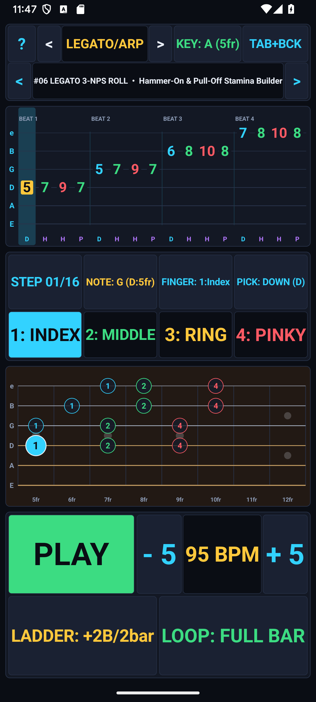
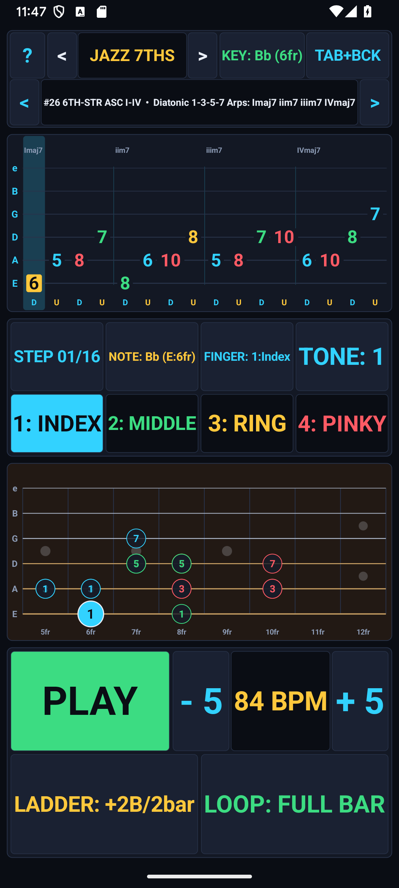
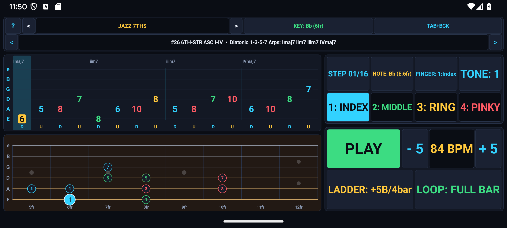
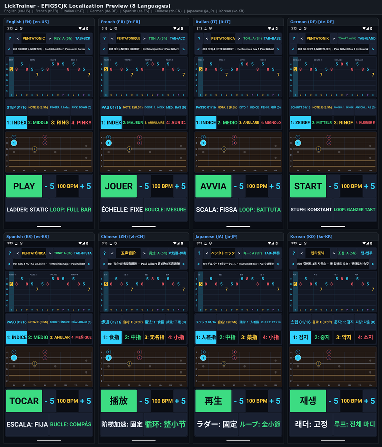

# Google Play Store Listing — LickTrainer — Guitar Tab & Speed Builder (`com.eggwall.licktrainer`)

## Short Description (80 / 80 characters)
> Practice 33 guitar licks with interactive tab, fretboard, and BPM speed ladders.

## Full Description (3435 / 4000 characters)
- **Standalone Description File:** [`PLAY_STORE_DESCRIPTION.md`](PLAY_STORE_DESCRIPTION.md)

Build authentic lead guitar vocabulary, clean picking technique, and effortless soloing speed with LickTrainer — Guitar Tab & Speed Builder. Designed as a focused daily practice companion for electric and acoustic guitarists, LickTrainer combines 33 hand-crafted guitar licks across 6 iconic genres with a synchronized scrolling 6-string tablature highway, a live 15-fret fingerboard visualizer, and an automated BPM Speed Ladder coach.

Whether you want to master expressive BB-style blues bends, scorching rock pentatonic cascades, smooth jazz ii–V–I bebop lines, country chicken-pickin' double stops, neo-soul chordal embellishments, or precision alternate-picked metal shred sequences, LickTrainer guides you from slow, accurate muscle memory to full performance tempo.

33 CURATED GUITAR LICKS ACROSS 6 GENRES
• Blues (6 Licks): Minor & Major Pentatonic boxes, expressive whole-step bends, blue-note turnarounds, Texas shuffle phrases, and Albert/BB-inspired vocal phrasing.
• Rock (6 Licks): Classic arena-rock motifs, repeating pentatonic triplets, pedal-point sequences, wide-interval string skips, and melodic Dorian hooks.
• Jazz & Bebop (6 Licks): Chromatic enclosures, Dorian & Mixolydian lines, ii–V–I voice-leading resolutions, altered dominant tensions, and Wes-style octave phrases.
• Country (5 Licks): Hybrid-picked open-string cascades, chromatic double-stop slides, pedal-steel bends, and brisk Telecaster-style train grooves.
• Neo-Soul & Funk (5 Licks): R&B double-stop slides, hammer-on chordal fills, syncopated 16th-note pocket riffs, and gospel-inflected pentatonic runs.
• Shred & Metal (5 Licks): Paul Gilbert-style 3-note-per-string alternate picking patterns, neoclassical harmonic minor arpeggio sweeps, and high-velocity legato sequences.

SYNCHRONIZED SCROLLING TAB + LIVE 15-FRET NECK
• Real-Time 6-String Tablature Highway: Watch notes scroll smoothly into the playhead with clear articulation symbols for Hammer-Ons (H), Pull-Offs (P), Slides (/ and \), Bends (b), Vibrato (~), and Accent markings.
• Dual-Layer Fretboard Visualization: Below the tab, a 15-fret guitar neck displays all underlying scale degrees in subtle ghost markers while lighting up the active note, string vibration, and upcoming target note in real time.
• 12-Key Transposition: Transpose any lick into all 12 keys instantaneously—LickTrainer shifts every fret number and scale map automatically so you can practice your favorite vocabulary anywhere on the neck.

AUTOMATED BPM SPEED LADDER & A–B PHRASE LOOPING
• Progressive Speed Coach: Enable the Speed Ladder to automatically increase the tempo by +2 BPM or +5 BPM after every 2, 4, or 8 clean repetitions—the proven method for breaking through speed plateaus without tension.
• Custom A–B Section Looper: Isolate tricky 4-note or 8-note transitions inside any lick using the A–B loop markers until the movement is effortless.
• Built-In Drum & Metronome Backing: Practice with a synthesized drum groove (Kick, Snare, Hi-Hat) and count-in click, or solo the guitar synth voice to study exact articulation and timing.

EXPRESSIVE REAL-TIME DSP GUITAR SYNTHESIS
• Powered by a custom 44.1 kHz Karplus-Strong physical modeling engine that renders realistic string plucks, pitch bends, legato slurs, and vibrato entirely offline with zero sample bloat.
• Keeps the screen awake during practice, works in both Portrait and Landscape orientations, and requires zero permissions.

## Play Store Visual Assets & Policy Links
- **Full Play Store Description (4000-char limit):** [`PLAY_STORE_DESCRIPTION.md`](PLAY_STORE_DESCRIPTION.md)
- **App Icon (512×512 PNG):** [`playstore-icon-512.png`](playstore-icon-512.png)
- **Feature Graphic (1024×500 PNG, Miyazaki Style):** [`feature-graphic-1024x500.png`](feature-graphic-1024x500.png)
- **Privacy Policy:** [`PRIVACY_POLICY.md`](PRIVACY_POLICY.md)

### Feature Graphic Preview

### Phone Screenshots (Portrait & Landscape)
| Portrait 1 | Portrait 2 |
| :---: | :---: |
|  |  |

| Landscape 1 | Landscape 2 |
| :---: | :---: |
|  |  |
<!-- I18N_EFIGSCJK_START -->

---

## Google Play Console "Import translations with AI" (All 20 World Languages)

Google Play Console's **Import translations with AI** dialog (*Grow users → Store presence → Store listings → Edit store listing → Manage translations → Import translations with AI*) accepts `.csv`, `.md`, or `.txt` files (UTF-8, up to 3 MB) and automatically extracts `languageCode`, `appName` (`≤ 30` chars), `shortDescription` (`≤ 80` chars), and `fullDescription` (`≤ 4000` chars) for every language in the file:

- **CSV Import File (Recommended):** **[`PLAY_STORE_AI_IMPORT.csv`](PLAY_STORE_AI_IMPORT.csv)**
- **Markdown Import File:** **[`PLAY_STORE_AI_IMPORT.md`](PLAY_STORE_AI_IMPORT.md)**
- **Structured JSON-in-TXT Import File:** **[`PLAY_STORE_AI_IMPORT.txt`](PLAY_STORE_AI_IMPORT.txt)**
- **EFIGSCJK Copy-Paste Reference:** **[`PLAY_STORE_I18N_EFIGSCJK.md`](PLAY_STORE_I18N_EFIGSCJK.md)**
- **Fastlane / Per-Locale Metadata Directory (All 20 Languages):** **[`playstore/metadata/android/`](playstore/metadata/android/)**

| BCP-47 Locale | Language | Title (`<= 30` chars) | Short Description (`<= 80` chars) | Full Description (`<= 4000` chars) | EFIGSCJK Screenshot (`1080×2400`) |
| :--- | :--- | :--- | :--- | :--- | :--- |
| **`en-US`** | English (United States) | [`title.txt`](playstore/metadata/android/en-US/title.txt) | [`short_description.txt`](playstore/metadata/android/en-US/short_description.txt) | [`full_description.txt`](playstore/metadata/android/en-US/full_description.txt) | [`en.png`](docs/images/i18n/en.png) |
| **`fr-FR`** | French (France) — Français | [`title.txt`](playstore/metadata/android/fr-FR/title.txt) | [`short_description.txt`](playstore/metadata/android/fr-FR/short_description.txt) | [`full_description.txt`](playstore/metadata/android/fr-FR/full_description.txt) | [`fr.png`](docs/images/i18n/fr.png) |
| **`it-IT`** | Italian (Italy) — Italiano | [`title.txt`](playstore/metadata/android/it-IT/title.txt) | [`short_description.txt`](playstore/metadata/android/it-IT/short_description.txt) | [`full_description.txt`](playstore/metadata/android/it-IT/full_description.txt) | [`it.png`](docs/images/i18n/it.png) |
| **`de-DE`** | German (Germany) — Deutsch | [`title.txt`](playstore/metadata/android/de-DE/title.txt) | [`short_description.txt`](playstore/metadata/android/de-DE/short_description.txt) | [`full_description.txt`](playstore/metadata/android/de-DE/full_description.txt) | [`de.png`](docs/images/i18n/de.png) |
| **`es-ES`** | Spanish (Spain) — Español | [`title.txt`](playstore/metadata/android/es-ES/title.txt) | [`short_description.txt`](playstore/metadata/android/es-ES/short_description.txt) | [`full_description.txt`](playstore/metadata/android/es-ES/full_description.txt) | [`es.png`](docs/images/i18n/es.png) |
| **`zh-CN`** | Chinese (Simplified) — 中文（简体） | [`title.txt`](playstore/metadata/android/zh-CN/title.txt) | [`short_description.txt`](playstore/metadata/android/zh-CN/short_description.txt) | [`full_description.txt`](playstore/metadata/android/zh-CN/full_description.txt) | [`zh.png`](docs/images/i18n/zh.png) |
| **`ja-JP`** | Japanese (Japan) — 日本語 | [`title.txt`](playstore/metadata/android/ja-JP/title.txt) | [`short_description.txt`](playstore/metadata/android/ja-JP/short_description.txt) | [`full_description.txt`](playstore/metadata/android/ja-JP/full_description.txt) | [`ja.png`](docs/images/i18n/ja.png) |
| **`ko-KR`** | Korean (South Korea) — 한국어 | [`title.txt`](playstore/metadata/android/ko-KR/title.txt) | [`short_description.txt`](playstore/metadata/android/ko-KR/short_description.txt) | [`full_description.txt`](playstore/metadata/android/ko-KR/full_description.txt) | [`ko.png`](docs/images/i18n/ko.png) |
| **`pt-BR`** | Portuguese (Brazil) — Português | [`title.txt`](playstore/metadata/android/pt-BR/title.txt) | [`short_description.txt`](playstore/metadata/android/pt-BR/short_description.txt) | [`full_description.txt`](playstore/metadata/android/pt-BR/full_description.txt) | — |
| **`ru-RU`** | Russian (Russia) — Русский | [`title.txt`](playstore/metadata/android/ru-RU/title.txt) | [`short_description.txt`](playstore/metadata/android/ru-RU/short_description.txt) | [`full_description.txt`](playstore/metadata/android/ru-RU/full_description.txt) | — |
| **`ar`** | Arabic — العربية | [`title.txt`](playstore/metadata/android/ar/title.txt) | [`short_description.txt`](playstore/metadata/android/ar/short_description.txt) | [`full_description.txt`](playstore/metadata/android/ar/full_description.txt) | — |
| **`hi-IN`** | Hindi (India) — हिन्दी | [`title.txt`](playstore/metadata/android/hi-IN/title.txt) | [`short_description.txt`](playstore/metadata/android/hi-IN/short_description.txt) | [`full_description.txt`](playstore/metadata/android/hi-IN/full_description.txt) | — |
| **`bn-BD`** | Bengali (Bangladesh) — বাংলা | [`title.txt`](playstore/metadata/android/bn-BD/title.txt) | [`short_description.txt`](playstore/metadata/android/bn-BD/short_description.txt) | [`full_description.txt`](playstore/metadata/android/bn-BD/full_description.txt) | — |
| **`id`** | Indonesian — Bahasa Indonesia | [`title.txt`](playstore/metadata/android/id/title.txt) | [`short_description.txt`](playstore/metadata/android/id/short_description.txt) | [`full_description.txt`](playstore/metadata/android/id/full_description.txt) | — |
| **`tr-TR`** | Turkish (Turkey) — Türkçe | [`title.txt`](playstore/metadata/android/tr-TR/title.txt) | [`short_description.txt`](playstore/metadata/android/tr-TR/short_description.txt) | [`full_description.txt`](playstore/metadata/android/tr-TR/full_description.txt) | — |
| **`vi`** | Vietnamese — Tiếng Việt | [`title.txt`](playstore/metadata/android/vi/title.txt) | [`short_description.txt`](playstore/metadata/android/vi/short_description.txt) | [`full_description.txt`](playstore/metadata/android/vi/full_description.txt) | — |
| **`pl-PL`** | Polish (Poland) — Polski | [`title.txt`](playstore/metadata/android/pl-PL/title.txt) | [`short_description.txt`](playstore/metadata/android/pl-PL/short_description.txt) | [`full_description.txt`](playstore/metadata/android/pl-PL/full_description.txt) | — |
| **`nl-NL`** | Dutch (Netherlands) — Nederlands | [`title.txt`](playstore/metadata/android/nl-NL/title.txt) | [`short_description.txt`](playstore/metadata/android/nl-NL/short_description.txt) | [`full_description.txt`](playstore/metadata/android/nl-NL/full_description.txt) | — |
| **`th`** | Thai — ไทย | [`title.txt`](playstore/metadata/android/th/title.txt) | [`short_description.txt`](playstore/metadata/android/th/short_description.txt) | [`full_description.txt`](playstore/metadata/android/th/full_description.txt) | — |
| **`uk`** | Ukrainian — Українська | [`title.txt`](playstore/metadata/android/uk/title.txt) | [`short_description.txt`](playstore/metadata/android/uk/short_description.txt) | [`full_description.txt`](playstore/metadata/android/uk/full_description.txt) | — |

### EFIGSCJK Localization Grid (Click Thumbnail for Full-Resolution `2260×2640` Image)

<!-- I18N_EFIGSCJK_END -->
