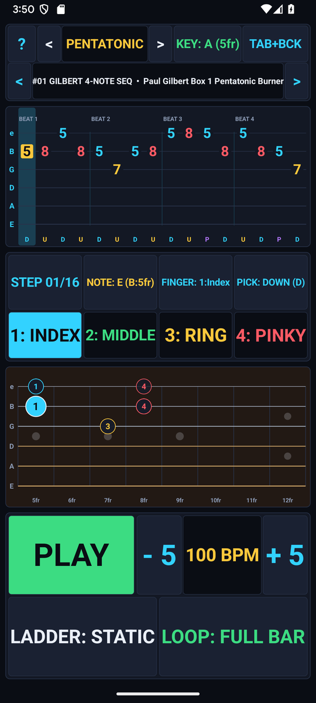
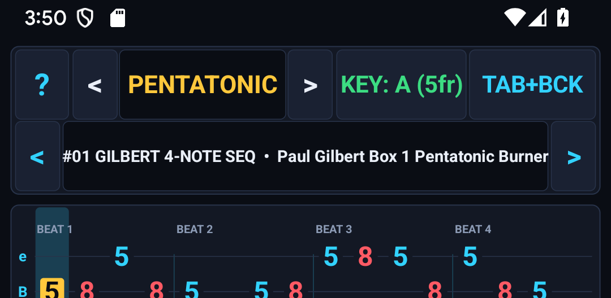
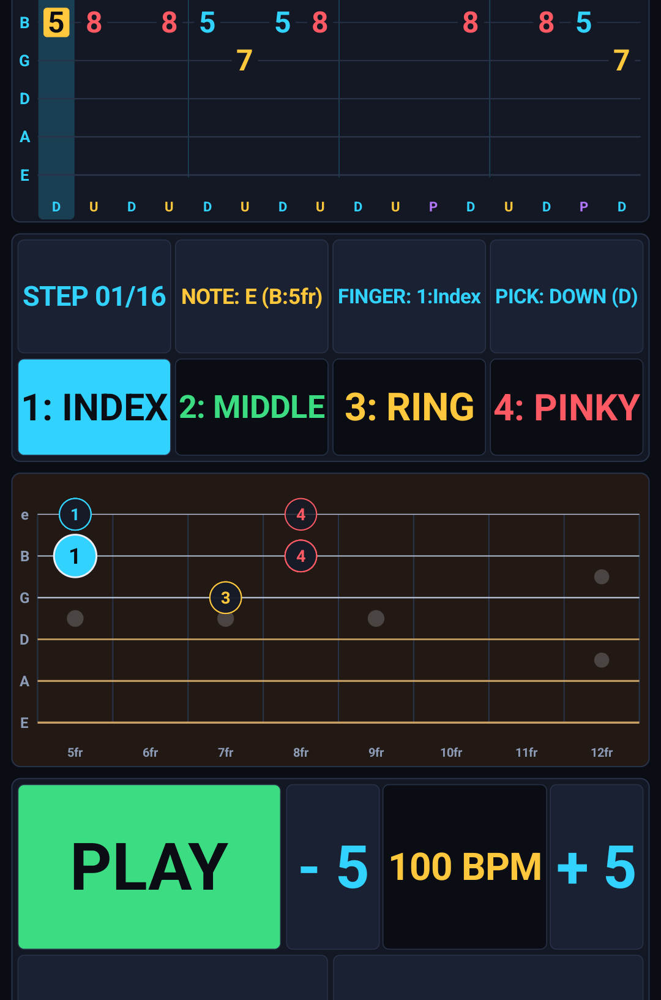
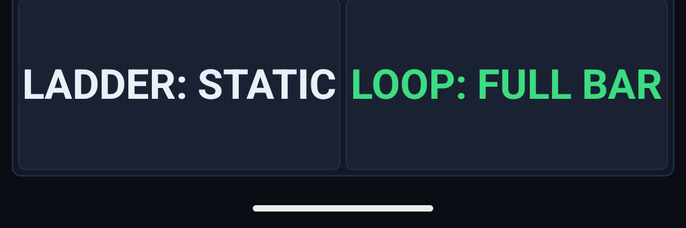
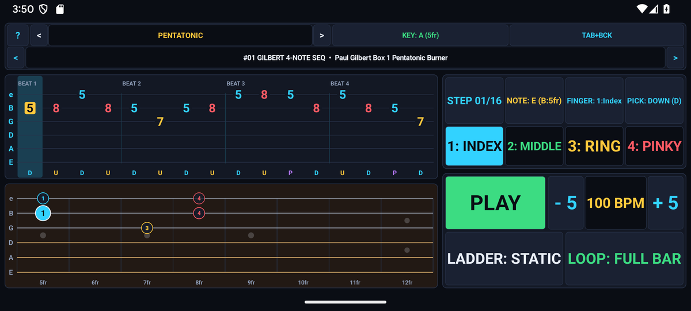

# LickTrainer — Guitar Tab Sequencer & Speed Builder — User & Musician's Guide

Interactive 6-string guitar tablature step sequencer, zoomed 8-fret neck inspector, 33 curated exercises across 6 categories (including 8 Jazz 7th diatonic arpeggio lessons), 12-key transposition, and automated Speed-Builder BPM ladders.

---

## 1. Visual Overview

### Portrait Workspace

### Top Header & Quick-Access Controls (`?` Help Modal)

- **`?` Help Pill (Top-Left)**: Tap `?` at any time to open the built-in two-tab Interactive Reference & Practice Guide modal (`HOW TO USE` and `PRACTICE TIPS`).
- **Mode / Preset / Key Selectors**: Tap any header pill to cycle modes, keys, presets, or audio synthesis options with immediate visual and audio feedback.

### Interactive Core Canvas & Visualizer

### Bottom Transport & Action Dock

### Two-Pane Landscape Layout
Rotate your device to landscape for a studio-grade **Two-Pane Split Workspace** that maximizes the primary interactive canvas on the left while keeping transport, inspector, and controls accessible on the right:

### Built-In `?` Help Modal

---

## 2. Key Features

- **33 Curated Guitar Licks Across 6 Categories**: Pentatonic (`#01-#05`), Legato & Arpeggios (`#06-#10`), Alternate Picking (`#11-#15`), Blues & Rock (`#16-#20`), Spider Warmups (`#21-#25`), and Jazz 7th Chord Arpeggios (`#26-#33`) in [`LickTheory.LICKS`](src/com/eggwall/licktrainer/LickTheory.java).
- **Synchronized Tablature + 8-Fret Neck Inspector**: Displays fret numbers, left-hand finger colors (`1=Index`, `2=Middle`, `3=Ring`, `4=Pinky`), picking directions (`D`, `U`, `H`, `P`, `/`), and Jazz 7th chord-tone degrees (`1-3-5-7`) in [`LickTrainerView.java`](src/com/eggwall/licktrainer/LickTrainerView.java).
- **Speed-Builder BPM Ladder**: Automatically ramps tempo (`+2 BPM / 2 Bars`, `+5 BPM / 4 Bars`, `+5 BPM / 8 Bars`, `+10 BPM / 4 Bars`) up to your target speed.
- **12-Voice Polyphonic Karplus-Strong Audio Engine**: Synthesizes lead guitar articulations, 4-note diatonic backing chords, and accented metronome clicks in [`LickSynthEngine.java`](src/com/eggwall/licktrainer/LickSynthEngine.java).

---

## 3. How to Improve Your Musicianship & Practice Routine

1. **Isolate 4-Note Cells with Sub-Range Loop**: Tap **LOOP: BEAT 1** to loop the first beat's 4 notes until your right-hand alternate picking (`D`/`U`) and left-hand fingerings (`1..4`) are effortless, then switch back to **LOOP: FULL BAR**.
2. **Progressive Speed Building**: Start 20 BPM below your comfort ceiling and enable **LADDER: +2B/2bar** or **+5B/4bar** so tempo increases automatically without interrupting your hands.
3. **Transpose Across All 12 Keys**: Tap the **KEY** pill (`E` through `Eb`) to practice the same biomechanical pattern across different string tensions and fret spacings.
4. **Master Diatonic Jazz 7th Arpeggios (`#26-#33`)**: Switch to **JAZZ 7THS** with **TAB+BCK** enabled to hear how `1-3-5-7` arpeggio tones resolve over `Imaj7`, `iim7`, `V7`, and `viim7b5` backing chords.

---

## 4. Zero-Distraction, 100% Offline Design

- **Zero Permissions & Zero Latency**: All audio is synthesized mathematically in real time at `44.1 kHz` on your device. No internet connection, account, or microphone access is ever required.
- **Automatic State Persistence**: Your active mode, key, tempo, and settings are automatically saved across app launches.
