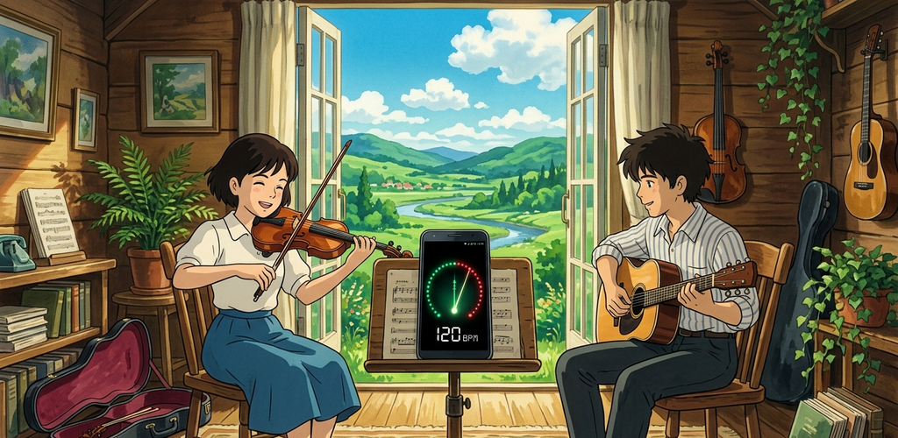
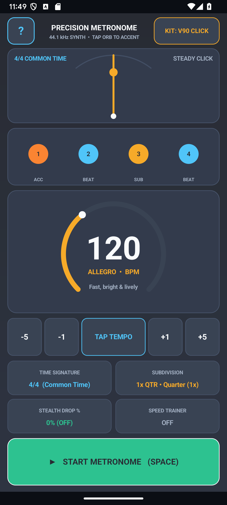
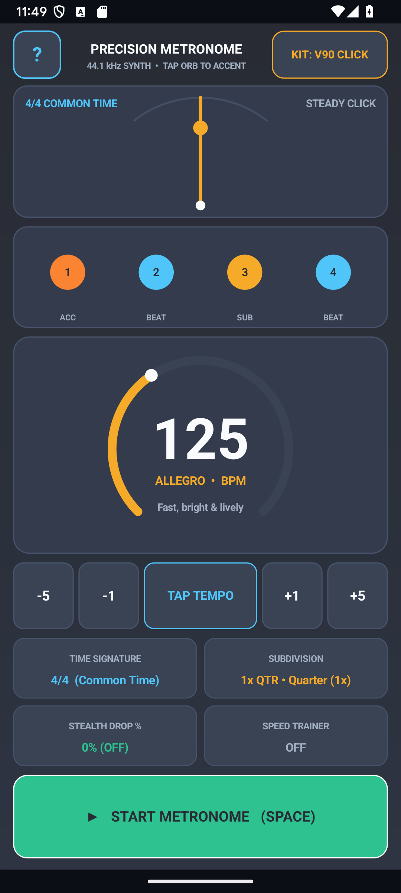
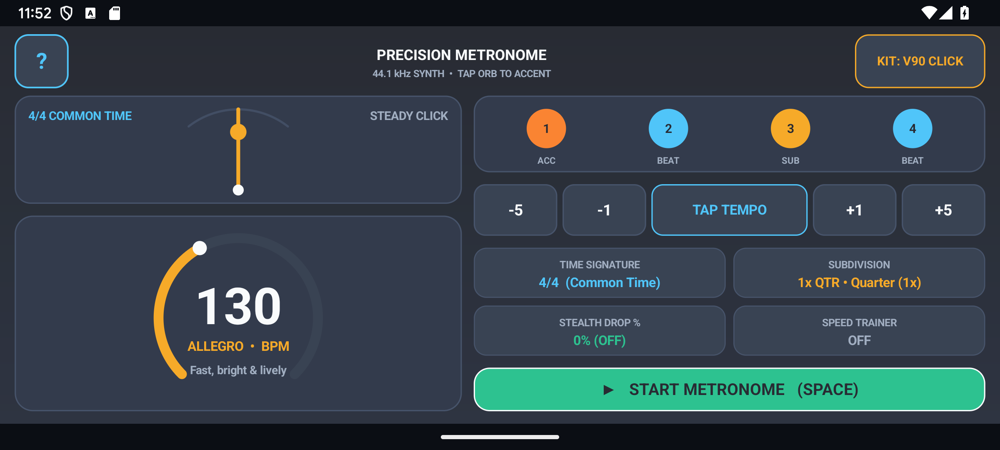
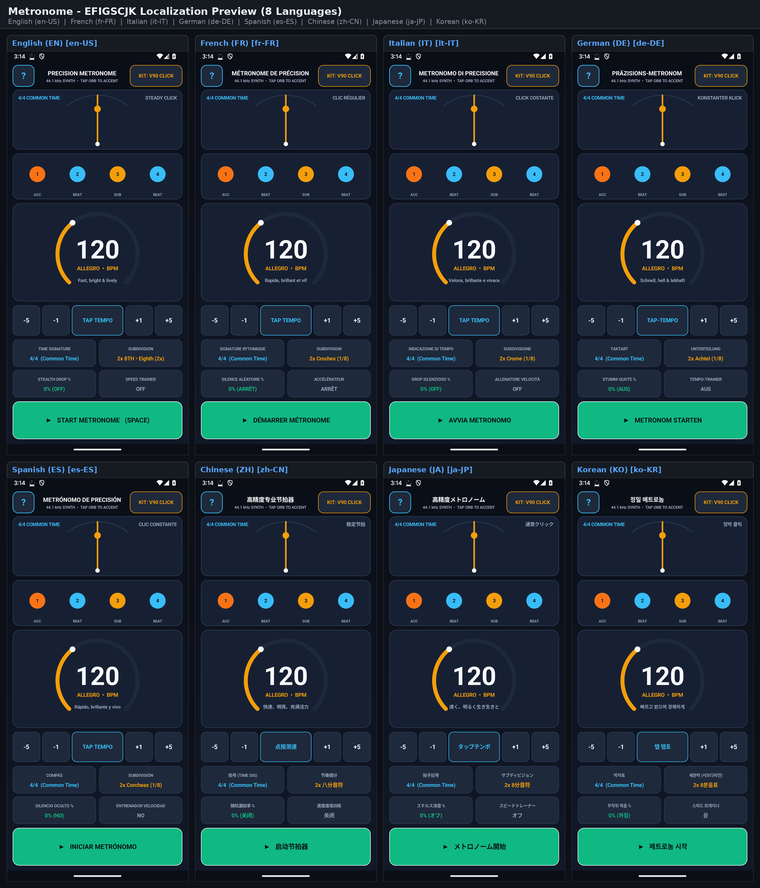

# Google Play Store Listing — Metronome — Precision Pendulum & Speed Coach (`com.eggwall.metronome`)

## Short Description (75 / 80 characters)
> Precision pendulum metronome with odd meters, polyrhythms, and speed coach.

## Full Description (3045 / 4000 characters)
- **Standalone Description File:** [`PLAY_STORE_DESCRIPTION.md`](PLAY_STORE_DESCRIPTION.md)

Lock in rock-solid timing, master complex odd meters and polyrhythms, and build effortless playing speed with Metronome — Precision Pendulum & Speed Coach. Engineered from the ground up for serious instrumentalists, drummers, guitarists, pianists, and ensemble musicians, this metronome runs on a sample-accurate 44.1 kHz PCM audio synthesis engine that eliminates the timing jitter of standard mobile timers.

Whether you are practicing classical repertoire, shedding progressive rock odd time signatures, internalizing 3-against-2 or 5-against-4 polyrhythms, or testing your internal clock with muted bars, Metronome delivers studio-grade precision and high-visibility visual feedback.

SAMPLE-ACCURATE 44.1 kHz TIMING & VISUAL PENDULUM
• Zero-Jitter Audio Engine: Every click, accent, and subdivision is calculated at the individual audio sample level at 44.1 kHz so the groove never drifts, even during long practice sessions.
• High-Contrast Pendulum & Beat Matrix: Follow the smooth, physics-inspired swinging pendulum arm and high-visibility beat LEDs from across the music stand or drum kit.
• Tap Tempo & Fine BPM Controls: Tap in any groove on the fly or use the -5, -1, +1, and +5 BPM steppers across a wide 20 BPM to 260 BPM range, complete with traditional Italian tempo markings (Largo, Adagio, Andante, Moderato, Allegro, Presto).

12 TIME SIGNATURES, ODD METERS & 6 SUBDIVISIONS
• Standard & Odd Time Signatures: Switch effortlessly between 4/4, 3/4, 2/4, 6/8, 9/8, 12/8, and odd meters including 5/4, 5/8, 7/4, 7/8, 11/8, and 13/8.
• Interactive Per-Beat Accent Sequencer: Tap any beat column to cycle between STRONG ACCENT, NORMAL BEAT, SUB-ACCENT, and MUTE to program custom clave patterns, asymmetric Balkan/prog groupings (such as 2+2+3 or 3+3+2), or backbeat grooves.
• 6 Rhythmic Subdivisions: Quarter notes, Eighth notes, Triplets, Sixteenth notes, Dotted Eighths (Swing/Shuffle), and Quintuplets.

DUAL-RING POLYRHYTHM GENERATOR
• Hear and See Cross-Rhythms: Activate Polyrhythm Mode to layer two independent rhythmic cycles simultaneously—including 3:2, 4:3, 5:3, 5:4, 7:4, and custom ratios—with distinct left/right pitch timbres and synchronized visual beat rings.

SPEED COACH & BAR DROPPER (MUTED-BAR TRAINER)
• Automated Speed Trainer: Automatically increment the tempo by +1 to +5 BPM every N bars so you can gradually push difficult passages past your target tempo without noticing the jumps.
• Bar Dropper (Internal Clock Test): Play 3 bars audible and mute 1 bar (or customize N bars on / M bars muted) to verify whether you rush or drag when the reference click disappears—the ultimate drill for studio and live tightness.

5 DISTINCT CLICK TIMBRES & STAGE-READY DESIGN
• Choose from Mechanical Woodblock, Classic Pendulum Click, Studio Cowbell, Electronic Beep, and Drum Kit Rimshot voices to cut through any acoustic or amplified instrument.
• Keeps the screen awake while running, adapts seamlessly to Portrait and Landscape orientations, requires zero permissions, and operates 100% offline with zero ads.

## Play Store Visual Assets & Policy Links
- **Full Play Store Description (4000-char limit):** [`PLAY_STORE_DESCRIPTION.md`](PLAY_STORE_DESCRIPTION.md)
- **App Icon (512×512 PNG):** [`playstore-icon-512.png`](playstore-icon-512.png)
- **Feature Graphic (1024×500 PNG, Miyazaki Style):** [`feature-graphic-1024x500.png`](feature-graphic-1024x500.png)
- **Privacy Policy:** [`PRIVACY_POLICY.md`](PRIVACY_POLICY.md)

### Feature Graphic Preview

### Phone Screenshots (Portrait & Landscape)
| Portrait 1 | Portrait 2 |
| :---: | :---: |
|  |  |

| Landscape 1 | Landscape 2 |
| :---: | :---: |
|  |  |
<!-- I18N_EFIGSCJK_START -->

---

## Google Play Console "Import translations with AI" (All 20 World Languages)

Google Play Console's **Import translations with AI** dialog (*Grow users → Store presence → Store listings → Edit store listing → Manage translations → Import translations with AI*) accepts `.csv`, `.md`, or `.txt` files (UTF-8, up to 3 MB) and automatically extracts `languageCode`, `appName` (`≤ 30` chars), `shortDescription` (`≤ 80` chars), and `fullDescription` (`≤ 4000` chars) for every language in the file:

- **CSV Import File (Recommended):** **[`PLAY_STORE_AI_IMPORT.csv`](PLAY_STORE_AI_IMPORT.csv)**
- **Markdown Import File:** **[`PLAY_STORE_AI_IMPORT.md`](PLAY_STORE_AI_IMPORT.md)**
- **Structured JSON-in-TXT Import File:** **[`PLAY_STORE_AI_IMPORT.txt`](PLAY_STORE_AI_IMPORT.txt)**
- **EFIGSCJK Copy-Paste Reference:** **[`PLAY_STORE_I18N_EFIGSCJK.md`](PLAY_STORE_I18N_EFIGSCJK.md)**
- **Fastlane / Per-Locale Metadata Directory (All 20 Languages):** **[`playstore/metadata/android/`](playstore/metadata/android/)**

| BCP-47 Locale | Language | Title (`<= 30` chars) | Short Description (`<= 80` chars) | Full Description (`<= 4000` chars) | EFIGSCJK Screenshot (`1080×2400`) |
| :--- | :--- | :--- | :--- | :--- | :--- |
| **`en-US`** | English (United States) | [`title.txt`](playstore/metadata/android/en-US/title.txt) | [`short_description.txt`](playstore/metadata/android/en-US/short_description.txt) | [`full_description.txt`](playstore/metadata/android/en-US/full_description.txt) | [`en.png`](docs/images/i18n/en.png) |
| **`fr-FR`** | French (France) — Français | [`title.txt`](playstore/metadata/android/fr-FR/title.txt) | [`short_description.txt`](playstore/metadata/android/fr-FR/short_description.txt) | [`full_description.txt`](playstore/metadata/android/fr-FR/full_description.txt) | [`fr.png`](docs/images/i18n/fr.png) |
| **`it-IT`** | Italian (Italy) — Italiano | [`title.txt`](playstore/metadata/android/it-IT/title.txt) | [`short_description.txt`](playstore/metadata/android/it-IT/short_description.txt) | [`full_description.txt`](playstore/metadata/android/it-IT/full_description.txt) | [`it.png`](docs/images/i18n/it.png) |
| **`de-DE`** | German (Germany) — Deutsch | [`title.txt`](playstore/metadata/android/de-DE/title.txt) | [`short_description.txt`](playstore/metadata/android/de-DE/short_description.txt) | [`full_description.txt`](playstore/metadata/android/de-DE/full_description.txt) | [`de.png`](docs/images/i18n/de.png) |
| **`es-ES`** | Spanish (Spain) — Español | [`title.txt`](playstore/metadata/android/es-ES/title.txt) | [`short_description.txt`](playstore/metadata/android/es-ES/short_description.txt) | [`full_description.txt`](playstore/metadata/android/es-ES/full_description.txt) | [`es.png`](docs/images/i18n/es.png) |
| **`zh-CN`** | Chinese (Simplified) — 中文（简体） | [`title.txt`](playstore/metadata/android/zh-CN/title.txt) | [`short_description.txt`](playstore/metadata/android/zh-CN/short_description.txt) | [`full_description.txt`](playstore/metadata/android/zh-CN/full_description.txt) | [`zh.png`](docs/images/i18n/zh.png) |
| **`ja-JP`** | Japanese (Japan) — 日本語 | [`title.txt`](playstore/metadata/android/ja-JP/title.txt) | [`short_description.txt`](playstore/metadata/android/ja-JP/short_description.txt) | [`full_description.txt`](playstore/metadata/android/ja-JP/full_description.txt) | [`ja.png`](docs/images/i18n/ja.png) |
| **`ko-KR`** | Korean (South Korea) — 한국어 | [`title.txt`](playstore/metadata/android/ko-KR/title.txt) | [`short_description.txt`](playstore/metadata/android/ko-KR/short_description.txt) | [`full_description.txt`](playstore/metadata/android/ko-KR/full_description.txt) | [`ko.png`](docs/images/i18n/ko.png) |
| **`pt-BR`** | Portuguese (Brazil) — Português | [`title.txt`](playstore/metadata/android/pt-BR/title.txt) | [`short_description.txt`](playstore/metadata/android/pt-BR/short_description.txt) | [`full_description.txt`](playstore/metadata/android/pt-BR/full_description.txt) | — |
| **`ru-RU`** | Russian (Russia) — Русский | [`title.txt`](playstore/metadata/android/ru-RU/title.txt) | [`short_description.txt`](playstore/metadata/android/ru-RU/short_description.txt) | [`full_description.txt`](playstore/metadata/android/ru-RU/full_description.txt) | — |
| **`ar`** | Arabic — العربية | [`title.txt`](playstore/metadata/android/ar/title.txt) | [`short_description.txt`](playstore/metadata/android/ar/short_description.txt) | [`full_description.txt`](playstore/metadata/android/ar/full_description.txt) | — |
| **`hi-IN`** | Hindi (India) — हिन्दी | [`title.txt`](playstore/metadata/android/hi-IN/title.txt) | [`short_description.txt`](playstore/metadata/android/hi-IN/short_description.txt) | [`full_description.txt`](playstore/metadata/android/hi-IN/full_description.txt) | — |
| **`bn-BD`** | Bengali (Bangladesh) — বাংলা | [`title.txt`](playstore/metadata/android/bn-BD/title.txt) | [`short_description.txt`](playstore/metadata/android/bn-BD/short_description.txt) | [`full_description.txt`](playstore/metadata/android/bn-BD/full_description.txt) | — |
| **`id`** | Indonesian — Bahasa Indonesia | [`title.txt`](playstore/metadata/android/id/title.txt) | [`short_description.txt`](playstore/metadata/android/id/short_description.txt) | [`full_description.txt`](playstore/metadata/android/id/full_description.txt) | — |
| **`tr-TR`** | Turkish (Turkey) — Türkçe | [`title.txt`](playstore/metadata/android/tr-TR/title.txt) | [`short_description.txt`](playstore/metadata/android/tr-TR/short_description.txt) | [`full_description.txt`](playstore/metadata/android/tr-TR/full_description.txt) | — |
| **`vi`** | Vietnamese — Tiếng Việt | [`title.txt`](playstore/metadata/android/vi/title.txt) | [`short_description.txt`](playstore/metadata/android/vi/short_description.txt) | [`full_description.txt`](playstore/metadata/android/vi/full_description.txt) | — |
| **`pl-PL`** | Polish (Poland) — Polski | [`title.txt`](playstore/metadata/android/pl-PL/title.txt) | [`short_description.txt`](playstore/metadata/android/pl-PL/short_description.txt) | [`full_description.txt`](playstore/metadata/android/pl-PL/full_description.txt) | — |
| **`nl-NL`** | Dutch (Netherlands) — Nederlands | [`title.txt`](playstore/metadata/android/nl-NL/title.txt) | [`short_description.txt`](playstore/metadata/android/nl-NL/short_description.txt) | [`full_description.txt`](playstore/metadata/android/nl-NL/full_description.txt) | — |
| **`th`** | Thai — ไทย | [`title.txt`](playstore/metadata/android/th/title.txt) | [`short_description.txt`](playstore/metadata/android/th/short_description.txt) | [`full_description.txt`](playstore/metadata/android/th/full_description.txt) | — |
| **`uk`** | Ukrainian — Українська | [`title.txt`](playstore/metadata/android/uk/title.txt) | [`short_description.txt`](playstore/metadata/android/uk/short_description.txt) | [`full_description.txt`](playstore/metadata/android/uk/full_description.txt) | — |

### EFIGSCJK Localization Grid (Click Thumbnail for Full-Resolution `2260×2640` Image)

<!-- I18N_EFIGSCJK_END -->
