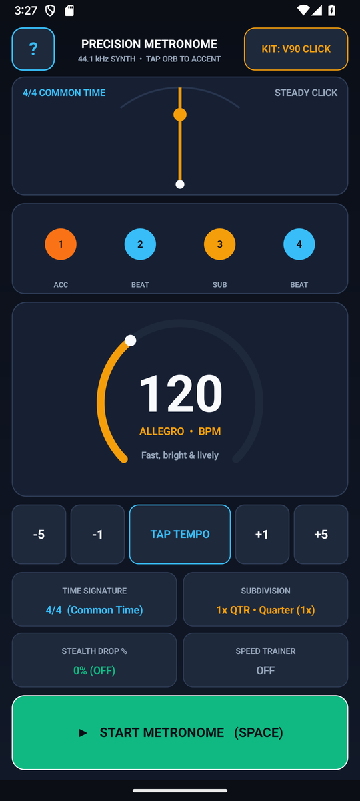
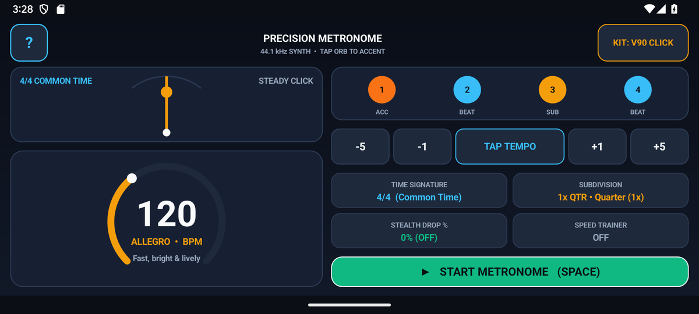

# Metronome — Precision Pendulum, Polyrhythm & Speed Trainer (`com.eggwall.metronome`)

<p align="center">
  
</p>

Sample-accurate studio metronome (`20–300 BPM`) with 60 FPS pendulum & beat ring, 12 time signatures (including odd meters `5/4`, `7/8`, and additive `3+2+2`), 7 subdivisions, polyrhythm cross-rhythms (`3:2`, `4:3`, `5:4`), Gap-Click Groove Trainer, and 5 click voice kits.

---

## Screenshots

| Portrait Workspace | Landscape Two-Pane Workspace |
| :---: | :---: |
|  |  |

---

## Documentation

- **[User & Musician's Guide (`USER_GUIDE.md`)](USER_GUIDE.md)** — Visual tour, feature reference, and structured practice routines.
- **[Developer & Customization Guide (`DEVELOPER_GUIDE.md`)](DEVELOPER_GUIDE.md)** — 4-class architecture ([`MetronomeTheory.java`](src/com/eggwall/metronome/MetronomeTheory.java), [`MetronomeSynthEngine.java`](src/com/eggwall/metronome/MetronomeSynthEngine.java), [`MetronomeView.java`](src/com/eggwall/metronome/MetronomeView.java), [`MetronomeActivity.java`](src/com/eggwall/metronome/MetronomeActivity.java)), customization recipes, and UI layout map.
- **[Privacy Policy (`PRIVACY_POLICY.md`)](PRIVACY_POLICY.md)** — Zero permissions, zero network access, and zero third-party SDK verification.

---

## Window & Screen Timeout Behavior

- **Visible System Status Bar**: Uses `@android:style/Theme.DeviceDefault.NoActionBar` ([`AndroidManifest.xml`](AndroidManifest.xml)) with system-bar window-inset padding in [`MetronomeActivity.java`](src/com/eggwall/metronome/MetronomeActivity.java) so the top Android status bar remains visible at all times.
- **Keep Screen On (`FLAG_KEEP_SCREEN_ON`)**: Keeps the screen awake while the app is in the foreground ([`MetronomeActivity.java`](src/com/eggwall/metronome/MetronomeActivity.java)) so the visual pendulum and beat ring remain visible during hands-free instrument practice.

---

## Build & Unit Test

```bash
./gradlew testDebugUnitTest assembleDebug assembleRelease
```
