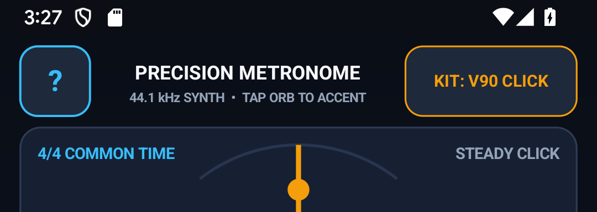
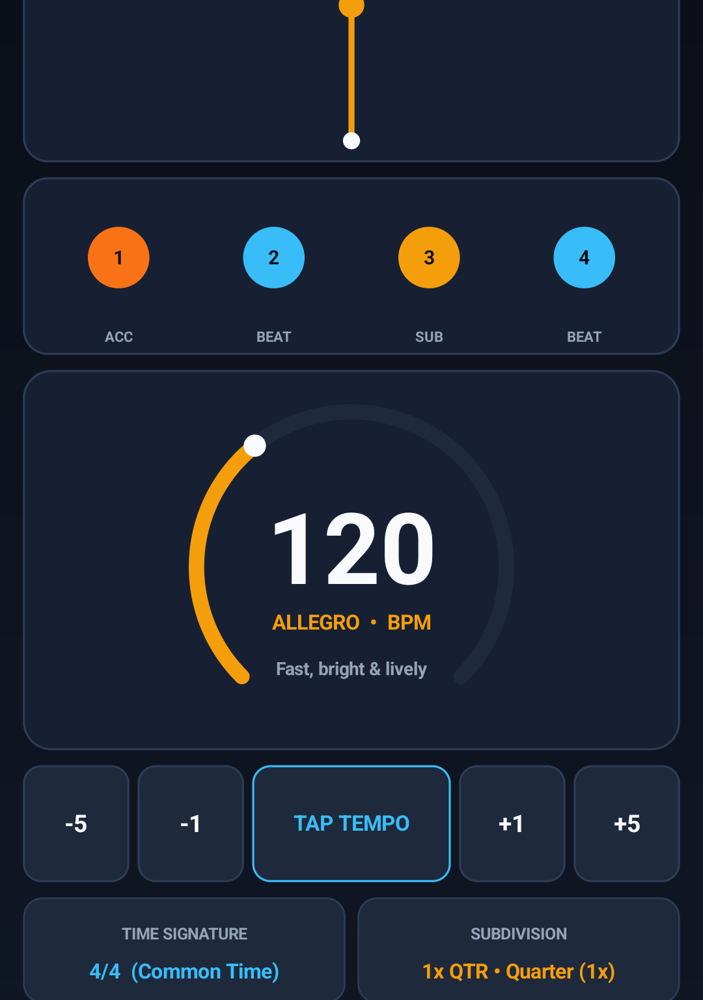
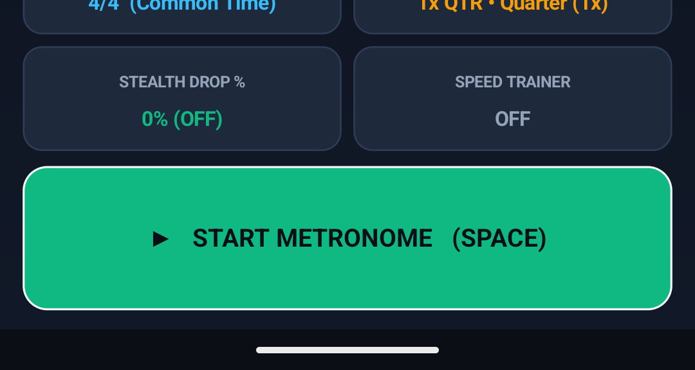

# Metronome — Precision Pendulum, Polyrhythm & Speed Trainer — User & Musician's Guide

Sample-accurate studio metronome (`20–300 BPM`) with 60 FPS pendulum & beat ring, 12 time signatures (including odd meters `5/4`, `7/8`, and additive `3+2+2`), 7 subdivisions, polyrhythm cross-rhythms (`3:2`, `4:3`, `5:4`), Gap-Click Groove Trainer, and 5 click voice kits.

---

## 1. Visual Overview

### Portrait Workspace

### Top Header & Quick-Access Controls (`?` Help Modal)

- **`?` Help Pill (Top-Left)**: Tap `?` at any time to open the built-in two-tab Interactive Reference & Practice Guide modal (`HOW TO USE` and `PRACTICE TIPS`).
- **Mode / Preset / Key Selectors**: Tap any header pill to cycle modes, keys, presets, or audio synthesis options with immediate visual and audio feedback.

### Interactive Core Canvas & Visualizer

### Bottom Transport & Action Dock

### Two-Pane Landscape Layout
Rotate your device to landscape for a studio-grade **Two-Pane Split Workspace** that maximizes the primary interactive canvas on the left while keeping transport, inspector, and controls accessible on the right:

### Built-In `?` Help Modal

---

## 2. Key Features

- **Sample-Accurate Audio-Frame Scheduler**: Calculates exact PCM sample boundaries at `44.1 kHz` inside [`MetronomeSynthEngine.java`](src/com/eggwall/metronome/MetronomeSynthEngine.java) with zero UI-thread timing jitter.
- **12 Time Signatures & Per-Beat Accent Matrix**: Supports `4/4`, `3/4`, `2/4`, `5/4`, `6/8`, `7/8 (2+2+3)`, `7/8 (3+2+2)`, `9/8`, `12/8`, `5/8`, `7/4`, and `1/4`—tap any beat orb in [`MetronomeView.java`](src/com/eggwall/metronome/MetronomeView.java) to cycle `MAX -> MED -> SOFT -> MUTE`.
- **Polyrhythms, Gap-Click Trainer & BPM Speed Ladder**: Practice `3:2`, `4:3`, and `5:4` polyrhythms, automatic silent gap bars (`3 ON / 1 MUTE`, `2 ON / 2 MUTE`) to test internal time, and automated `+BPM` speed ladders in [`MetronomeTheory.java`](src/com/eggwall/metronome/MetronomeTheory.java).
- **5 Synthesized Click Voices**: Woodblock, Studio Beep, Rimshot/Cowbell, Hi-Hat/Kick, and Warm Marimba.

---

## 3. How to Improve Your Musicianship & Practice Routine

1. **Internalize Pocket with Gap-Click Mute Bars**: Enable **TRAINER: GAP 3+1** (`3 bars clicking, 1 bar silent`). Focus on subdividing mentally during the silent measure so your downbeat lands squarely on Beat 1 when the click returns.
2. **Master Odd Meters with Additive Accents**: Select `7/8 (2+2+3)` or `7/8 (3+2+2)` and tap the beat orbs to set primary accents (`MAX`) on the subgroup starts (`1, 3, 5` or `1, 4, 6`).
3. **Hear Polyrhythms Physically**: Enable `3:2` or `4:3` polyrhythm and tap the primary pulse with your right hand while tapping the counter-rhythm with your left hand.
4. **Use TAP Tempo to Match Recordings**: Tap the **TAP** button 4+ times along with any song to compute its exact BPM and Italian tempo marking (`Largo` .. `Prestissimo`).

---

## 4. Zero-Distraction, 100% Offline Design

- **Zero Permissions & Zero Latency**: All audio is synthesized mathematically in real time at `44.1 kHz` on your device. No internet connection, account, or microphone access is ever required.
- **Automatic State Persistence**: Your active mode, key, tempo, and settings are automatically saved across app launches.
