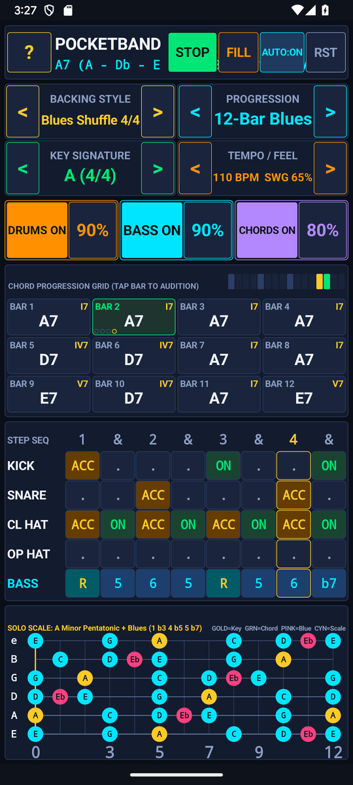
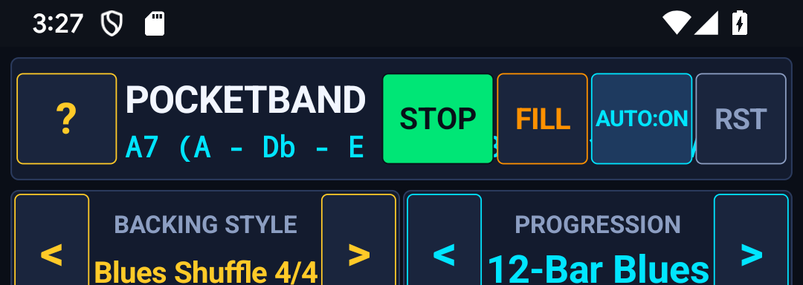
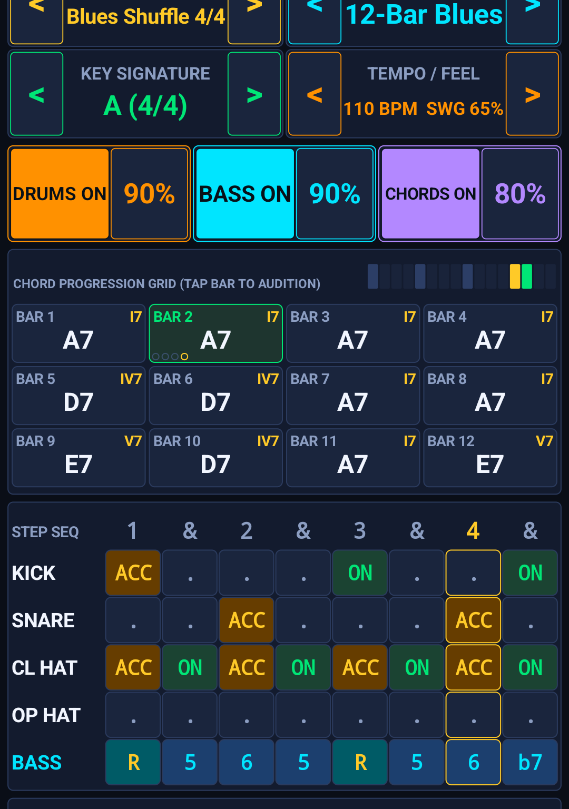
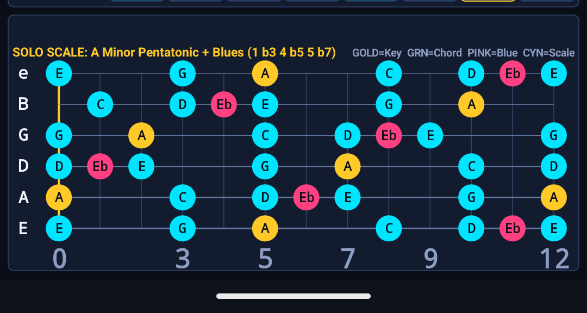
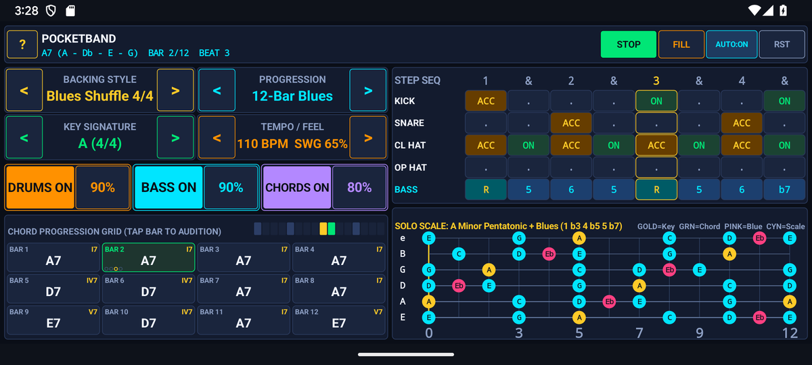
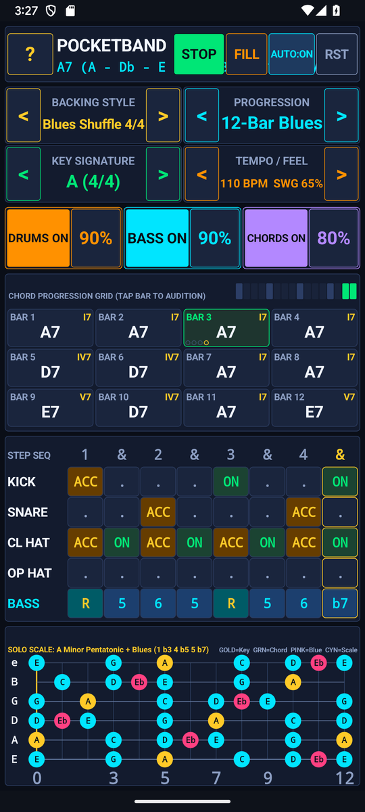

# PocketBand — Backing Track & Groove Workstation — User & Musician's Guide

4-bar chord progression looper, 16-step 5-track drum & bass sequencer, 8 genre presets, 8 chord-progression templates, 4 bassline patterns, and real-time multi-track DSP synthesizer for solo improvisation.

---

## 1. Visual Overview

### Portrait Workspace

### Top Header & Quick-Access Controls (`?` Help Modal)

- **`?` Help Pill (Top-Left)**: Tap `?` at any time to open the built-in two-tab Interactive Reference & Practice Guide modal (`HOW TO USE` and `PRACTICE TIPS`).
- **Mode / Preset / Key Selectors**: Tap any header pill to cycle modes, keys, presets, or audio synthesis options with immediate visual and audio feedback.

### Interactive Core Canvas & Visualizer

### Bottom Transport & Action Dock

### Two-Pane Landscape Layout
Rotate your device to landscape for a studio-grade **Two-Pane Split Workspace** that maximizes the primary interactive canvas on the left while keeping transport, inspector, and controls accessible on the right:

### Built-In `?` Help Modal

---

## 2. Key Features

- **8 Complete Genre Presets & 8 Progression Templates**: Rock, Blues Shuffle, Jazz Swing, Funk Groove, Bossa Nova, Reggae Drop, Metal Double-Kick, and Lo-Fi Soul in [`BandTheory.java`](src/com/eggwall/pocketband/BandTheory.java).
- **Interactive 16-Step 5-Track Sequencer Grid**: Tap any cell across `KICK`, `SNARE`, `HI-HAT`, `PERC`, and `BASS` with 3 velocity levels (`Off`, `Normal`, `Accent`) in [`PocketBandView.java`](src/com/eggwall/pocketband/PocketBandView.java).
- **4-Bar Roman Numeral Chord Looper**: Customize each bar's chord (`I`, `ii`, `iii`, `IV`, `V7`, `vi`, `bVII`, etc.), transpose across all 12 keys, and switch bassline styles (`Root`, `Walking`, `Octave`, `Arpeggio`).
- **Real-Time Multi-Track DSP Synthesizer**: Generates pitch-swept analog kick, dual-mode snare, metallic FM hi-hat/perc, warm plucked bass, and 4-voice electric piano / guitar chord comping in [`BandSynthEngine.java`](src/com/eggwall/pocketband/BandSynthEngine.java).

---

## 3. How to Improve Your Musicianship & Practice Routine

1. **Lock In Your Pocket with Track Mutes**: Mute the `CHORD` or `BASS` track using the track header pills to practice playing basslines or rhythm guitar comping solely against the drum groove.
2. **Master Swing vs. Straight Subdivisions**: Increase the **SWING** percentage on Blues and Jazz progressions to practice laying back behind the beat on 16th-note subdivisions.
3. **Practice Modal & Blues Improvisation**: Load the `12-Bar Blues` or `ii-V-I Jazz` progression and transpose through all 12 keys using the **KEY** selector.
4. **Build Custom Drum Grooves**: Tap cells in the 16-step matrix (`Normal` -> `Accent` -> `Off`) to create displaced backbeats or syncopated funk ghost notes.

---

## 4. Zero-Distraction, 100% Offline Design

- **Zero Permissions & Zero Latency**: All audio is synthesized mathematically in real time at `44.1 kHz` on your device. No internet connection, account, or microphone access is ever required.
- **Automatic State Persistence**: Your active mode, key, tempo, and settings are automatically saved across app launches.
