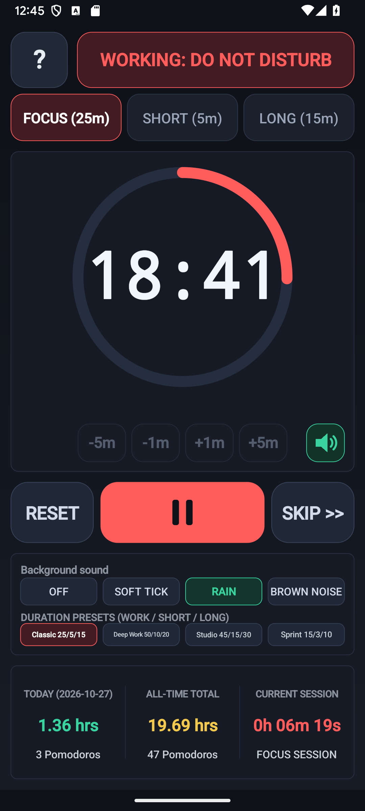
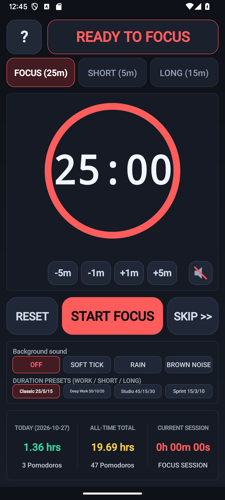
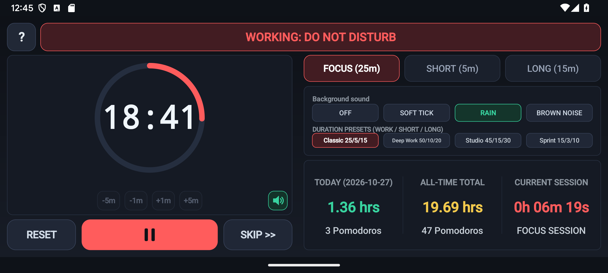
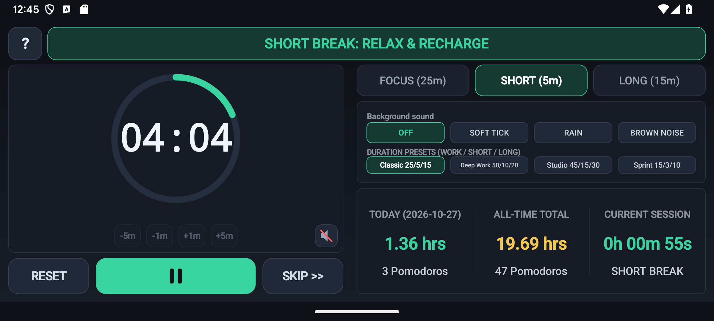
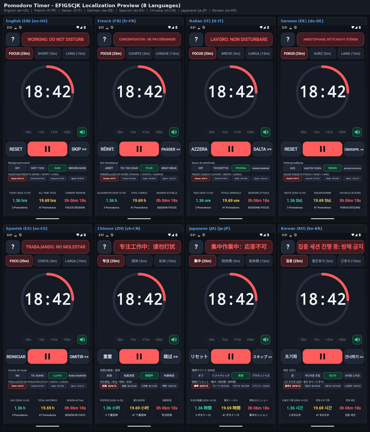
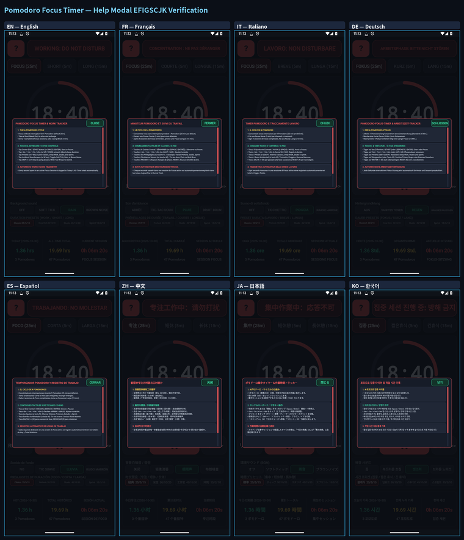

# Pomodoro — Focus Timer, Background Sound & Work Tracker (`com.eggwall.pomodoro`)

<p align="center">
  
</p>

> **Play Store Short Description:** Stay focused with a clean Pomodoro timer, ambient soundscapes, and work log.

Distraction-free Pomodoro focus timer with a circular countdown ring, 4 duration presets, procedural background sound (`SOFT TICK`, `RAIN`, `BROWN NOISE`), and persistent Today / All-Time work-hours logging.


---

## Built for Both Musicians & Software Engineers

### 1. For Musicians, Music Students & Guitar Students
- **Practical Daily Practice Companion**: Built for structured music practice sessions, study blocks, and deep engineering work with procedural background soundscapes and automatic practice/work-hour tracking.
- **100% Offline & Distraction-Free**: Runs with zero network permissions, zero ads, and instant 44.1 kHz real-time audio synthesis.
- **Musician's Guide**: See **[`USER_GUIDE.md`](USER_GUIDE.md)** for a complete visual tour, music-theory reference, and structured practice routines.

### 2. For Software Engineers & Tinkerers (Modify & Build Your Own Apps)
- **Clean, Hackable 4-Class Architecture**: This app is intentionally architected with zero third-party runtime dependencies so software engineers and musician-coders can read the entire codebase in an afternoon and customize it for their exact use case:
  1. **Pure JVM Domain & Theory Layer ([`src/com/eggwall/pomodoro/PomodoroModel.java`](src/com/eggwall/pomodoro/PomodoroModel.java))**: Stateless tables and math with zero Android UI dependencies—100% unit-tested on a standard JVM in **[`test/com/eggwall/pomodoro/PomodoroModelTest.java`](test/com/eggwall/pomodoro/PomodoroModelTest.java)**.
  2. **Real-Time 44.1 kHz Audio Synthesis ([`src/com/eggwall/pomodoro/PomodoroSynthEngine.java`](src/com/eggwall/pomodoro/PomodoroSynthEngine.java))**: Low-latency `AudioTrack` PCM synthesis with zero heap allocations inside the audio loop.
  3. **Responsive Custom Canvas UI ([`src/com/eggwall/pomodoro/PomodoroView.java`](src/com/eggwall/pomodoro/PomodoroView.java))**: Hardware-accelerated vector rendering that adapts automatically between Portrait and Landscape.
- **How to Customize**: Add custom work/break interval presets, new procedural background soundscapes (pink noise, binaural drones, gentle chimes), or custom session telemetry views.
- **Developer Documentation**:
  - **[Developer & Customization Guide (`DEVELOPER_GUIDE.md`)](DEVELOPER_GUIDE.md)** — Module breakdown, screen rendering map, and step-by-step code customization recipes.
  - **[Suite Porting & Engineering Playbook (`../porting.md`)](../porting.md)** — Full architectural guide explaining how these apps are scaffolded, synthesized, tested, and packaged so you can build your own custom Android apps.

---

## Phone Screenshots

### Main Workspace (Portrait & Landscape)
| Portrait Workspace | Landscape Workspace |
| :---: | :---: |
|  |  |

### Additional Functionality Screenshots (2 Portrait + 2 Landscape)
| Portrait Feature 1 | Portrait Feature 2 |
| :---: | :---: |
|  |  |

| Landscape Feature 1 | Landscape Feature 2 |
| :---: | :---: |
|  |  |

---

## Documentation & Play Store Assets

- **[User & Musician's Guide (`USER_GUIDE.md`)](USER_GUIDE.md)** — Visual tour, feature reference, and structured practice routines.
- **[Developer & Customization Guide (`DEVELOPER_GUIDE.md`)](DEVELOPER_GUIDE.md)** — Architecture, customization recipes, and UI layout map for software engineers.
- **[Suite Porting & Architecture Playbook (`../porting.md`)](../porting.md)** — Reusable engineering guide for building or porting custom Android audio/music apps.
- **[Play Store Listing & Assets (`PLAY_STORE_LISTING.md`)](PLAY_STORE_LISTING.md)** — Short description, 512×512 icon, 1024×500 Miyazaki-style feature graphic, and phone screenshots.
- **[Privacy Policy (`PRIVACY_POLICY.md`)](PRIVACY_POLICY.md)** — Zero permissions, zero network access, and zero third-party SDK verification.

---

## Window & Screen Timeout Behavior

- **Visible System Status Bar**: Uses `@android:style/Theme.DeviceDefault.NoActionBar` ([`AndroidManifest.xml`](AndroidManifest.xml)) with system-bar window-inset padding so the top Android status bar remains visible at all times.
- **Standard Screen Timeout**: Does not set `FLAG_KEEP_SCREEN_ON`, respecting the user's normal device screen timeout.

<!-- I18N_EFIGSCJK_START -->
---

## Internationalization (i18n) — Top 20 World Languages & EFIGSCJK Preview

**Pomodoro Timer** is localized across the **top 20 world languages** via Android resource qualifiers (`res/values-<lang>/strings.xml`) and runtime canvas/UI localization (`AppI18n`):

- **Supported 20 Languages:** English (`en-US`), French (`fr-FR`), Italian (`it-IT`), German (`de-DE`), Spanish (`es-ES`), Simplified Chinese (`zh-CN`), Japanese (`ja-JP`), Korean (`ko-KR`), Portuguese (`pt-BR`), Russian (`ru-RU`), Arabic (`ar`), Hindi (`hi-IN`), Bengali (`bn-BD`), Indonesian (`id`), Turkish (`tr-TR`), Vietnamese (`vi`), Polish (`pl-PL`), Dutch (`nl-NL`), Thai (`th`), and Ukrainian (`uk`).
- **Google Play Console "Import translations with AI" (All 20 Languages):** Upload **[`PLAY_STORE_AI_IMPORT.csv`](PLAY_STORE_AI_IMPORT.csv)** (recommended), **[`PLAY_STORE_AI_IMPORT.md`](PLAY_STORE_AI_IMPORT.md)**, or **[`PLAY_STORE_AI_IMPORT.txt`](PLAY_STORE_AI_IMPORT.txt)** in **Grow users → Store presence → Store listings → Edit store listing → Import translations with AI** to populate **App name** (`≤ 30` chars), **Short description** (`≤ 80` chars), and **Full description** (`≤ 4000` chars) across all 20 languages in one step.
- **Fastlane / Per-Locale Store Metadata:** See **[`playstore/metadata/android/`](playstore/metadata/android/)** (all 20 locales) and **[`PLAY_STORE_I18N_EFIGSCJK.md`](PLAY_STORE_I18N_EFIGSCJK.md)**.

### EFIGSCJK 8-Language Visual Contact Sheet (Click Thumbnail to Inspect Full Resolution)

Click the thumbnail below to open the full-resolution `2260×2640` 8-language contact sheet ([`docs/images/i18n/efigscjk_grid.png`](docs/images/i18n/efigscjk_grid.png)), or open any individual `1080×2400` language screenshot directly:

- **Individual Full-Resolution Screenshots:** [**English (`en`)**](docs/images/i18n/en.png) · [**Français (`fr`)**](docs/images/i18n/fr.png) · [**Italiano (`it`)**](docs/images/i18n/it.png) · [**Deutsch (`de`)**](docs/images/i18n/de.png) · [**Español (`es`)**](docs/images/i18n/es.png) · [**中文 (`zh`)**](docs/images/i18n/zh.png) · [**日本語 (`ja`)**](docs/images/i18n/ja.png) · [**한국어 (`ko`)**](docs/images/i18n/ko.png)

[](docs/images/i18n/efigscjk_grid.png)

### EFIGSCJK 8-Language Help (`?`) Modal Verification Contact Sheet

Every interactive Help (`?`) guide modal is localized across all 20 supported languages and verified across EFIGSCJK (`en`, `fr`, `it`, `de`, `es`, `zh`, `ja`, `ko`) with zero text clipping or overflow:

- **Individual Help Modal Screenshots:** [**English (`help_en`)**](docs/images/i18n/help_en.png) · [**Français (`help_fr`)**](docs/images/i18n/help_fr.png) · [**Italiano (`help_it`)**](docs/images/i18n/help_it.png) · [**Deutsch (`help_de`)**](docs/images/i18n/help_de.png) · [**Español (`help_es`)**](docs/images/i18n/help_es.png) · [**中文 (`help_zh`)**](docs/images/i18n/help_zh.png) · [**日本語 (`help_ja`)**](docs/images/i18n/help_ja.png) · [**한국어 (`help_ko`)**](docs/images/i18n/help_ko.png)

[](docs/images/i18n/efigscjk_help_grid.png)
<!-- I18N_EFIGSCJK_END -->

---

## Build & Unit Test

```bash
./gradlew testDebugUnitTest assembleDebug assembleRelease
```
