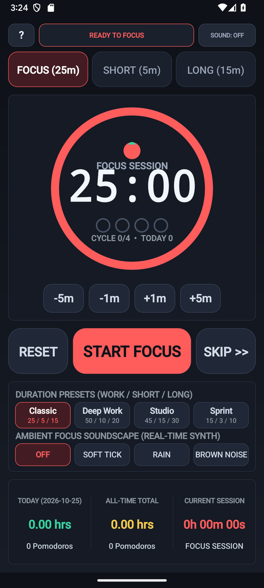
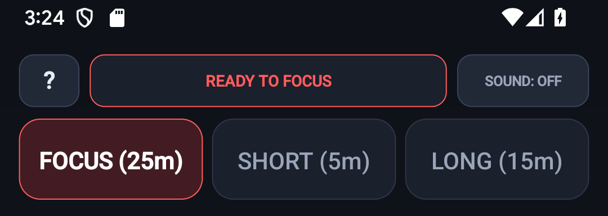
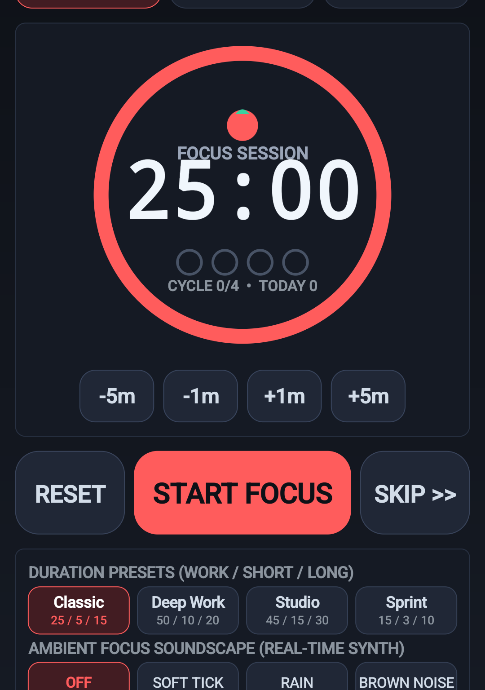
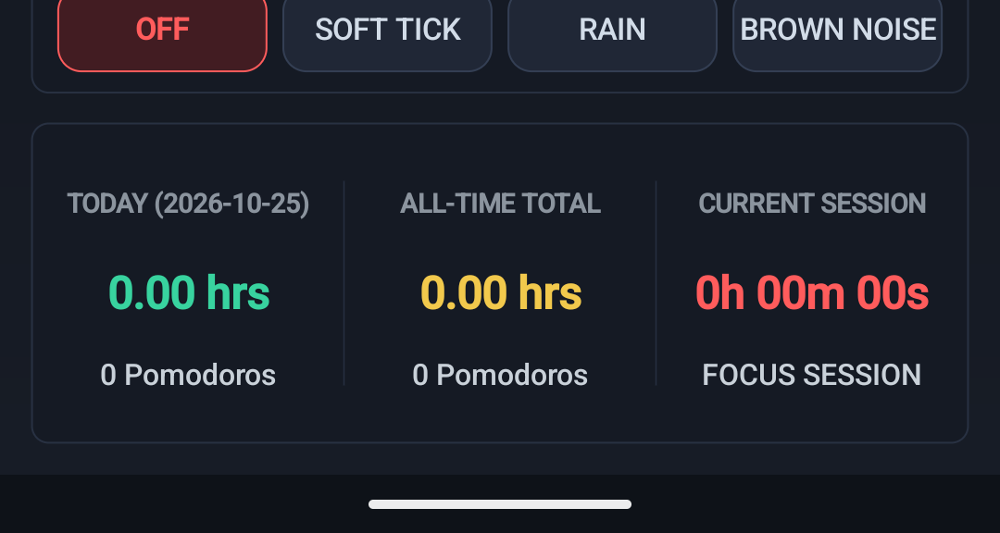
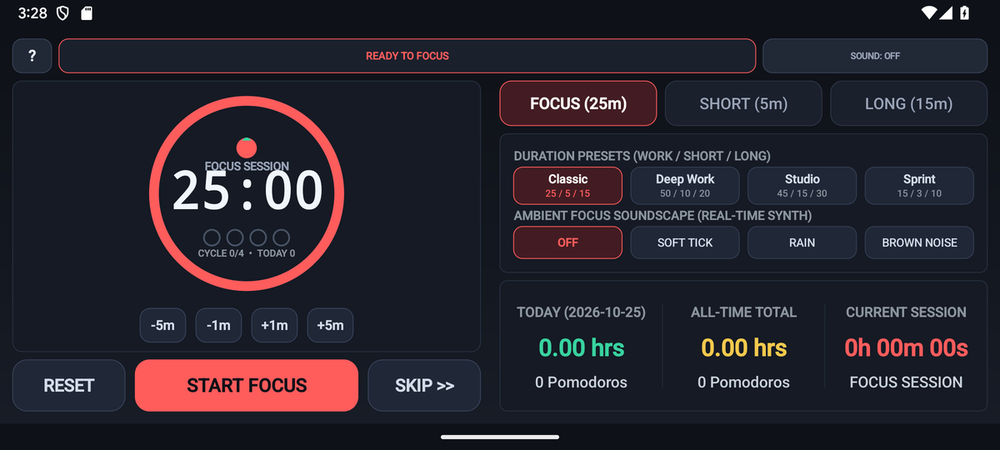
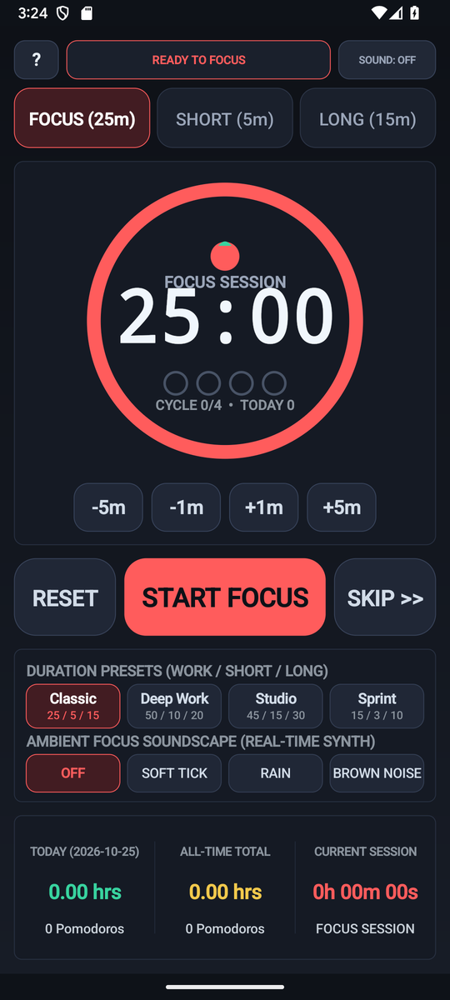

# Pomodoro — Focus Timer, Task Tracker & Ambient Soundscape — User & Musician's Guide

Distraction-free Pomodoro focus workstation with 60 FPS radial countdown ring, 4 workflow presets (`25/5`, `50/10`, `15/3`, `45/15`), interactive 6-slot practice/study task checklist, 4-tomato cycle tracker, and real-time procedural ambient noise & singing-bowl chime synthesizer.

---

## 1. Visual Overview

### Portrait Workspace

### Top Header & Quick-Access Controls (`?` Help Modal)

- **`?` Help Pill (Top-Left)**: Tap `?` at any time to open the built-in two-tab Interactive Reference & Practice Guide modal (`HOW TO USE` and `PRACTICE TIPS`).
- **Mode / Preset / Key Selectors**: Tap any header pill to cycle modes, keys, presets, or audio synthesis options with immediate visual and audio feedback.

### Interactive Core Canvas & Visualizer

### Bottom Transport & Action Dock

### Two-Pane Landscape Layout
Rotate your device to landscape for a studio-grade **Two-Pane Split Workspace** that maximizes the primary interactive canvas on the left while keeping transport, inspector, and controls accessible on the right:

### Built-In `?` Help Modal

---

## 2. Key Features

- **4 Focus Presets & Custom Duration Adjusters**: Classic `25/5`, Deep Work `50/10`, Sprint `15/3`, and Studio Practice `45/15` with `-1m` / `+1m` fine adjustments and `+5m` live extension in [`PomodoroModel.java`](src/com/eggwall/pomodoro/PomodoroModel.java).
- **4-Tomato Cycle Progress & Session Analytics**: Automatically transitions between **FOCUS**, **SHORT BREAK**, and **LONG BREAK** (every 4 completed pomodoros), tracking completed cycles, total focused minutes, and daily goal streaks.
- **Interactive 6-Slot Practice/Focus Task Queue**: Select active tasks, toggle checkmarks, and track how many pomodoros each task has received in [`PomodoroView.java`](src/com/eggwall/pomodoro/PomodoroView.java).
- **Procedural Ambient Soundscapes & Phase Chimes**: Synthesizes continuous **Brown Noise**, **Warm Rain**, or **60 BPM Soft Tick** during Focus sessions and multi-harmonic singing-bowl / bell chimes on phase transitions in [`PomodoroSynthEngine.java`](src/com/eggwall/pomodoro/PomodoroSynthEngine.java).

---

## 3. How to Improve Your Musicianship & Practice Routine

1. **Structure Deliberate Music Practice Blocks**: Use the 6 task slots to divide your session (e.g., `Warmup & Spider`, `Sight Reading`, `Ear Training`, `Repertoire Etude`, `Speed Builder`) and dedicate one 25-minute tomato to each.
2. **Mask Environmental Distractions with Brown Noise**: Toggle the **AMBIENT** pill to `BROWN` or `RAIN` during deep focus blocks; the soundscape automatically pauses during breaks so your ears rest.
3. **Respect the 4-Tomato Long Break**: After 4 consecutive focus blocks, take the full 15–20 minute Long Break away from your instrument or desk to consolidate motor memory.
4. **Use +5m Only When in Deep Flow**: If a breakthrough happens right as the timer nears zero, tap **+5 MIN** to finish the phrase cleanly before taking your break.

---

## 4. Zero-Distraction, 100% Offline Design

- **Zero Permissions & Zero Latency**: All audio is synthesized mathematically in real time at `44.1 kHz` on your device. No internet connection, account, or microphone access is ever required.
- **Automatic State Persistence**: Your active mode, key, tempo, and settings are automatically saved across app launches.
