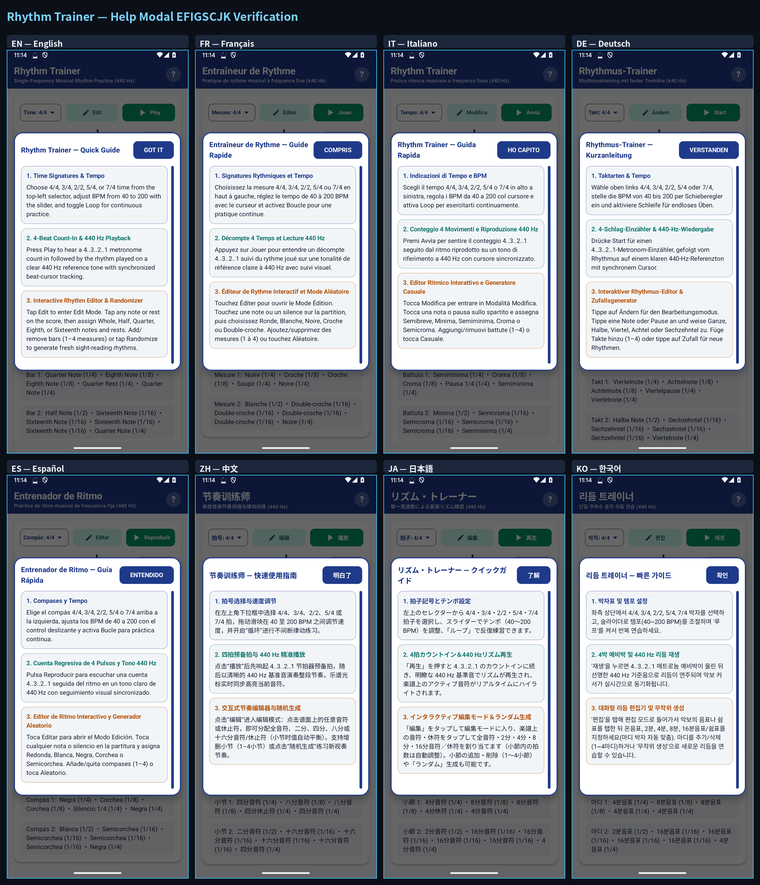

# Rhythm Trainer (`com.eggwall.rhythmtrainer`)

An Android musical rhythm training application written in Kotlin with Jetpack Compose and real-time `440 Hz` PCM audio synthesis.

<p align="center">
  
</p>

---

## Built for Both Musicians & Software Engineers

### 1. For Musicians, Music Students & Guitar Students
- **Master Rhythm Notation & Odd Meters**: Practice reading and hearing whole, half, quarter, eighth, and sixteenth notes and rests across `4/4`, `3/4`, `2/2`, `5/4`, and `7/4` time signatures.
- **Interactive Edit & Count-In Playback**: Build custom two-bar rhythmic patterns in **Edit Mode** and hear them played back at `440 Hz` after a 4-beat click count-in.
- **Musician's Guide**: See **[`USER_GUIDE.md`](USER_GUIDE.md)** for full usage instructions.

### 2. For Software Engineers & Tinkerers (Modify & Build Your Own Apps)
- **Clean, Hackable Architecture**: Separates pure rhythm-bar math ([`RhythmModels.kt`](app/src/main/java/com/eggwall/rhythmtrainer/RhythmModels.kt)), real-time `44.1 kHz` PCM synthesis ([`RhythmAudioEngine.kt`](app/src/main/java/com/eggwall/rhythmtrainer/RhythmAudioEngine.kt)), and vector notation rendering ([`NotationCanvas.kt`](app/src/main/java/com/eggwall/rhythmtrainer/NotationCanvas.kt)), verified by JUnit tests ([`RhythmTrainerTest.kt`](app/src/test/java/com/eggwall/rhythmtrainer/RhythmTrainerTest.kt)).
- **Developer Documentation**:
  - **[Developer & Customization Guide (`DEVELOPER_GUIDE.md`)](DEVELOPER_GUIDE.md)** — Module breakdown and customization recipes.
  - **[Suite Porting & Engineering Playbook (`../porting.md`)](../porting.md)** — Full architectural guide for building custom Android audio and music apps.

<!-- I18N_EFIGSCJK_START -->
---

## Internationalization (i18n) — Top 20 World Languages & EFIGSCJK Preview

**Rhythm Trainer** is localized across the **top 20 world languages** via Android resource qualifiers (`app/src/main/res/values-<lang>/strings.xml`) and runtime canvas/UI localization (`AppI18n`):

- **Supported 20 Languages:** English (`en-US`), French (`fr-FR`), Italian (`it-IT`), German (`de-DE`), Spanish (`es-ES`), Simplified Chinese (`zh-CN`), Japanese (`ja-JP`), Korean (`ko-KR`), Portuguese (`pt-BR`), Russian (`ru-RU`), Arabic (`ar`), Hindi (`hi-IN`), Bengali (`bn-BD`), Indonesian (`id`), Turkish (`tr-TR`), Vietnamese (`vi`), Polish (`pl-PL`), Dutch (`nl-NL`), Thai (`th`), and Ukrainian (`uk`).
- **Google Play Console "Import translations with AI" (All 20 Languages):** Upload **[`PLAY_STORE_AI_IMPORT.csv`](PLAY_STORE_AI_IMPORT.csv)** (recommended), **[`PLAY_STORE_AI_IMPORT.md`](PLAY_STORE_AI_IMPORT.md)**, or **[`PLAY_STORE_AI_IMPORT.txt`](PLAY_STORE_AI_IMPORT.txt)** in **Grow users → Store presence → Store listings → Edit store listing → Import translations with AI** to populate **App name** (`≤ 30` chars), **Short description** (`≤ 80` chars), and **Full description** (`≤ 4000` chars) across all 20 languages in one step.
- **Fastlane / Per-Locale Store Metadata:** See **[`playstore/metadata/android/`](playstore/metadata/android/)** (all 20 locales) and **[`PLAY_STORE_I18N_EFIGSCJK.md`](PLAY_STORE_I18N_EFIGSCJK.md)**.

### EFIGSCJK 8-Language Visual Contact Sheet (Click Thumbnail to Inspect Full Resolution)

Click the thumbnail below to open the full-resolution `2260×2640` 8-language contact sheet ([`docs/images/i18n/efigscjk_grid.png`](docs/images/i18n/efigscjk_grid.png)), or open any individual `1080×2400` language screenshot directly:

- **Individual Full-Resolution Screenshots:** [**English (`en`)**](docs/images/i18n/en.png) · [**Français (`fr`)**](docs/images/i18n/fr.png) · [**Italiano (`it`)**](docs/images/i18n/it.png) · [**Deutsch (`de`)**](docs/images/i18n/de.png) · [**Español (`es`)**](docs/images/i18n/es.png) · [**中文 (`zh`)**](docs/images/i18n/zh.png) · [**日本語 (`ja`)**](docs/images/i18n/ja.png) · [**한국어 (`ko`)**](docs/images/i18n/ko.png)

[](docs/images/i18n/efigscjk_grid.png)

### EFIGSCJK 8-Language Help (`?`) Modal Verification Contact Sheet

Every interactive Help (`?`) guide modal is localized across all 20 supported languages and verified across EFIGSCJK (`en`, `fr`, `it`, `de`, `es`, `zh`, `ja`, `ko`) with zero text clipping or overflow:

- **Individual Help Modal Screenshots:** [**English (`help_en`)**](docs/images/i18n/help_en.png) · [**Français (`help_fr`)**](docs/images/i18n/help_fr.png) · [**Italiano (`help_it`)**](docs/images/i18n/help_it.png) · [**Deutsch (`help_de`)**](docs/images/i18n/help_de.png) · [**Español (`help_es`)**](docs/images/i18n/help_es.png) · [**中文 (`help_zh`)**](docs/images/i18n/help_zh.png) · [**日本語 (`help_ja`)**](docs/images/i18n/help_ja.png) · [**한국어 (`help_ko`)**](docs/images/i18n/help_ko.png)

[](docs/images/i18n/efigscjk_help_grid.png)
<!-- I18N_EFIGSCJK_END -->

---

## Building on Linux

```bash
./gradlew assembleDebug testDebugUnitTest
```
