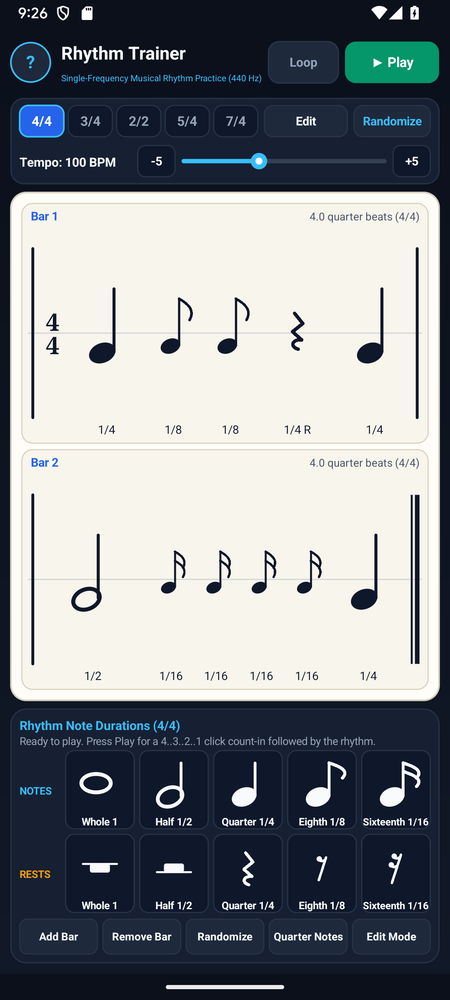
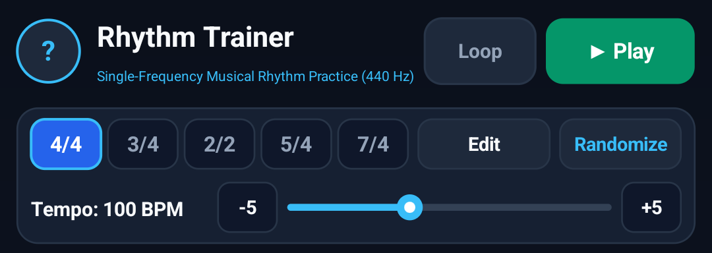
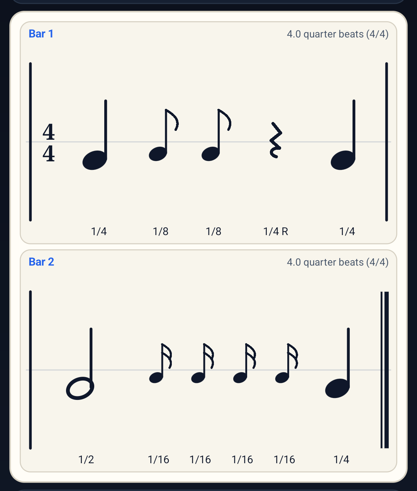
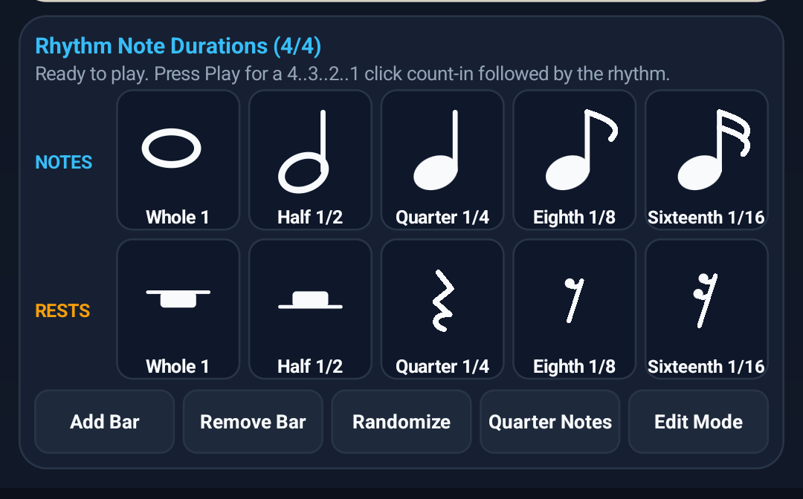
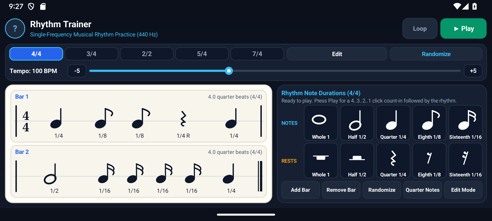
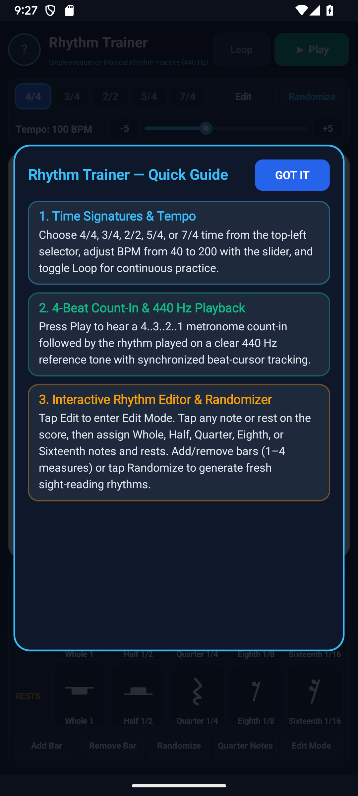

# Rhythm Trainer — Musical Rhythm Notation Editor & 440 Hz Practice Player — User & Musician's Guide

**Rhythm Trainer (`com.eggwall.rhythmtrainer`)** helps music and guitar students internalize note and rest durations across standard and odd time signatures using clean rhythm notation, a 4-beat metronome count-in (`4 .. 3 .. 2 .. 1`), and single-frequency (`440 Hz` Concert A4) audio playback.

---

## 1. Visual Overview

### Portrait Workspace

### Top Header & Quick-Access Controls (`?` Help Modal)

- **`?` Help Pill (Top-Left)**: Tap `?` at any time to open the built-in Quick Guide modal.
- **Time Signature Selector (`4/4`, `3/4`, `2/2`, `5/4`, `7/4`)**: Tap any meter pill to switch between common time, waltz time, cut time, and odd meters (`5/4` and `7/4`).
- **Tempo & Transport Controls**: Adjust BPM from `40` to `200` using `-5`, `+5`, or the slider, toggle **Loop**, and press **Play** to start the 4-beat count-in.

### Interactive Rhythm Notation Score Card

### Bottom Note & Rest Duration Palette Dock

### Two-Pane Landscape Layout
Rotate your device to landscape for a studio-grade **Two-Pane Split Workspace** that places the rhythm notation score on the left and the interactive note/rest duration palette on the right:

### Built-In `?` Help Modal

---

## 2. Practice & Edit Workflow

1. **Play Mode**: Tap **Play** to hear a 4-beat click count-in (`4 .. 3 .. 2 .. 1`), followed by a `440 Hz` tone sustained for each note's exact written duration (while rests remain silent) and calm bar-level highlighting across the active measure. Enable **Loop** to repeat the phrase continuously.
2. **Edit Mode**: Tap any note or rest on the score (or tap **Edit**) to select it, then tap any **Note Duration** (`Whole 1`, `Half 1/2`, `Quarter 1/4`, `Eighth 1/8`, `Sixteenth 1/16`) or **Rest Duration** in the bottom dock. The measure automatically subdivides or absorbs neighboring beats so every bar always sums to the exact time signature.
3. **Bar Management & Randomizer**: Tap **Add Bar** or **Remove Bar** (`1–4` measures), **Quarter Notes** to reset to steady quarter beats, or **Randomize** to generate fresh sight-reading rhythms on demand.
