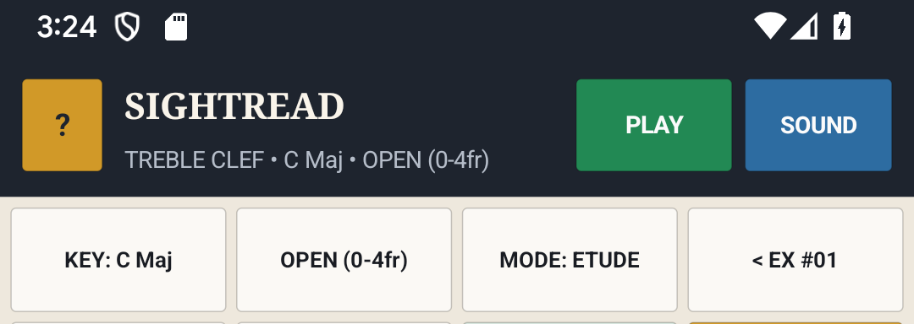
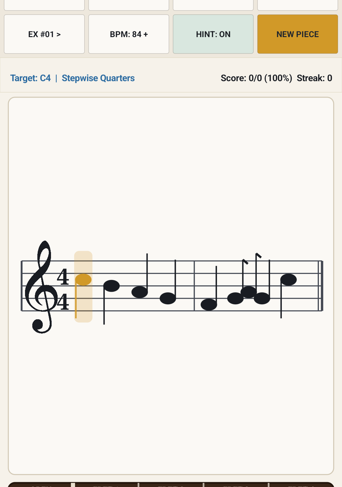
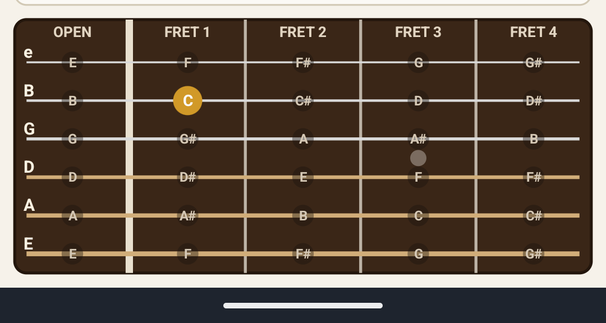
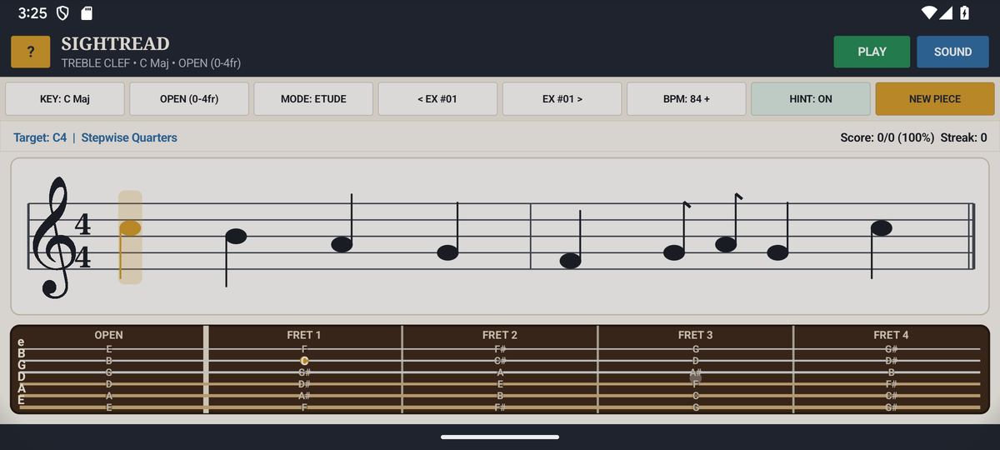
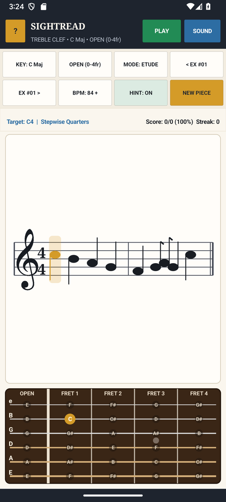

# SightRead — Staff Notation, Guitar Position & Piano Trainer — User & Musician's Guide

Interactive musical staff sight-reading trainer featuring engraved 5-line Treble Clef notation, 7 key signatures (`C`, `G`, `D`, `A`, `E`, `F`, `Bb`), 5 guitar neck position windows (`Open` .. `Pos 9`), 99 deterministic 2-bar etudes across 4 complexity levels, and compact 6-string Guitar Fretboard input.

---

## 1. Visual Overview

### Portrait Workspace

### Top Header & Quick-Access Controls (`?` Help Modal)

- **`?` Help Pill (Top-Left)**: Tap `?` at any time to open the built-in two-tab Interactive Reference & Practice Guide modal (`HOW TO USE` and `PRACTICE TIPS`).
- **Mode / Preset / Key Selectors**: Tap any header pill to cycle modes, keys, presets, or audio synthesis options with immediate visual and audio feedback.

### Interactive Core Canvas & Visualizer

### Bottom Transport & Action Dock

### Two-Pane Landscape Layout
Rotate your device to landscape for a studio-grade **Two-Pane Split Workspace** that maximizes the primary interactive canvas on the left while keeping transport, inspector, and controls accessible on the right:

### Built-In `?` Help Modal

---

## 2. Key Features

- **True Vector Musical Staff Engraving**: Renders a single 5-line Treble Clef with a calligraphic engraved G-Clef (`FreeSerif` contour), sharp/flat key signatures, ledger lines, stem directions, and beamed eighth-note pairs in [`SightReadView.java`](src/com/eggwall/sightread/SightReadView.java).
- **5 Guitar Neck Positions & 7 Key Signatures**: Constrains every generated exercise strictly to the selected 4-fret guitar position (`OPEN 0-4fr`, `POS 2`, `POS 5`, `POS 7`, `POS 9`) and key signature (`C Maj` .. `Bb 2b`) in [`SightReadTheory.java`](src/com/eggwall/sightread/SightReadTheory.java).
- **3 Interactive Practice Modes**: **ETUDE** (looping 2-measure metronomic playback with scrolling cursor), **QUIZ** (step-by-step interactive sight-reading where the cursor advances when you play the correct fret), and **FLOW** (continuous sight-reading).
- **Compact 6-String Guitar Fretboard**: Tap any fret inside the active 4-fret window on the 6-string guitar neck to answer quizzes and audition notes via [`SightReadSynthEngine.java`](src/com/eggwall/sightread/SightReadSynthEngine.java).

---

## 3. How to Improve Your Musicianship & Practice Routine

1. **Break the Open-Position Ceiling**: Once you can sight-read Level 1–2 exercises in `OPEN (0-4fr)`, switch to `POS 5 (5-8fr)` and `POS 7 (7-10fr)` so you learn to read standard notation directly in middle-neck positions without looking down at your hands.
2. **Read Key Signatures, Not Accidentals**: Cycle through `G (1#)`, `D (2#)`, `F (1b)`, and `Bb (2b)` in **QUIZ** mode so your fingers automatically apply the key signature's sharps or flats on the fretboard.
3. **Look One Beat Ahead in ETUDE & FLOW Modes**: Set a comfortable tempo (`72–84 BPM`) and keep your eyes on the *next* beat's notehead while your fingers play the current beat.
4. **Master Ledger Lines Across Positions**: Use **LEVEL 3 (Leaps)** and **LEVEL 4 (Syncopated)** to build instant recognition of upper and lower Treble Clef ledger lines (`E2` on the 6th string up to high `A5` on the 1st string).

---

## 4. Zero-Distraction, 100% Offline Design

- **Zero Permissions & Zero Latency**: All audio is synthesized mathematically in real time at `44.1 kHz` on your device. No internet connection, account, or microphone access is ever required.
- **Automatic State Persistence**: Your active mode, key, tempo, and settings are automatically saved across app launches.
