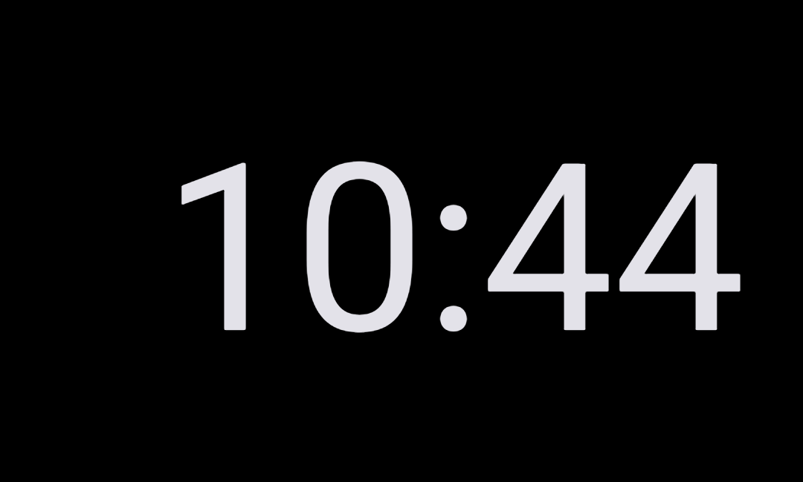

# Sound Sleep — Bedside Night Clock & White Noise — Developer & Customization Guide

This guide explains the architecture of **`com.eggwall.soundsleep`** and how software engineers can customize its burn-in drift interval, progressive dimming curve, audio resources, custom music folder discovery, and fullscreen layout.

---

## 1. Modular Two-Component Architecture

The application is engineered under [`src/com/eggwall/soundsleep/`](src/com/eggwall/soundsleep/) and [`res/`](res/) with zero third-party runtime dependencies:

| File | Responsibility | Threading & Platform APIs |
| :--- | :--- | :--- |
| [`SleepActivity.java`](src/com/eggwall/soundsleep/SleepActivity.java) | Fullscreen bedside clock `Activity` managing `FLAG_KEEP_SCREEN_ON`, immersive system-bar hiding (`WindowInsetsController` / `SYSTEM_UI_FLAG_IMMERSIVE_STICKY`), 10-minute burn-in position drift (`mChangeClockLocation`), progressive icon alpha dimming (`mAlphaDecrement`), bottom-up swipe gesture filtering (`mGestureDetector`), and `BroadcastReceiver` UI state sync. | Android Main UI thread (`Handler(Looper.getMainLooper())`). |
| [`AudioService.java`](src/com/eggwall/soundsleep/AudioService.java) | Background/foreground media playback `Service` (`FOREGROUND_SERVICE_TYPE_MEDIA_PLAYBACK`) managing `MediaPlayer`, `PARTIAL_WAKE_LOCK`, `AudioFocusRequest`, `MediaStore` querying for `Music/sleeping` tracks, raw resource looping (`R.raw.noise` and `R.raw.jingle`), and package-scoped status broadcasts. | Main thread command handling + asynchronous `MediaPlayer.prepareAsync()` media thread. |
| [`res/layout/main.xml`](res/layout/main.xml) | Declarative UI layout with root black `FrameLayout` (`@+id/toplevel`), two full-width vertical `LinearLayout` touch zones (`@+id/startMusic` and `@+id/startWhiteNoise`), status icons (`@+id/note` and `@+id/cloud`), and `120dp` `TextClock` (`@+id/clock`). | Inflated by [`SleepActivity.onCreate()`](src/com/eggwall/soundsleep/SleepActivity.java#L306). |
| [`AndroidManifest.xml`](AndroidManifest.xml) | Declares `SleepActivity`, `AudioService` (`foregroundServiceType="mediaPlayback"`), and local media/service permissions (`WAKE_LOCK`, `FOREGROUND_SERVICE`, `FOREGROUND_SERVICE_MEDIA_PLAYBACK`, `POST_NOTIFICATIONS`, `READ_MEDIA_AUDIO`, `READ_EXTERNAL_STORAGE`). | Compatible from `minSdk = 19` (Android 4.4) through `targetSdk = 36` (Android 15+). |

---

## 2. Screen Regions & Layout Map in [`SleepActivity.java`](src/com/eggwall/soundsleep/SleepActivity.java) & [`res/layout/main.xml`](res/layout/main.xml)

### Top Half — Sleep Music Touch Zone & Note Icon


Defined by `@+id/startMusic` (`layout_weight="1"`, `onClick="musicPressed"`) and `@+id/note` (`@drawable/music`) in [`res/layout/main.xml`](res/layout/main.xml#L14-L44). Positioned along `noteY = 0` at a random horizontal offset `noteX = (int) ((1 - locationX) * (mWidth - noteSize.first))` in [`SleepActivity.changeIconLocation()`](src/com/eggwall/soundsleep/SleepActivity.java#L239-L266).

### Center / Drifting `120dp` `TextClock`


Defined by `@+id/clock` (`android:textSize="120dp"`, `format12Hour="h:mm"`, `format24Hour="h:mm"`) in [`res/layout/main.xml`](res/layout/main.xml#L46-L52). Animated to a new random `(x, y)` inside window bounds `(mWidth - v.getMeasuredWidth(), mHeight - v.getMeasuredHeight())` via `v.animate().x(x).y(y)` in [`SleepActivity.changeClockLocation()`](src/com/eggwall/soundsleep/SleepActivity.java#L203-L209).

### Bottom Half — White Noise Touch Zone & Rain Cloud Icon


Defined by `@+id/startWhiteNoise` (`layout_weight="1"`, `onClick="whiteNoisePressed"`) and `@+id/cloud` (`@drawable/rain`) in [`res/layout/main.xml`](res/layout/main.xml#L23-L38). Positioned along `cloudY = mHeight - cloudSize.second` at `cloudX = (int) (locationX * (mWidth - cloudSize.first))`, mirroring `noteX` on the opposite horizontal side.

### Responsive Landscape Orientation


When the device rotates to Landscape, [`SleepActivity.populateTopLevelDimen()`](src/com/eggwall/soundsleep/SleepActivity.java#L214-L234) reads the updated `topLevel.getWidth()` and `topLevel.getHeight()` so both half-screen buttons and the 10-minute drift bounds automatically span the full landscape dimensions.

---

## 3. State Machine & Activity ↔ Service IPC Protocol

```
  [User taps Top Half]                     [User taps Bottom Half]
   SleepActivity.musicPressed()             SleepActivity.whiteNoisePressed()
              │                                        │
              ▼                                        ▼
    startService(REQUEST = MUSIC)            startService(REQUEST = WHITE_NOISE)
              │                                        │
              └──────────────► AudioService ◄──────────┘
                                    │
          ┌─────────────────────────┼─────────────────────────┐
          ▼                         ▼                         ▼
   State == SILENCE          State == MUSIC           State == WHITE_NOISE
   stopSelf() & broadcast    Shuffle MediaStore       Loop R.raw.noise &
   MESSAGE_SILENCE           or loop R.raw.jingle     broadcast MESSAGE_WHITE_NOISE
```

- **Toggle-to-Silence Semantics**: In [`AudioService.onStartCommand()`](src/com/eggwall/soundsleep/AudioService.java#L151-L156), receiving the same `typeOfResource` that is already playing (`mTypePlaying == typeOfResource`) transitions `mTypePlaying` to `SILENCE` and calls `stopSelf()`.
- **Package-Scoped Broadcasts**: [`AudioService.postSuccessMessage()`](src/com/eggwall/soundsleep/AudioService.java#L168-L172) calls `i.setPackage(getPackageName())` before `sendBroadcast(i)`, and [`SleepActivity.onCreate()`](src/com/eggwall/soundsleep/SleepActivity.java#L315-L319) registers `mMessageReceiver` with `Context.RECEIVER_NOT_EXPORTED` on Android 13+ (`API 33+`).

---

## 4. How Engineers Can Customize & Extend the App

- **Changing the Burn-In Drift Interval or Dimming Curve**:
  - Edit `DELAY = 10 * 60 * 1000` in [`SleepActivity.java` line 53](src/com/eggwall/soundsleep/SleepActivity.java#L53) to adjust how frequently the clock and icons move.
  - Edit `newCloudAlpha`, `newNoteAlpha`, and `mAlphaDecrement` in [`SleepActivity.changeIconLocation()`](src/com/eggwall/soundsleep/SleepActivity.java#L253-L259) to customize minimum overnight icon brightness.
- **Replacing the Bundled White Noise or Default Lullaby**:
  - Replace [`res/raw/noise.ogg`](res/raw/noise.ogg) or [`res/raw/jingle.mp3`](res/raw/jingle.mp3) with your own OGG/MP3 audio loops (loaded via `getResources().openRawResourceFd(resourceToPlay)` in [`AudioService.play()`](src/com/eggwall/soundsleep/AudioService.java#L192-L219)).
- **Changing the Custom Sleep Music Directory Name**:
  - Update `MUSIC_DIR = "sleeping"` in [`AudioService.java` line 97](src/com/eggwall/soundsleep/AudioService.java#L97) to point to any custom subfolder under `Music/`.
- **Customizing Clock Typography or 24-Hour Format**:
  - Edit `android:textSize="120dp"`, `android:format12Hour`, or `android:format24Hour` on `@+id/clock` in [`res/layout/main.xml`](res/layout/main.xml#L46-L52) (for example, changing `format24Hour` to `"HH:mm"` if leading-zero 24-hour display is desired).

---

## 5. Building, Signing & Verifying

Build Debug and Release APKs and the Play Store Android App Bundle (`.aab`) using the Gradle wrapper (configured in [`build.gradle`](build.gradle)):

```bash
./gradlew assembleDebug assembleRelease bundleRelease
```

- **Debug APK**: `build/outputs/apk/debug/SoundSleep-debug.apk`
- **Release APK**: `build/outputs/apk/release/SoundSleep-release.apk`
- **Release App Bundle (`.aab`)**: `build/outputs/bundle/release/SoundSleep-release.aab`
