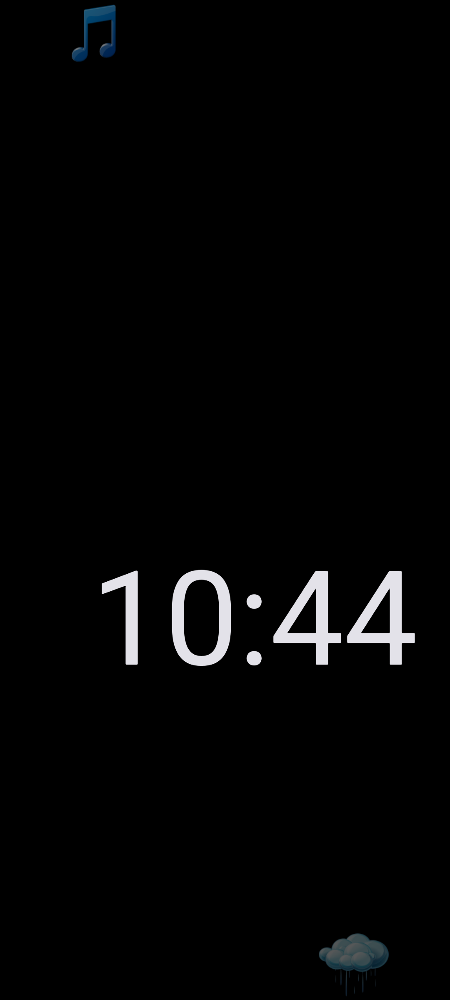
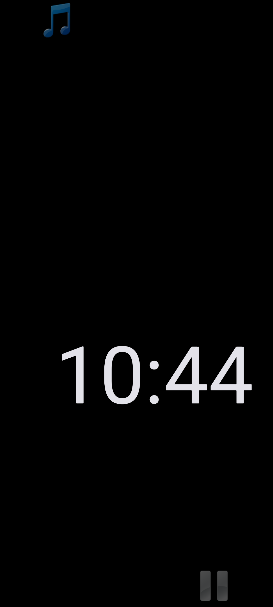
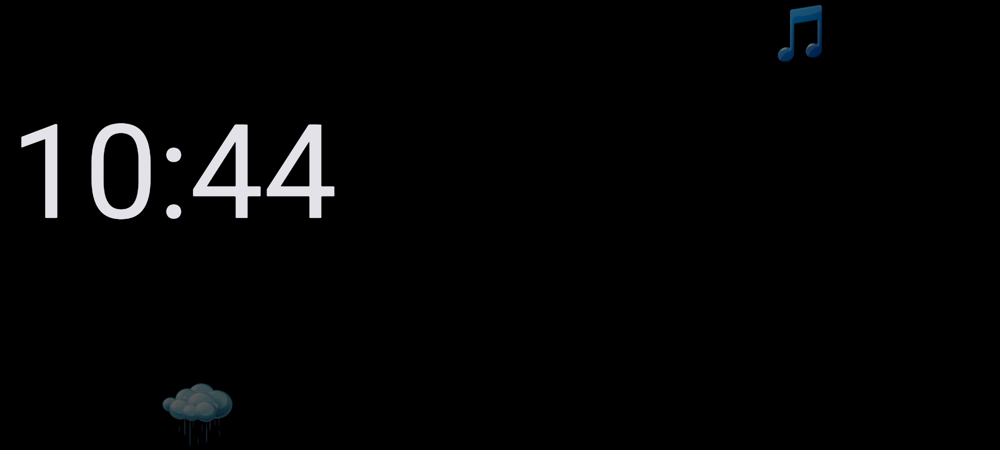
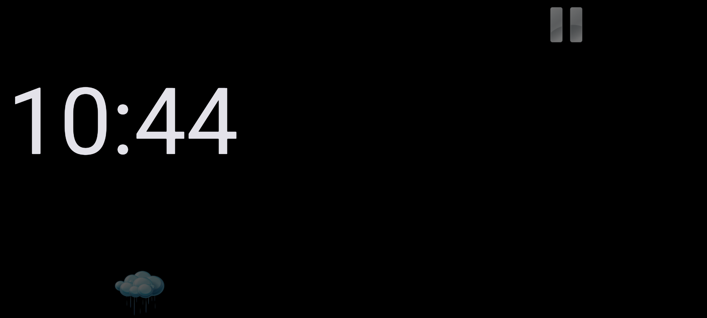
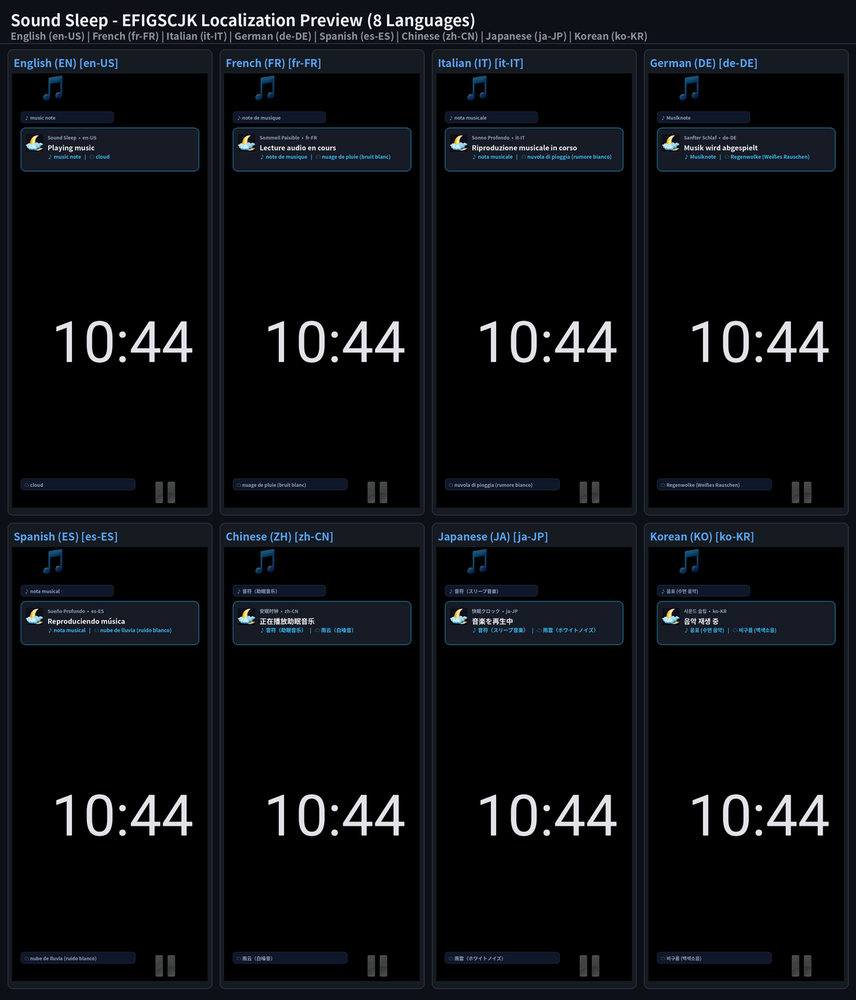

# Google Play Store Listing — Sound Sleep — Bedside Night Clock & White Noise (`com.eggwall.soundsleep`)

## Short Description (77 / 80 characters)
> Minimalist all-night bedside clock with soothing white noise and sleep music.

## Full Description (3704 / 4000 characters)
- **Standalone Description File:** [`PLAY_STORE_DESCRIPTION.md`](PLAY_STORE_DESCRIPTION.md)

Turn your phone or tablet into a calm, zero-glare bedside clock and soothing sleep sound machine with Sound Sleep — Bedside Night Clock & White Noise. Engineered specifically to sit on a nightstand all night without lighting up your bedroom or damaging your OLED/LCD display, Sound Sleep combines a large, readable time readout on a pure black background with one-tap white noise and custom sleep music playback.

Unlike complex sleep-tracking apps that require accounts, subscriptions, cloud connectivity, or bright multi-tabbed menus in the middle of the night, Sound Sleep launches straight into an ultra-dark, immersive fullscreen view designed for effortless eyes-half-closed operation.

ALL-NIGHT BEDSIDE CLOCK WITH IMMERSIVE FULLSCREEN
• High-Contrast Pure Black Display: Renders the current time in a large, clean 120dp h:mm format over a true #000000 black background—emitting minimal light in a dark bedroom while remaining instantly legible across the room.
• True Immersive Fullscreen: Automatically hides the Android status bar, title bar, and on-screen navigation buttons (Home, Back, Recents) so no bright system chrome disturbs your sleep.
• Always-On Nightstand Mode: Keeps the display awake while visible on screen so you can check the time at a glance without fumbling for power buttons at 3:00 AM.
• Smart Swipe-Up Ignore: Intelligently filters out accidental bottom-up navigation swipes so exiting to the Home screen or switching apps never accidentally triggers audio playback.

AUTOMATIC OLED BURN-IN PROTECTION & PROGRESSIVE DIMMING
• 10-Minute Smooth Drift: Every 10 minutes, the clock digits and control icons smoothly animate to new random coordinates on the screen to prevent pixel burn-in and image retention on OLED, AMOLED, and LCD panels.
• Mirrored Icon Separation: The top Music Note icon and bottom Rain Cloud icon automatically mirror each other horizontally across opposite sides of the screen for balanced visual separation.
• Progressive Overnight Dimming: Control icons start at a gentle translucent level and progressively dim further every 10 minutes until the screen is as dark as possible overnight. A single touch anywhere immediately restores icon visibility.

EYES-CLOSED HALF-SCREEN TOUCH CONTROLS FOR WHITE NOISE & SLEEP MUSIC
The entire screen is divided into two giant, invisible touch zones so you never have to hunt for tiny buttons in the dark:
• Bottom Half (Rain Cloud Icon — White Noise): Tap anywhere on the bottom half of the screen to loop continuous, soothing white noise bundled inside the app—ideal for masking street traffic, hotel hallway noise, tinnitus, or household sounds.
• Top Half (Music Note Icon — Sleep Music): Tap anywhere on the top half of the screen to play shuffled tracks from your device's Music/sleeping folder (discovered automatically via Android MediaStore), or fall back seamlessly to the bundled gentle looping lullaby jingle.
• Tap Again for Silence: When either audio mode is active, its icon transforms into a clear Pause (||) symbol. Tap the active half a second time to stop playback and return to complete silence.

RELIABLE BACKGROUND PLAYBACK & PRIVACY-FIRST DESIGN
• Foreground Media Service & Wake Lock: Audio playback runs inside a dedicated Android Media Playback Service with audio-focus management and a partial CPU wake lock, ensuring your white noise or sleep music plays reliably all night.
• Portrait & Landscape Support: Adapts smoothly whether your phone or tablet rests vertically on a charging pad or horizontally on a bedside dock.
• 100% Offline & Private: Requests zero internet permissions, collects zero personal data, contains zero ads or analytics SDKs, and is licensed under Apache 2.0.

## Play Store Visual Assets & Policy Links
- **Full Play Store Description (4000-char limit):** [`PLAY_STORE_DESCRIPTION.md`](PLAY_STORE_DESCRIPTION.md)
- **App Icon (512×512 PNG):** [`playstore-icon-512.png`](playstore-icon-512.png)
- **Feature Graphic (1024×500 PNG, Miyazaki Style):** [`feature-graphic-1024x500.png`](feature-graphic-1024x500.png)
- **Privacy Policy:** [`PRIVACY_POLICY.md`](PRIVACY_POLICY.md)

### Feature Graphic Preview

### Phone Screenshots (Portrait & Landscape)
| Portrait 1 (Bedside Clock) | Portrait 2 (White Noise Active) |
| :---: | :---: |
|  |  |

| Landscape 1 (Nightstand Dock) | Landscape 2 (Sleep Music Active) |
| :---: | :---: |
|  |  |
<!-- I18N_EFIGSCJK_START -->

---

## Google Play Console "Import translations with AI" (All 20 World Languages)

Google Play Console's **Import translations with AI** dialog (*Grow users → Store presence → Store listings → Edit store listing → Manage translations → Import translations with AI*) accepts `.csv`, `.md`, or `.txt` files (UTF-8, up to 3 MB) and automatically extracts `languageCode`, `appName` (`≤ 30` chars), `shortDescription` (`≤ 80` chars), and `fullDescription` (`≤ 4000` chars) for every language in the file:

- **CSV Import File (Recommended):** **[`PLAY_STORE_AI_IMPORT.csv`](PLAY_STORE_AI_IMPORT.csv)**
- **Markdown Import File:** **[`PLAY_STORE_AI_IMPORT.md`](PLAY_STORE_AI_IMPORT.md)**
- **Structured JSON-in-TXT Import File:** **[`PLAY_STORE_AI_IMPORT.txt`](PLAY_STORE_AI_IMPORT.txt)**
- **EFIGSCJK Copy-Paste Reference:** **[`PLAY_STORE_I18N_EFIGSCJK.md`](PLAY_STORE_I18N_EFIGSCJK.md)**
- **Fastlane / Per-Locale Metadata Directory (All 20 Languages):** **[`playstore/metadata/android/`](playstore/metadata/android/)**

| BCP-47 Locale | Language | Title (`<= 30` chars) | Short Description (`<= 80` chars) | Full Description (`<= 4000` chars) | EFIGSCJK Screenshot (`1080×2400`) |
| :--- | :--- | :--- | :--- | :--- | :--- |
| **`en-US`** | English (United States) | [`title.txt`](playstore/metadata/android/en-US/title.txt) | [`short_description.txt`](playstore/metadata/android/en-US/short_description.txt) | [`full_description.txt`](playstore/metadata/android/en-US/full_description.txt) | [`en.png`](docs/images/i18n/en.png) |
| **`fr-FR`** | French (France) — Français | [`title.txt`](playstore/metadata/android/fr-FR/title.txt) | [`short_description.txt`](playstore/metadata/android/fr-FR/short_description.txt) | [`full_description.txt`](playstore/metadata/android/fr-FR/full_description.txt) | [`fr.png`](docs/images/i18n/fr.png) |
| **`it-IT`** | Italian (Italy) — Italiano | [`title.txt`](playstore/metadata/android/it-IT/title.txt) | [`short_description.txt`](playstore/metadata/android/it-IT/short_description.txt) | [`full_description.txt`](playstore/metadata/android/it-IT/full_description.txt) | [`it.png`](docs/images/i18n/it.png) |
| **`de-DE`** | German (Germany) — Deutsch | [`title.txt`](playstore/metadata/android/de-DE/title.txt) | [`short_description.txt`](playstore/metadata/android/de-DE/short_description.txt) | [`full_description.txt`](playstore/metadata/android/de-DE/full_description.txt) | [`de.png`](docs/images/i18n/de.png) |
| **`es-ES`** | Spanish (Spain) — Español | [`title.txt`](playstore/metadata/android/es-ES/title.txt) | [`short_description.txt`](playstore/metadata/android/es-ES/short_description.txt) | [`full_description.txt`](playstore/metadata/android/es-ES/full_description.txt) | [`es.png`](docs/images/i18n/es.png) |
| **`zh-CN`** | Chinese (Simplified) — 中文（简体） | [`title.txt`](playstore/metadata/android/zh-CN/title.txt) | [`short_description.txt`](playstore/metadata/android/zh-CN/short_description.txt) | [`full_description.txt`](playstore/metadata/android/zh-CN/full_description.txt) | [`zh.png`](docs/images/i18n/zh.png) |
| **`ja-JP`** | Japanese — 日本語 | [`title.txt`](playstore/metadata/android/ja-JP/title.txt) | [`short_description.txt`](playstore/metadata/android/ja-JP/short_description.txt) | [`full_description.txt`](playstore/metadata/android/ja-JP/full_description.txt) | [`ja.png`](docs/images/i18n/ja.png) |
| **`ko-KR`** | Korean — 한국어 | [`title.txt`](playstore/metadata/android/ko-KR/title.txt) | [`short_description.txt`](playstore/metadata/android/ko-KR/short_description.txt) | [`full_description.txt`](playstore/metadata/android/ko-KR/full_description.txt) | [`ko.png`](docs/images/i18n/ko.png) |
| **`pt-BR`** | Portuguese (Brazil) — Português | [`title.txt`](playstore/metadata/android/pt-BR/title.txt) | [`short_description.txt`](playstore/metadata/android/pt-BR/short_description.txt) | [`full_description.txt`](playstore/metadata/android/pt-BR/full_description.txt) | — |
| **`ru-RU`** | Russian — Русский | [`title.txt`](playstore/metadata/android/ru-RU/title.txt) | [`short_description.txt`](playstore/metadata/android/ru-RU/short_description.txt) | [`full_description.txt`](playstore/metadata/android/ru-RU/full_description.txt) | — |
| **`ar`** | Arabic — العربية | [`title.txt`](playstore/metadata/android/ar/title.txt) | [`short_description.txt`](playstore/metadata/android/ar/short_description.txt) | [`full_description.txt`](playstore/metadata/android/ar/full_description.txt) | — |
| **`hi-IN`** | Hindi — हिन्दी | [`title.txt`](playstore/metadata/android/hi-IN/title.txt) | [`short_description.txt`](playstore/metadata/android/hi-IN/short_description.txt) | [`full_description.txt`](playstore/metadata/android/hi-IN/full_description.txt) | — |
| **`bn-BD`** | Bangla (Bengali) — বাংলা | [`title.txt`](playstore/metadata/android/bn-BD/title.txt) | [`short_description.txt`](playstore/metadata/android/bn-BD/short_description.txt) | [`full_description.txt`](playstore/metadata/android/bn-BD/full_description.txt) | — |
| **`id`** | Indonesian — Bahasa Indonesia | [`title.txt`](playstore/metadata/android/id/title.txt) | [`short_description.txt`](playstore/metadata/android/id/short_description.txt) | [`full_description.txt`](playstore/metadata/android/id/full_description.txt) | — |
| **`tr-TR`** | Turkish — Türkçe | [`title.txt`](playstore/metadata/android/tr-TR/title.txt) | [`short_description.txt`](playstore/metadata/android/tr-TR/short_description.txt) | [`full_description.txt`](playstore/metadata/android/tr-TR/full_description.txt) | — |
| **`vi`** | Vietnamese — Tiếng Việt | [`title.txt`](playstore/metadata/android/vi/title.txt) | [`short_description.txt`](playstore/metadata/android/vi/short_description.txt) | [`full_description.txt`](playstore/metadata/android/vi/full_description.txt) | — |
| **`pl-PL`** | Polish — Polski | [`title.txt`](playstore/metadata/android/pl-PL/title.txt) | [`short_description.txt`](playstore/metadata/android/pl-PL/short_description.txt) | [`full_description.txt`](playstore/metadata/android/pl-PL/full_description.txt) | — |
| **`nl-NL`** | Dutch — Nederlands | [`title.txt`](playstore/metadata/android/nl-NL/title.txt) | [`short_description.txt`](playstore/metadata/android/nl-NL/short_description.txt) | [`full_description.txt`](playstore/metadata/android/nl-NL/full_description.txt) | — |
| **`th`** | Thai — ไทย | [`title.txt`](playstore/metadata/android/th/title.txt) | [`short_description.txt`](playstore/metadata/android/th/short_description.txt) | [`full_description.txt`](playstore/metadata/android/th/full_description.txt) | — |
| **`uk`** | Ukrainian — Українська | [`title.txt`](playstore/metadata/android/uk/title.txt) | [`short_description.txt`](playstore/metadata/android/uk/short_description.txt) | [`full_description.txt`](playstore/metadata/android/uk/full_description.txt) | — |

### EFIGSCJK Localization Grid (Click Thumbnail for Full-Resolution `2260×2640` Image)

<!-- I18N_EFIGSCJK_END -->
